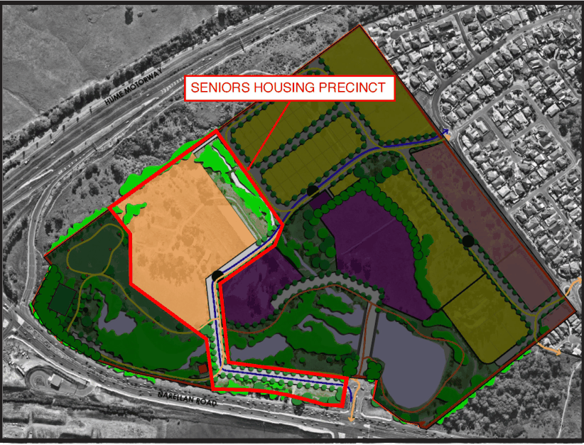
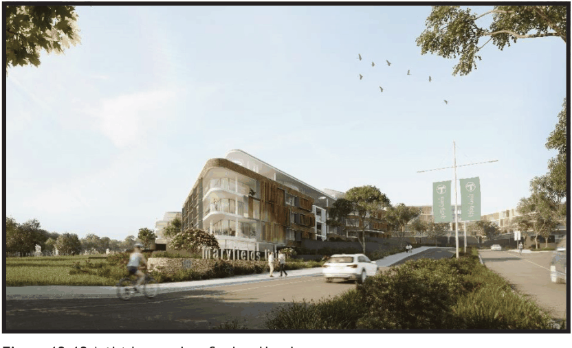
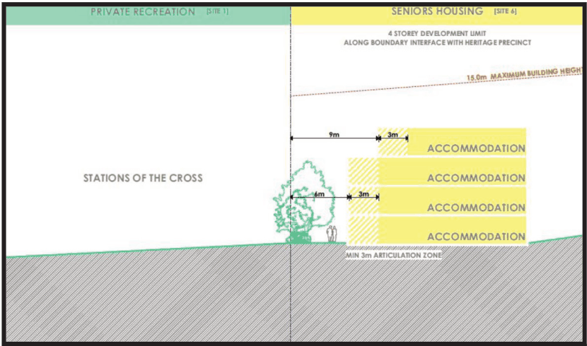

### 13.6 13.6.4 Seniors Housing Precinct

#### Seniors Housing

Objectives

#### Precinct

■

■ Provide high quality independent and assisted living housing solutions for persons aged 55 and over.

■

■ Provide a modern attractive built form that integrates with the surrounding landscape setting and respects the heritage significance of the adjoining heritage listed precinct.

■

■ Manage bushfire risk by encouraging the appropriate treatment and use of the required Asset Protection Zones (APZ) through strategic placement of car parking, roads, landscaping, and buildings.

■

■ Facilitate a precinct road and path layout that provides suitable connectivity for residents whilst discouraging through public vehicular access between  Narellan Road and Maryfields Drive.

Controls

1\.	 Buildings must be designed by a qualified and registered architect. All facades of any buildings within the seniors housing precinct must embrace a high quality of architectural presentation and complement the surrounding landscape setting and heritage precinct.

2\.	 The occupancy of residential accommodation is regulated under Campbelltown Local Environmental Plan 2015, generally being restricted to seniors and people who have a disability. A covenant or similar restriction must be provided on the title of the land to restrict the occupancy of any approved development in accordance with this limitation. 3 Building design and layout shall be generally consistent with the following requirements:

a.	 all buildings shall have a positive street address and presentation;

b.	 building facades shall generally present as a maximum of 4-storeys in height.

#### Seniors Housing

#### Project

> [Picture on page 37: a picture, saved as a picture (images/vol-2-part-13-maryfields-development-control-plan-page-37-3.gif, 150 dpi).]

Figure 13.12 Seniors Housing Precinct

c.	 provision of an active interface with the open space riparian corridor to the north and the heritage precinct to the south;

d.	 suitable building layout and facade treatments to mitigate impacts of vehicular noise from the adjacent Hume Motorway.

e.	 building materials and colour palate should incorporate natural earth tones to complement the landscape context.

f.	 compliance with NSW RFS Guidelines including provision of APZs as generally depicted in Figure 13.17.

4\.	 Any development shall be consistent with the requirements of ‘Stations of the Cross, Maryfields, Campbelltown’ Conservation Management Plan prepared by Perumal Murphy Alessi - May 2015. This may include:

#### Seniors Housing

#### Precinct

a.	 maximising surveillance opportunities to the heritage precinct through building design layout, and provision of balconies and living areas fronting the heritage precinct.

b.	 complementary landscaping and unobtrusive fencing treatments at ground level along the common boundary to provide an integrated setting with a strong visual connection between the spaces.

5\.	 The road and subdivision layout is to be generally consistent with the materplan, including:

a.	 provision of a private driveway connection across the northern creek to provide a northern connection with the adjacent residential precinct; and

b. provision of a limited road connection to the north for use by bus and emergency vehicles only.

c.	 allocation of a peripheral road reserve within the APZs as illustrated at Figure 13.17.

d.	 provision of pedestrian and cycleways to promote connectivity with other precincts.

6\.	 Building setbacks shall be provided as follows:

a.	 building setbacks to a public road is to be a minimum of 6 metres;

b.	 the first three storeys of any scheme fronting the heritage precinct or open space corridor must be setback a minimum of 6m storey being setback a further 3m (9m minimum).

#### Seniors Housing

#### Precinct

7\.	 Regular tree planting to both sides of streets and within building street setbacks and open car parking spaces shall be provided to deliver a tree dominated precinct.

8\.	 Operational noise from mechanical plant, loading docks and car parks associated with the seniors housing precinct should be minitaged where necessary using selected building materials, acoustic screens, enclosures and acoustic shielding.

> [Picture on page 39: a picture, saved as a picture (images/vol-2-part-13-maryfields-development-control-plan-page-39-15.gif, 150 dpi).]

Figure 13.13 Artist Impression- Seniors Housing

> [Picture on page 39: a picture, saved as a picture (images/vol-2-part-13-maryfields-development-control-plan-page-39-17.gif, 150 dpi).]

Figure 13.14 Senior Housing Setbacks
