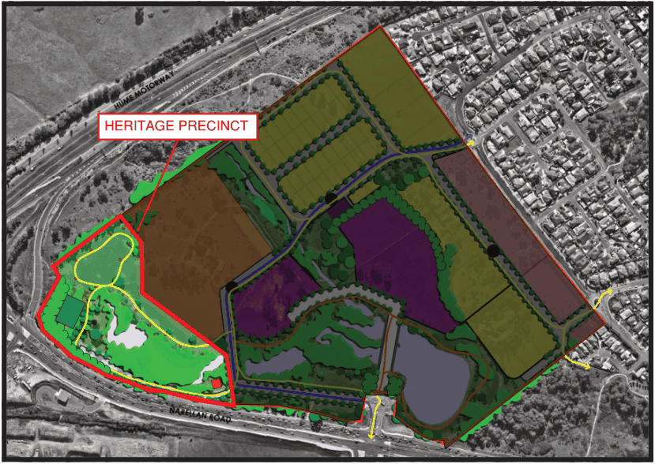
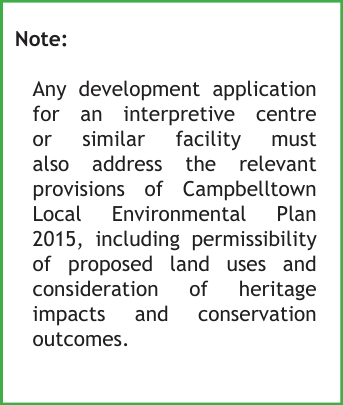
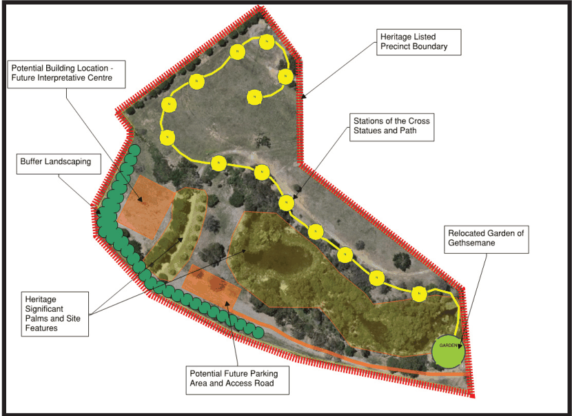

### 13.6 13.6.5 Heritage Precinct

#### Heritage

Objectives

#### Precinct

■

■ Promote long term conservation outcomes and public use of the site consistent with the Conservation Management Plan (CMP) prepared for the site.

■

■ Ensure new development and vegetation management conserves the heritage significance of the site.

■

■ Promote public access and interpretation of the cultural significance of the site.

■

■ Ensure any new development is low in scale and not visible from Narellan Road.

> [Picture on page 40: a picture, saved as a picture (images/vol-2-part-13-maryfields-development-control-plan-page-40-18.gif, 150 dpi).]

Figure 13.15 Heritage Precinct at Maryfields Estate Controls

1\.	 Any development within the heritage precinct must be generally consistent with the Conservation Management Plan prepared for the site.

2\.	 The CMP may be reviewed and updated to take into account changes in legislation or any changes to site conditions.

#### Heritage

#### Note:

#### Precinct

3\.	 Any development within the heritage precinct must be low in scale and not be visible from the adjacent Narellan Road or the Hume Motorway. This will require low building heights, substantial building setbacks from the road frontage, dense landscape screening, and use of natural building materials and neutral colour palates.

4\.	 Any development proposal for an Interpretative Centre or similar facility, as  identified in the CMP, must also provide heritage documentation prepared by a suitably qualified person that includes:

The Heritage precinct is illustrated at Figure 13.15 and is approximately 6 hectares in area. The precinct is listed as an item of local heritage significance given historical religious practices undertaken on the site by the broader Catholic community. The Stations of the Cross Statues and Garden of Gethsemane are significant physical elements associated with these religious activities that remain as the visual evidence of religious worship on the site.

a.	 A proposed development design outcome that is low scale and visually compatible with the landscaped setting of the site.

The Stations of the Cross Statues have been restored and repositioned as part of the rezoning process of the Maryfields Estate, so that a sense of the “pilgrimage” and experience of rising to the 12th Station in an open landscaped setting is retained and can continue to be interpreted.

b.	 A demonstrated public benefit including long term conservation outcomes for the Stations of the Cross and the associated landscape elements of the heritage listed precinct.

c.	 An interpretative strategy to

A Conservation Management Plan (CMP) has been prepared to outline the history and significance of the Station of the Cross statues at Maryfields and provide policy guidelines for their long term conservation, use and maintenance as part of the cultural heritage of Campbelltown:

tell the story and background to the Maryfields estate, including aboriginal history and connections; the changing natural landscape; religious connections to the local area and people; religious connections to the local area and people; and 	 the development of the Stations of the Cross and religious celebrations.

-May 2015 ‘Stations of the Cross, Maryfields, Campbelltown’ Conservation Management Plan (CMP) prepared by Perumal Murphy Alessi (‘PMA’).

d.	 A public accessibility strategy

The CMP will provide the basis of any assessment of potential heritage impacts for development proposed within the precinct.

to provide safe and equitable access for the public, including where feasible the continuation of religious and associated activities.

e.	 Consideration of an integrated caretaker’s residence to manage site conservation outcomes.

#### Heritage

#### Precinct

f.	 Archaeological assessment for any major site works or excavation

g.	 An assessment of opportunities to use the facility and associated external areas as a communal space for the adjacent Seniors Precinct.

h.	 Review of the Vegetation Management Plan required in accordance with Part 13.5.

5\.	 Pedestrian and cycle paths are to be delivered generally in accordance with the Masterplan and the controls specified at Part 13.2.

6\.	 Carparking shall be provided in the general location indicated in Figure

13.16 to 	 service the car parking needs of the heritage precinct. An at-grade car park and associated driveway may be provided in the general location shown subject to:

a. 	 A traffic impact assessment being provided by a suitably qualified person to demonstrate that the design, layout and quantity of carparking is suitable to accommodate vehicular parking demand generated by the intended use;

b.	 Sufficient landscape plantings being provided to mitigate any adverse visual impacts of any proposed carparking and driveway areas.

> [Picture on page 42: a map, saved as a picture (images/vol-2-part-13-maryfields-development-control-plan-page-42-41.gif, 150 dpi); the street names and other small labels are on the picture.]
> Words printed on the picture (title and legend, copied from the PDF):
> Any development application
> for an interpretive centre
> or similar facility must
> also address the relevant
> provisions of Campbelltown
> Local Environmental Plan
> 2015, including permissibility
> of proposed land uses and
> consideration of heritage
> impacts and conservation

#### Heritage

#### Precinct

> [Picture on page 43: a picture, saved as a picture (images/vol-2-part-13-maryfields-development-control-plan-page-43-3.gif, 150 dpi).]

Figure 13.16 Detailed Heritage Precinct supported by CMP
