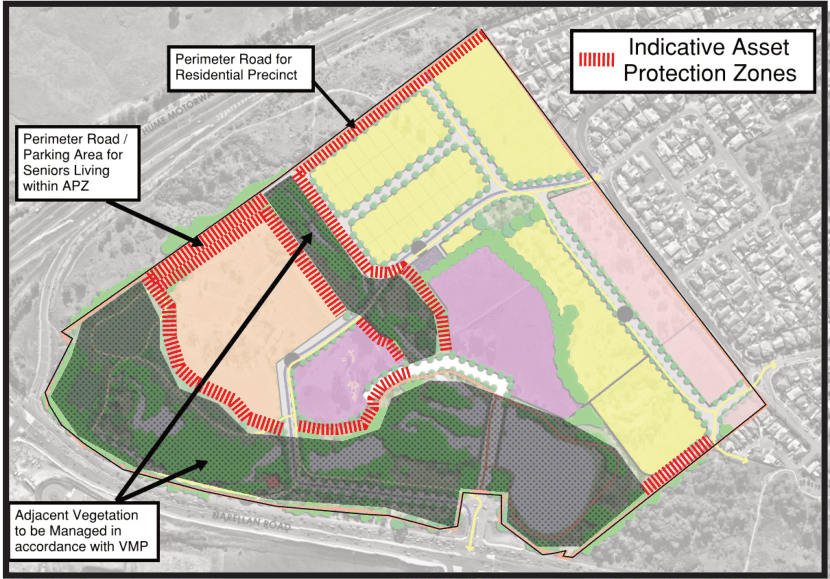
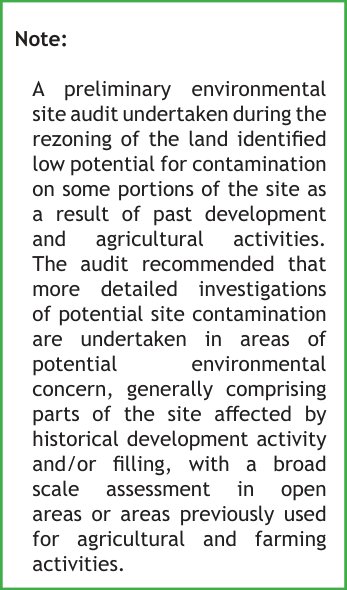

### 13.7 13.7 Risk Management

#### Risk

Management This Part sets out relevant controls to appropriately manage site specific risk

factors identified for the Maryfields Estate.

#### 13.7.1 Bushfire Risk

Objectives

■

■ To ensure that all development within Maryfields Estate appropriately manages potential bushfire risk.

Controls

1\.	 All subdivision and development must be compliant with the relevant requirements of the NSW Rural Fire Service Planning for Bushfire Protection Guidelines 2006 (as amended).

2\.	 Where asset protection zones are required on private land, a suitable restriction must be recorded on the titles of any created lots to ensure any required APZs are appropriately managed in perpetuity by the respective land owners.

3\.	 Indicative Asset Protection Zones required for development within Maryfields Estate are illustrated in Figure 13.17 (source: Bushfire Constraints Assessment for the Maryfields Estate Rezoning, Campbelltown - Australian Bushfire Protection Planners P/L October 2013).

#### Dam Wall

#### Structural Integrity

> [Picture on page 45: a picture, saved as a picture (images/vol-2-part-13-maryfields-development-control-plan-page-45-3.gif, 150 dpi).]

Figure 13.17 Indicative Asset Protection Zones required to address Bushfire Risk

#### 13.7.2 Dam Wall Structural Integrity (Main Lake)

Objectives

■

■ To ensure that the development of Maryfields Estate ensures the structural integrity of the main dam wall forming the main lake adjacent to the Narellan Road frontage.

Controls

1\.	 Works to safeguard the long term structural integrity of the main dam wall must be undertaken to the requirements of Council as part of the first stage of the development of Maryfields Estate.

2\.	 A structural assessment of the main dam wall and the proposed methodology to ensure the stability of the dam wall must be provided by a suitably qualified hydraulic engineer having regard to post-development stormwater flows, and is to include consideration of the following:

#### Dam Wall

#### Structural Integrity

a.	 Provision of a minimum freeboard level of 1.0m. The required freeboard height is to be achieved by a reduction in the spillway height level rather than increasing the height of the dam wall.

b.	 Adjustment of dam wall batter angles and/or controlled floor mechanisms to provide an optimum design outcome.

c.	 Design parameters for required spillway(s).

d.	 Measures to provide long-term erosion control including protection measures for the internal dam wall against wave action and suitable 	vegetation treatments of the external wall areas.

3\.	 Any structural works associated with the main dam wall shall where possible be undertaken in concert with the construction of the business park access roads to maximise the re-use efficiency of materials within the site.

#### 13.7.3 Site Remediation

Objectives

#### Site

#### Remediation

■

■ To ensure that the land is suitable for the proposed use in terms of site

> [Picture on page 47: a picture, saved as a picture (images/vol-2-part-13-maryfields-development-control-plan-page-47-7.gif, 150 dpi).]
> Words printed on the picture (title and legend, copied from the PDF):
> Note:
> A preliminary environmental
> site audit undertaken during the
> rezoning of the land identified
> low potential for contamination
> on some portions of the site as
> a result of past development
> and agricultural activities.
> The audit recommended that
> more detailed investigations
> of potential site contamination
> are undertaken in areas of
> potential environmental
> concern, generally comprising
> parts of the site affected by
> historical development activity
> and/or filling, with a broad
> scale assessment in open
> areas or areas previously used
> for agricultural and farming
> activities.

contamination.

Controls

1\.	 An evaluation of site contamination risks is required to be completed by a suitably qualified person in accordance with the requirements of Managing Land Contamination Planning Guidelines, SEPP 55 – Remediation of Land (EPA, DUAP, 1998)

2\.	 Where a site is identified as being, or having the potential to be contaminated, a Contamination Management Plan shall be submitted with the development application to demonstrate that the land may be appropriately remediated for the proposed use.
