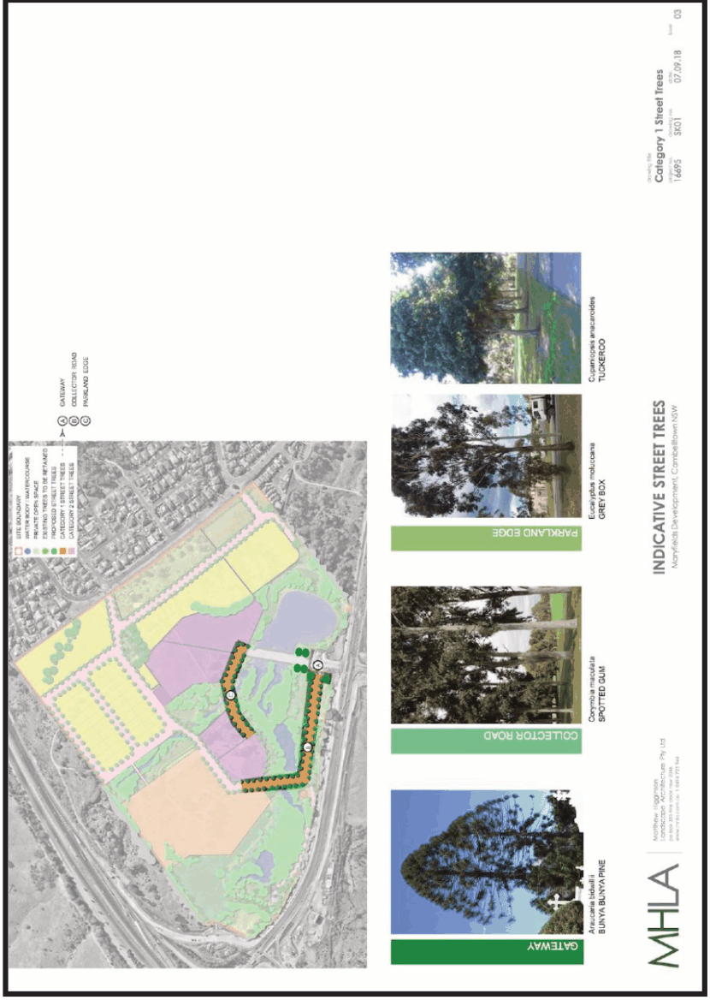
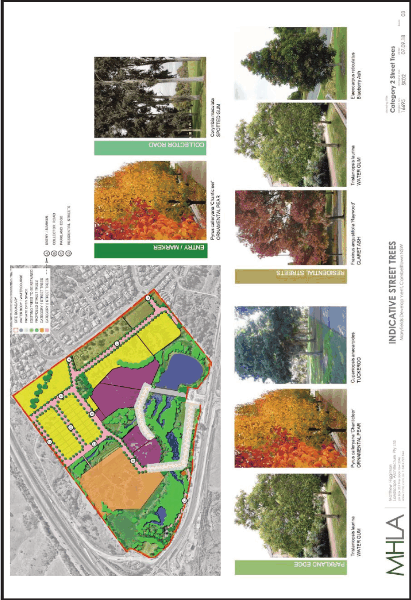

### 13.8 13.8 Appendix 1 - Indicative Street Tree Planting Plan

> [Picture on page 48: a picture, saved as a picture (images/vol-2-part-13-maryfields-development-control-plan-page-48-2.gif, 150 dpi).]

#### Appendix 1

#### Appendix 1

> [Picture on page 49: a picture, saved as a picture (images/vol-2-part-13-maryfields-development-control-plan-page-49-2.gif, 150 dpi).]
