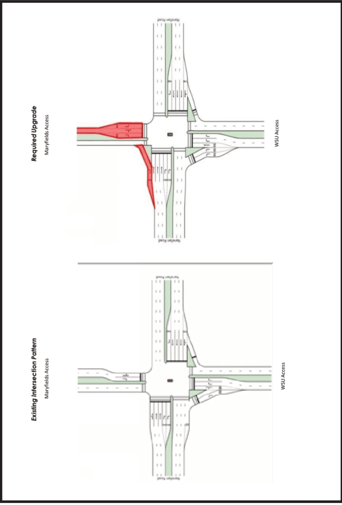
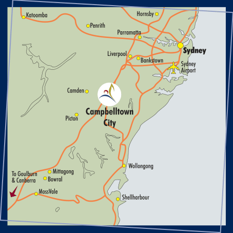

### 13.9 13.9 Appendix 2- Indicative Intersection Upgrade Works

#### Appendix 2

Indicative Intersection Upgrade Works - Narellan Road (Subject to RMS Requirements).

> [Picture on page 50: a picture, saved as a picture (images/vol-2-part-13-maryfields-development-control-plan-page-50-4.gif, 150 dpi).]

### This page is intentionally

### left blank.

> [Picture on page 52: a picture, saved as a picture (images/vol-2-part-13-maryfields-development-control-plan-page-52-1.gif, 150 dpi).]

campbelltown.nsw.gov.au

Campbelltown City Council, PO Box 57, Campbelltown, NSW 2560
