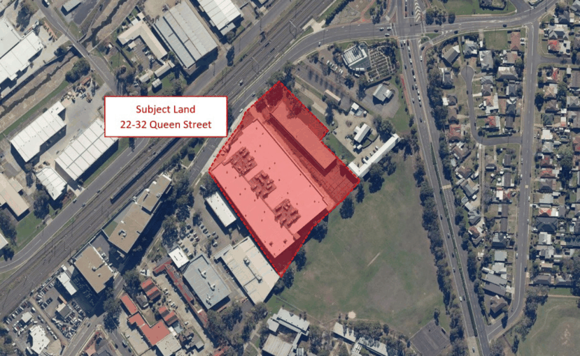

### 14.1 13.1 Application

#### Application

#### 14.1.1 Land to which this Part applies

This Development Control Plan (DCP) applies to land at 22-32 Queen Street, Campbelltown, being the land identified in Figure 14.1 below. The subject site comprises three (3) lots and is known legally as Lot X in DP 409704, Lot 15 in DP 14782 and Lot 1 in DP 1154928. The land is situated in the Campbelltown CBD fronting Queen Street. The site adjoins the Campbelltown High School located to the south and the Colonial Motor Inn and also a Garden Centre to the north, which includes the heritage listed barn and Stables, which formed part of the John Warby Estate. The site at 20,465.7m2 currently contains the Direct Factory Outlet (DFO) retail centre. This is a large bulky retail building which is now largely defunct. This is a 3-4 storey building of significant massing. The site is generally flat and has a large frontage to Queen Street. Queen Street is the main entry road to the Campbelltown CBD. The site is within 850m from the entrance to the railway station. Queen Street is a main bus route, and the site is well served by public transport.

> [Picture on page 4: a picture, saved as a picture (images/vol-2-part-14-22-32-queen-street-development-control-plan-page-4-17.gif, 150 dpi).]

Figure 14.1 – Land to which this part applies – 22-32 Queen Street

#### 14.1.2 Purpose of this Part

The purpose of this Part is to establish a supplementary planning framework (beyond the general provisions of the Campbelltown Sustainable City DCP) for achieving the Council endorsed vision for the subject land (DFO site) at 22-32 Queen Street, Campbelltown, through the establishment of site specific objectives and controls. In doing so it provides a platform against which Council will assess future development applications for a mixed use development at 22-32 Queen Street, Campbelltown.

#### 14.1.3 Relationship with Campbelltown (Sustainable City) DCP

#### Application

This DCP forms part of the Campbelltown (Sustainable City) DCP (‘CSCDCP’) and provides additional controls and guidelines that apply specifically to development at 22-32 Queen Street, Campbelltown. Where a development control is not specified in this Part, development is subject to all other relevant controls of CSCDCP. Where there is an inconsistency between this Part and any other provision of the CSCDCP, this Part applies to the extent of the inconsistency. Campbelltown City Council Engineering Design Guide for Development applies to development at 22- 32 Queen Street, Campbelltown.
