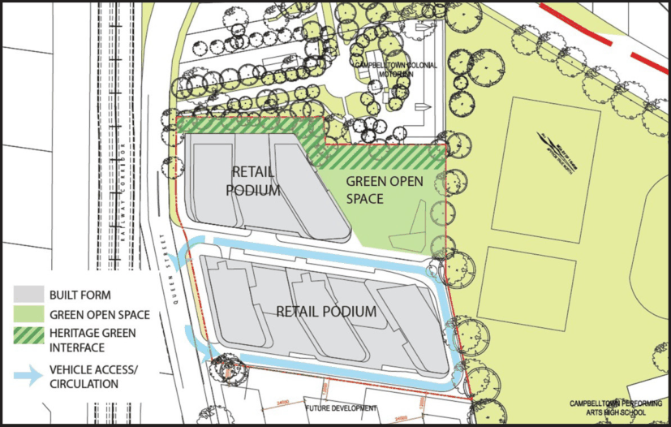

### 14.2 Vision and  Development Objectives

Vision and

#### Development

#### Objectives

#### Objectives

■ To facilitate the delivery of a high-quality mixed-use development that responds to the character of the CBD while supporting urban renewal of a large consolidated site; ■ Facilitates the provision of housing supply and job creation close to transport, services and community facilities; ■ To achieve an integrated liveable development through building envelopes and layout that provide excellent amenity, solar access, natural ventilation, visual privacy and apartment amenity; ■ To create a significant public open space in the heart of the development, connecting to a network of publicly accessible spaces; ■ Balancing pedestrian and public spaces with ensuring safe vehicle access and traffic solutions; and ■ To connect the site to the broader CBD, through the creation of a vibrant and active main street, a significant civic space connecting and enhancing the setting of the adjoining heritage listed Warby Barn and Stables, and allowing for future through-links and connections to adjoining land.

#### Controls

1.

1\. Development is to generally comply with the concept masterplan for the site shown at Figure 14.2. The masterplan is founded primarily on consideration of key site parameters; street interface; impacts on neighbours; and amenity standards of State Environmental Planning Policy (SEPP) 65/Australian Design Guide (ADG) for future dwellings on the

site. It provides the conceptual building layout and footprints, road design, open space, interface and setbacks and land use outcomes for the development. All development applications relating to 22-32 Queen Street, Campbelltown are to be generally consistent with the Masterplan. The masterplan consists of the following characteristics and outcomes

• Maximum height of 15 storeys;

• Minimum 9 metres setback where future development interfaces with the boundary to the state listed heritage item, Warby’s barn and stables.

• Stepping of massing away from the heritage items to minimise impacts.

• Suitable heritage curtilage.

• Providing a heritage interface zone and addressing the development towards the precinct.

• Maximising greenspace for resident and visitor amenity.

• Maximising solar amenity through proper alignment of buildings.

• Minimising overshadowing through alignment of buildings.

• Provide a central ‘Eat Street’ activated main road along the former Warby estate heritage item access road alignment.

• Proposed 4 storey podium along Queen Street to reinforce streetscape, with towers above.

• Proposed 2 and 5 storey podium to reinforce street edges.

• Proposed access road loop to provide servicing access for retail/loading, garbage

Vision and

#### Development

#### Objectives

collection and street addresses for all the buildings, with anti clockwise vehicular circulation.

• Proposed civic space aligned with and connecting to heritage precinct.

• Ensure ADG building separations and set backs.

> [Picture on page 7: a picture, saved as a picture (images/vol-2-part-14-22-32-queen-street-development-control-plan-page-7-12.gif, 150 dpi).]

Figure 14.2 - 22-32 Queen Street Masterplan
