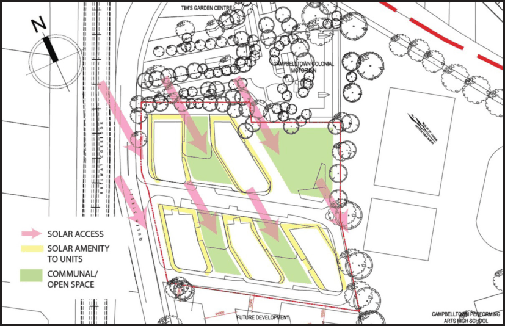

### 14.3 14.3 Development Objectives and Controls

#### Development

Objectives and

#### Controls

#### 14.3.1 Building Orientation and Layout

#### Objectives

■ To establish building forms that are orientated appropriately so as to minimise overshadowing and maximise solar access to internal public spaces and neighbouring properties. ■ To create a sense of visual separation between buildings, podiums and tower levels. ■ To provide appropriate building separation to ensure privacy, access to light and ventilation and a high-quality visual outlook from residential apartments. ■ To establish a public realm and pedestrian network to enhance liveability and building siting and massing. ■ To utilise opportunities for communal open space and green building buffer between tower forms.

#### Controls

#### Controls

1

1 Building footprints, open space and roads and pedestrian areas are to be

Building footprints, open space and roads and pedestrian areas are to be provided in accordance with Figure 14.3 below.

provided in accordance with Figure 14.3 below. 2

2 Tower forms are to be designed and orientated generally in a north-east/

Tower forms are to be designed and orientated generally in a north-east/ south-west orientation, in accordance with Figure 14.3 below to maximise

south-west orientation, in accordance with Figure 14.3 below to maximise solar access and residential amenity and minimise overshadowing to

solar access and residential amenity and minimise overshadowing to properties to the south.

properties to the south. 3

3 The orientation of the built form is to maximise solar access to the open

The orientation of the built form is to maximise solar access to the open space/civic plaza on 21st June.

space/civic plaza on 21st June.

#### Development

Objectives and

#### Controls

> [Picture on page 9: a picture, saved as a picture (images/vol-2-part-14-22-32-queen-street-development-control-plan-page-9-4.gif, 150 dpi).]

Figure 14.3 - 22-32 Building orientation and layout
