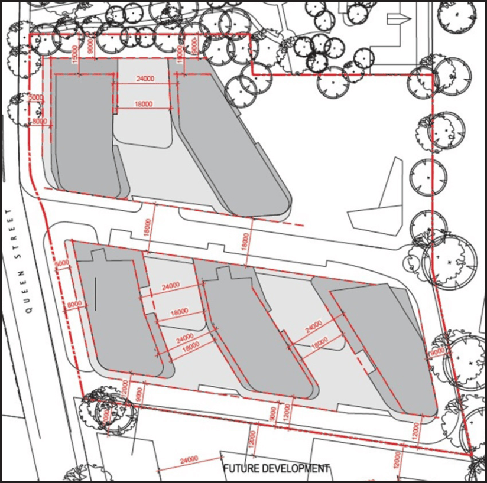

### 14.3 14.3.2 Building Separation and Setbacks

#### Development

Objectives and

#### Objectives

#### Controls

■ To reinforce street edges and the public domain. ■ To create a sense of visual distinction and separation between the podium and tower levels. ■ To ensure compliance with the Apartment Design Guide.

#### Controls

#### Controls

1

1 Building setbacks should be provided in accordance with Table 14.1 and Figure 14.4,

Building setbacks should be provided in accordance with Table 14.1 and Figure 14.4, generally comprising:

generally comprising:

•• A minimum 9 metre setback to the boundary with the heritage listed Warby’s

A minimum 9 metre setback to the boundary with the heritage listed Warby’s barn and stable and minimum tower setback of 15 metres;

barn and stable and minimum tower setback of 15 metres;

•• A minimum podium setback of 5 metres and tower setback of 8 metres to Queen

A minimum podium setback of 5 metres and tower setback of 8 metres to Queen Street;

Street;

•• A minimum separation of buildings facilitated by the main ‘eat street’ of 18

A minimum separation of buildings facilitated by the main ‘eat street’ of 18 metres;

metres;

2

2 Building separations are to be in accordance with the Apartment Design Guide and

Building separations are to be in accordance with the Apartment Design Guide and generally in accordance with Figure 14.4 below.

generally in accordance with Figure 14.4 below.

| Location | Level | Setback |
|---|---|---|
| Queen Street | Podium level (up to 4 storeys) Upper floors (above 4 storeys) | 5 metres 8 metres |
| Heritage Interface | Podium and levels 1-8 Upper floors 9-12 | 9 metres 15 metres |
| School Ground Interface | Any development | 9 metres |

Table 14.1 Setbacks

#### Development

Objectives and

#### Controls

> [Picture on page 11: a picture, saved as a picture (images/vol-2-part-14-22-32-queen-street-development-control-plan-page-11-4.gif, 150 dpi).]

Figure 14.4 - Building separation and setbacks
