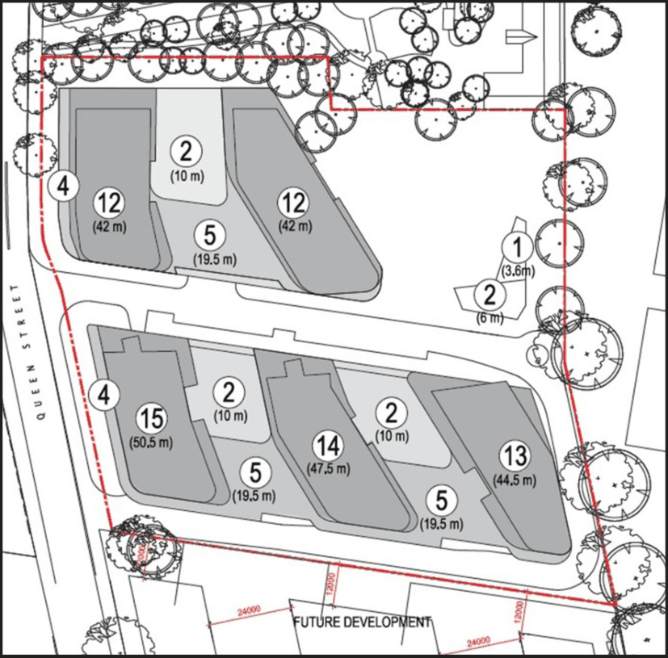

### 14.3 14.3.3 Maximum Building Heights

#### Development

Objectives and

#### Objectives

#### Controls

■ To ensure the maximum height reflects the intended future scale of development within the Campbelltown CBD. ■ To nominate a range of building heights that will provide a range in built form and land use intensity across the development site. ■ To maximise solar access to the public domain, open space and pedestrian areas. ■ To minimise undesirable visual impact, disruption of views, loss of privacy and solar access to adjoining land.

#### Controls

#### Controls

1

1 Development must be consistent with the number of storeys identified in Figure 14.5

Development must be consistent with the number of storeys identified in Figure 14.5 below.

below. 2

2 The maximum height for any building is 15 storeys.

The maximum height for any building is 15 storeys. 3

3 The retail/commercial level height should be a minimum of 5 metres in height.

The retail/commercial level height should be a minimum of 5 metres in height.

#### Development

Objectives and

#### Controls

> [Picture on page 13: a picture, saved as a picture (images/vol-2-part-14-22-32-queen-street-development-control-plan-page-13-4.gif, 150 dpi).]

Figure 14.5 - Maximum Building Heights
