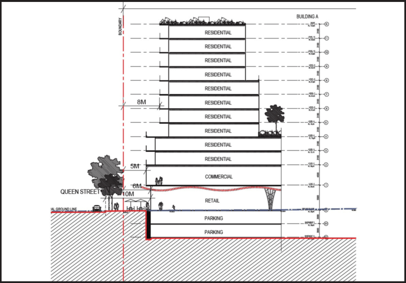

### 14.3 14.3.4 Queen Street Interface

#### Development

Objectives and

#### Objectives

#### Controls

■ To revitalise and activate Queen Street with high levels of amenity and an enhanced public domain. ■ To create pedestrian friendly streets, with outdoor dining opportunities, street tree planting, inviting public gathering spaces and attractive street furniture. ■ To improve pedestrian linkages along Queen Street to the train station. ■ To provide setbacks that ensure the scale and feel of Queen Street is maintained.

#### Controls

#### Controls

1

1 Building setbacks to Queen Street should be provided in accordance with Figure 14.6

Building setbacks to Queen Street should be provided in accordance with Figure 14.6 below, including:

below, including:

•• A minimum podium setback of 5 metres;

A minimum podium setback of 5 metres;

•• A minimum ground floor setback of 6 metres; and

A minimum ground floor setback of 6 metres; and

•• A minimum tower setback of 8 metres.

A minimum tower setback of 8 metres.

#### Development

Objectives and

#### Controls

> [Picture on page 15: a picture, saved as a picture (images/vol-2-part-14-22-32-queen-street-development-control-plan-page-15-4.gif, 150 dpi).]

Figure 14.6 - Queen Street interface
