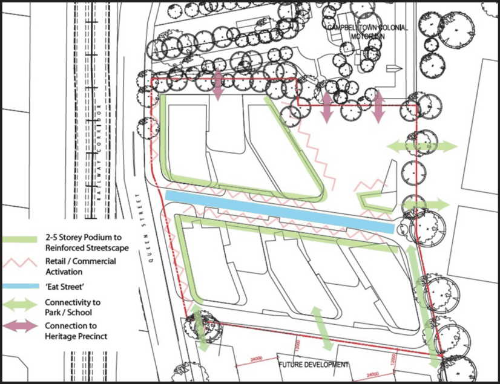
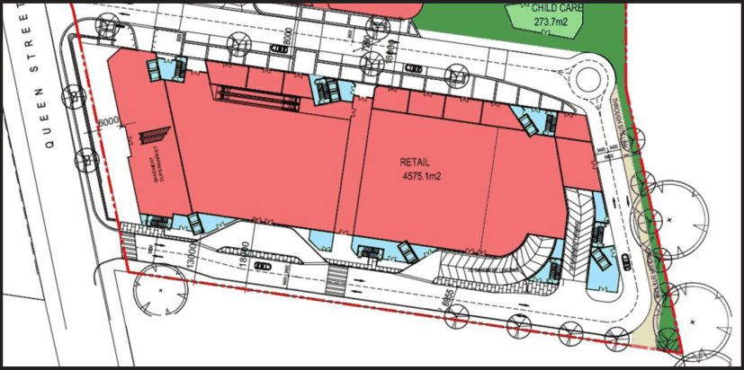

### 14.3 14.3.5 Streetscape and Site Connectivity

#### Development

Objectives and

#### Objectives

#### Controls

■ To provide public connectivity through the site to adjoining land. ■ To activate street frontages to create a vibrant mixed use development with a high quality visual outlook. ■ To provide a main street through the site that links Queen Street to the future open space to the south east. ■ To ensure that the development enhances the public domain, defines the streetscape and creates a physical and visible connection between built form and the public space. ■ To ensure connectivity and physical interface between the civic plaza and the adjoining heritage listed Warby barn and stables to the north east. ■ To provide a high degree of articulation that establishes a fine grain frontage at ground level. ■ To reinforce pedestrian comfort at street level, including a sheltered/shaded and attractive pedestrian environment.

#### Controls

#### Controls

1

1 New streets and pedestrian connections are to be activated where possible through

New streets and pedestrian connections are to be activated where possible through design and active uses.

design and active uses. 2

2 Public awnings for weather protection and public amenity are to be included.

Public awnings for weather protection and public amenity are to be included. 3

3 Blank walls to the public domain are to be minimised and only permitted in

Blank walls to the public domain are to be minimised and only permitted in exceptional circumstances, and in such cases should be treated with appropriate

exceptional circumstances, and in such cases should be treated with appropriate levels of design detail and visual articulation to create visual interest.

levels of design detail and visual articulation to create visual interest. 4

4 Buildings must include active uses along Queen Street and the main street through

Buildings must include active uses along Queen Street and the main street through the site.

the site. 5

5 Shade structures/awnings are to be provided all the Queen Street and main street

Shade structures/awnings are to be provided all the Queen Street and main street ground level frontages.

ground level frontages. 6

6 Pedestrian movement is to be prioritised by appropriate crossings, footpath designs,

Pedestrian movement is to be prioritised by appropriate crossings, footpath designs, street furniture, parking layouts etc.

street furniture, parking layouts etc. 7

7 To support the provision of pedestrian links to the south to allow connectivity now

To support the provision of pedestrian links to the south to allow connectivity now and in the future as adjoining sites develop.

and in the future as adjoining sites develop.

#### Development

Objectives and

#### Controls

> [Picture on page 17: a picture, saved as a picture (images/vol-2-part-14-22-32-queen-street-development-control-plan-page-17-4.gif, 150 dpi).]

Figure 14.7 - Streetscape and Site connectivity

> [Picture on page 17: a picture, saved as a picture (images/vol-2-part-14-22-32-queen-street-development-control-plan-page-17-6.gif, 150 dpi).]

Figure 14.8 - Possible site connections to the south
