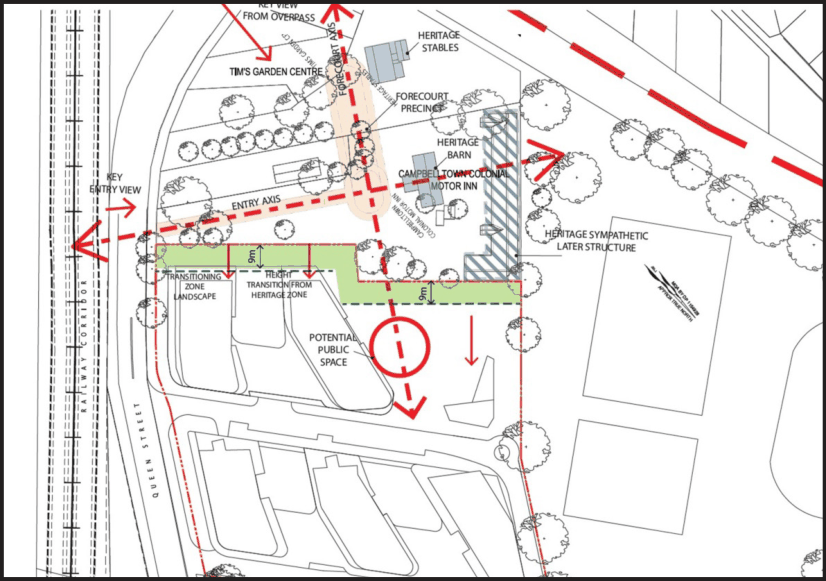

### 14.3 14.3.6 Heritage Interface

#### Development

Objectives and

#### Objectives

#### Controls

■ Provide an appropriate backdrop to the Warby site as seen from the north-east (Campbelltown Road overpass) with the “old Campbelltown” presented against the “new Campbelltown”, without overwhelming the historic site. ■ Ensure the project does not prejudice the future development of the Warby site, rather provide opportunities for the future development of the Warby site in a way that will enhance its significance and interlink with the Project site.

#### Controls

#### Controls

1

1 Respond to the axes of the Warby site (the configuration of the buildings and the

Respond to the axes of the Warby site (the configuration of the buildings and the entry drive).

entry drive). 2

2 Respond to the alignment of the historic entry drive to the west and interpret this

Respond to the alignment of the historic entry drive to the west and interpret this early drive in the internal road alignments/access ways in the Project site.

early drive in the internal road alignments/access ways in the Project site. 3

3 Introduce a lower scale and open space along the Warby site property boundary.

Introduce a lower scale and open space along the Warby site property boundary. 4

4 Concentrate taller buildings to the west and north, away from the Warby site and

Concentrate taller buildings to the west and north, away from the Warby site and out of the principal view lines from the northeast.

out of the principal view lines from the northeast. 5

5 Integrate pedestrian access and landscaping into the heritage transition zone/

Integrate pedestrian access and landscaping into the heritage transition zone/ setback.

setback. 6

6 Avoid visually overwhelming the Warby site by stepping away the massing of the new

Avoid visually overwhelming the Warby site by stepping away the massing of the new development from the shared property boundary.

development from the shared property boundary. 7

7 Avoid locating “back of house” services and carpark entries within the transition

Avoid locating “back of house” services and carpark entries within the transition zone between the Warby site and the Project site.

zone between the Warby site and the Project site.

#### Development

Objectives and

#### Controls

> [Picture on page 19: a picture, saved as a picture (images/vol-2-part-14-22-32-queen-street-development-control-plan-page-19-4.gif, 150 dpi).]

Figure 14.9 - Heritage Interface
