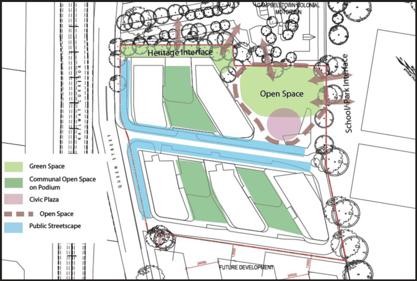

### 14.3 14.3.7 Landscaping and Public Open Space

#### Development

Objectives and

#### Objectives

#### Controls

■ To establish a useable area of public open space to cater for the amenity of future residents, workers and visitors. ■ To allow for passive recreation opportunities, catering for a broad range of activities and intergeneration needs. ■ To facilitate community interaction and gathering for local residents, workers and visitors. ■ To provide public open space with good solar access and high standards of amenity. ■ To activate the edge of the public open space to encourage safe and legitimate use of the open space and foster passive surveillance. ■ To ensure sufficient deep soil to enable the growth of large trees within open space and buffer areas/heritage interface. ■ To ensure safety and security of users and residents associated with the usage of the open space. ■ To ensure open space is appropriately landscaped with hard and soft materials, street furniture, trees, planting, and walking paths. ■ To provide a building for civic and social infrastructure use within the open space.

#### Controls

#### Controls

1

1 Public open space is to be provided as identified by Figure 14.10 to a minimum of

Public open space is to be provided as identified by Figure 14.10 to a minimum of 4,000sq.m.

4,000sq.m. 2

2 A public domain plan is to be prepared and submitted to Council with a development

A public domain plan is to be prepared and submitted to Council with a development application for the construction of public open space that illustrates the context,

application for the construction of public open space that illustrates the context, role and purpose of open space elements.

role and purpose of open space elements. 3

3 50% of the civic plaza is to receive a minimum of 3 hour direct solar access between

50% of the civic plaza is to receive a minimum of 3 hour direct solar access between 9 am and 2pm on 21 June.

9 am and 2pm on 21 June. 4

4 Public art should be incorporated into the design of the open space adjacent to

Public art should be incorporated into the design of the open space adjacent to the Warby barn and stables site that reinforces the significance of the heritage

the Warby barn and stables site that reinforces the significance of the heritage landscape.

landscape. 5

5 Maintain public access to the civic plaza.

Maintain public access to the civic plaza. 6

6 To ensure the civic/social infrastructure building is designed to respond to the public

To ensure the civic/social infrastructure building is designed to respond to the public open space ensuring that the building does not undermine the integrity of the space

open space ensuring that the building does not undermine the integrity of the space and public access.

and public access. 7

7 Should social infrastructure uses such as child care be included, the design and

Should social infrastructure uses such as child care be included, the design and interface is to be carefully considered to ensure the safety and protection of

interface is to be carefully considered to ensure the safety and protection of children and public access and usability of the open space.

children and public access and usability of the open space.

#### Development

Objectives and

#### Controls

> [Picture on page 21: a picture, saved as a picture (images/vol-2-part-14-22-32-queen-street-development-control-plan-page-21-4.gif, 150 dpi).]

Figure 14.10 - Open Space
