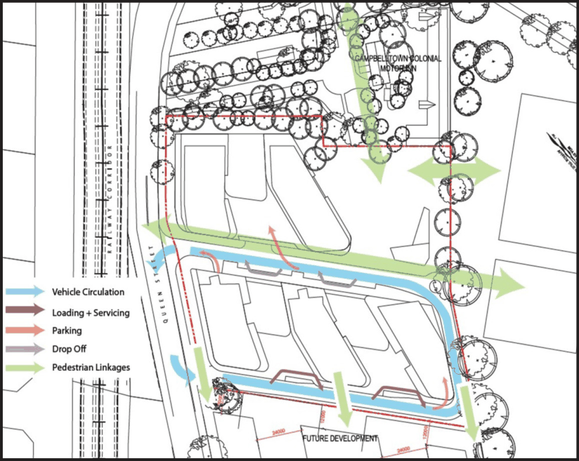

### 14.3 14.3.8 Circulation and Access

#### Development

Objectives and

#### Objectives

#### Controls

■ To prioritise pedestrian and public amenity throughout the development. ■ To establish a safe balance between pedestrian, cycling and vehicle movement. ■ Provide convenient, efficient, safe access and parking for vehicles, services (including deliveries and waste), pedestrians and cyclists. ■ To minimise the visual impact of vehicle accessways from the public domain. ■ To ensure a safe and convenient vehicular arrangement from Queen Street and throughout the site. ■ To minimise vehicular crossover of the public realm. ■ Provide adequate ‘end-of-trip’ facilities, including a change room with showers, to encourage walking and cycling to work by retail and commercial staff. ■ To provide a building for civic and social infrastructure use within the open space.

#### Controls

#### Controls

1

1 Pedestrian linkages are to be secured and enhanced between Queen Street and the

Pedestrian linkages are to be secured and enhanced between Queen Street and the current high school grounds (future open space under the Campbelltown Precinct

current high school grounds (future open space under the Campbelltown Precinct Plan); between the new civic plaza space and the heritage listed Warby’s barn and

Plan); between the new civic plaza space and the heritage listed Warby’s barn and stables; and between the civic plaza and the high school.

stables; and between the civic plaza and the high school. 2

2 Vehicular circulation is to be in an anti-clockwise direction as indicated in Figure

Vehicular circulation is to be in an anti-clockwise direction as indicated in Figure 14.11.

14.11. 3

3 Car parking and bicycle spaces are to be provided in accordance with the rates set

Car parking and bicycle spaces are to be provided in accordance with the rates set out in table 14.2 below.

out in table 14.2 below. 4

4 Where possible, driveway crossovers should be limited to two crossover for

Where possible, driveway crossovers should be limited to two crossover for residential cars, and two for service vehicles across the development.

residential cars, and two for service vehicles across the development. 5

5 There is to be no provision made for loading bays on the main street or Queen

There is to be no provision made for loading bays on the main street or Queen Street.

Street. 6

6 Adequate ‘end-of-trip’ facilities are to be provided, including a change room with

Adequate ‘end-of-trip’ facilities are to be provided, including a change room with showers, to encourage walking and cycling to work by retail and commercial staff.

showers, to encourage walking and cycling to work by retail and commercial staff.

#### Development

Objectives and

#### Controls

| Car Parking and Bicycle Rates |  |
|---|---|
| Residential Objective 3J-1 in the NSW Planning and Environment Apartment Design Guide 2015 states the parking requirement is the “minimum car parking requirement for residents and visitors is set out in the Guide to Traffic Generating Developments, or the car parking requirement prescribed by the relevant Council, whichever is less”. Hence the parking requirement based upon RMS Guidelines is as follows: Note: All resident and visitor parking spaces are required to be 2.5m wide by 5.5m long based upon Clause 5.5.4(b) in DCP2015 |  |
| 1 bedroom | Minimum 0.4 spaces per unit |
| 2 bedroom | Minimum 0.7 spaces per unit |
| 3 bedroom | Minimum 1.4 spaces per unit |
| Visitors | 1 space per 5 units |
| Disabled and Adaptable | Clause 5.5.3 b) in Campbelltown DCP2015 requires 10% of dwellings within a residential flat building to be adaptable. |
| Bicycle Parking | 1 space per 5 units |
| Commercial, retail and serviced apartments The car parking rates for the serviced apartments and retail and commercial uses are based on Table 6.4.2.1 Car Parking Rates in Campbelltown DCP 2015. |  |
| Serviced apartments | 1 space per 4 apartments Plus 1 space/ manage |
| Bulky goods premises | 1 per 60m2 GFA |
| Shops (Ground floor) | 1 per 25m2 GFA |
| Gymnasium | 1 per 25m2 GFA |
| Restaurants | 1.5 spaces per 10m2 GFA |
| Business Premises | 1 space per 35m2 GFA |
| Childcare centre | 1 space per 4 children |

Table 14.2 - 22-32 Building orientation and layout

#### Development

Objectives and

#### Controls

> [Picture on page 24: a picture, saved as a picture (images/vol-2-part-14-22-32-queen-street-development-control-plan-page-24-4.gif, 150 dpi).]

Figure 14.11 - Circulation and Access

#### 14.3.9 Crime Prevention Through Environmental Design (CPTED)

#### Development

Objectives and

#### Objectives

#### Controls

■ To promote design features within new developments and the redevelopment of existing areas, which will enhance the safety from crime for the community, including visitors. ■ To enhance public safety by reducing opportunities for crime. ■ To reduce the fear of crime through the provision of safe, well designed and maintained buildings, facilities and public spaces. ■ To optimise the community use of public spaces and facilities. ■ To encourage development which promotes safety on neighbouring public and private land. ■ To provide a building for civic and social infrastructure use within the open space.

#### CPTED Design Concepts

#### CPTED Design Concepts

Crime Prevention through Environmental Design (CPTED) promotes the idea that

Crime Prevention through Environmental Design (CPTED) promotes the idea that creativedesign can be an effective deterrent to criminal behaviour within the community.

creativedesign can be an effective deterrent to criminal behaviour within the community. CPTED is based on four design and usage concepts that can reduce the incidence and fear

CPTED is based on four design and usage concepts that can reduce the incidence and fear of crime, including: -

of crime, including: -

• Natural Surveillance - location and use of design features and activities that create a perception of increased risk of detection for intruders and of increased safety and security for legitimate uses.

• Access Control - the use of design features that deny offenders access to targets, reduce escape opportunities and guide legitimate users through the environment.

• Territorially - the use of physical features designed to express ownership and control the environment and delineate private and semi-private spaces.

• Maintenance - ensuring adequate measures are taken to ensure the continued use of space for the intended purpose and increased feelings of safety for users.

#### Controls

#### Controls

1

1 Any future development application is to address the above principles of crime

Any future development application is to address the above principles of crime prevention through environmental design.

prevention through environmental design.
