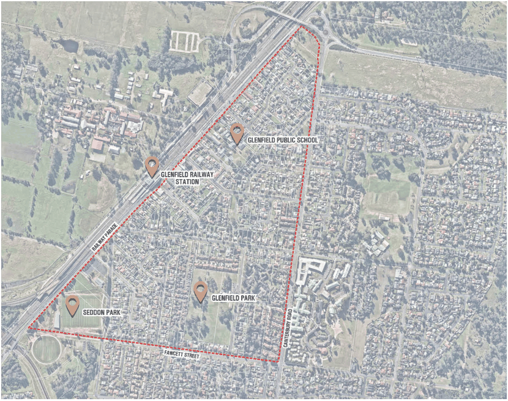

#### 15.1.2 Land to which this part applies

The land where this Part of Volume 2 Site Specific Development Control Plans of the Campbelltown (Sustainable City) Development Control Plan 2015 (SCDCP) applies is shown in Figure 15.1.2.1 below. This site is  a triangular-shaped Precinct located within Eastern Glenfield (“Glenfield East Precinct”). This precinct is bounded by the railway line to the west, Canterbury Road to the east, and Fawcett Street to the south.

The Glenfield East Precinct is mapped as an ‘Urban Release Area’ within the Campbelltown Local Environment Plan 2015 (CLEP 2015)  and has been identified for future urban redevelopment and intensification. This is largely due to the precinct’s proximity and accessibility to the Glenfield Railway station and amenities.

> [Picture on page 3: a picture, saved as a picture (images/vol-2-part-15-glenfield-east-development-control-plan-page-3-21.gif, 150 dpi).]

Figure 15.1.2.1 - Land to which this site specific DCP Applies - Glenfield East Precinct

#### Application
