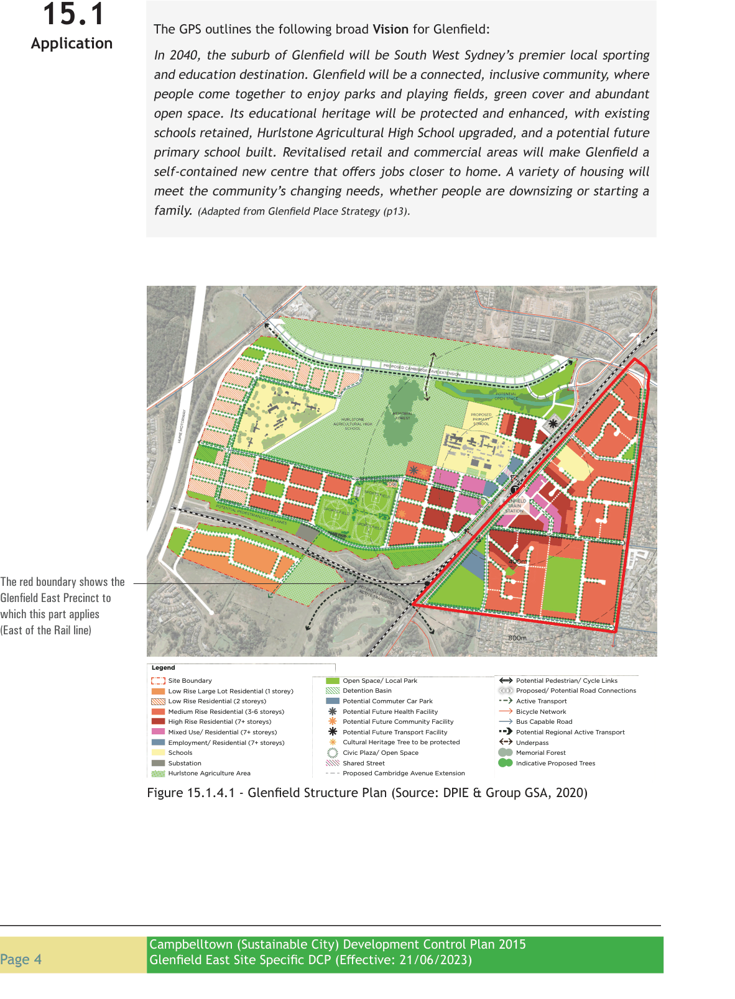

#### 15.1.4 Background: A New Vision, Place Strategy and Structure

#### Plan for Glenfield

On 16 July 2021 the Department of Planning, Industry and Environment (DPIE) finalised a wider rezoning of Glenfield, which included the Glenfield East Precinct in addition to extensive land holdings located on the western side of the railway line and Hurlstone Agricultural High School.

The rezoning involved amendments to a number of key provisions in the CLEP 2015, including land use zones, maximum building heights and floor space ratio controls, which also facilitated bringing the vision highlighted in the ‘Glenfield to Macarthur Corridor Strategy’ and ‘Western City District Plan’ to fruition.

As part of the planning documentation for the Glenfield East Precinct, the ‘Glenfield Place Strategy’ (GPS) was also finalised in July 2021 and included a Structure Plan which is shown in Figure 15.1.4.1 of this Part. The GPS aims to achieve better urban design outcomes and deliver sufficient infrastructure to support the intensification of future development proposed within this Precinct. It is envisaged that the redevelopment of Glenfield as per the GPS will facilitate the provision of approximately 7,000 additional homes, 2,900 new jobs, increased open space/recreational facilities and an extensive upgrade to Hurlstone Agricultural High School.

> [Picture on page 5: a map, saved as a picture (images/vol-2-part-15-glenfield-east-development-control-plan-page-5-1.gif, 150 dpi); the street names and other small labels are on the picture.]
> Words printed on the picture (title and legend, copied from the PDF):
> Glenfield Structure Plan
> Glenfield Structure Plan
> Glenfield Structure Plan
> Low Rise Large Lot Residential (1 storey)
> Low Rise Residential (2 storeys)
> Medium Rise Residential (3-6 storeys)
> High Rise Residential (7+ storeys)
> Mixed Use/ Residential (7+ storeys)
> Employment/ Residential (7+ storeys)
> Hurlstone Agriculture Area
> Open Space/ Local Park
> Low Rise Large Lot Residential (1 storey) Detention Basin
> Low Rise Residential (2 storeys)
> Potential Commuter Car Park
> Medium Rise Residential (3-6 storeys) Potential Future Health Facility
> High Rise Residential (7+ storeys)
> Potential Future Community Facility
> Mixed Use/ Residential (7+ storeys)
> Potential Future Transport Facility
> Employment/ Residential (7+ storeys) Cultural Heritage Tree to be protected HURLSTONE
> Civic Plaza/ Open Space
> Hurlstone Agriculture Area
> Proposed Cambridge Avenue Extension
> Open Space/ Local Park
> Potential Pedestrian/ Cycle Links
> Proposed/ Potential Road Connections
> Low Rise Large Lot Residential (1 storey)
> Potential Commuter Car Park
> Low Rise Residential (2 storeys)
> Potential Future Health Facility
> Medium Rise Residential (3-6 storeys)
> Potential Future Community Facility
> Bus Capable Road
> High Rise Residential (7+ storeys)
> Potential Future Transport Facility
> Potential Regional Active Transport
> Mixed Use/ Residential (7+ storeys)
> Cultural Heritage Tree to be protected Underpass
> Employment/ Residential (7+ storeys)
> Civic Plaza/ Open Space
> Indicative Proposed Trees
> Proposed Cambridge Avenue Extension
> Hurlstone Agriculture Area
> POTENTIAL PEDESTRIAN/CYCLE LANES
> Potential Pedestrian/ Cycle Links
> Open Space/ Local Park
> Proposed/ Potential Road Connections
> Potential Commuter Car Park
> Potential Future Health Facility
> Bus Capable Road
> Potential Future Community Facility
> Potential Regional Active Transport
> Potential Future Transport Facility
> Cultural Heritage Tree to be protected
> Civic Plaza/ Open Space
> Indicative Proposed Trees
> Proposed Cambridge Avenue Extension
> Potential Pedestrian/ Cycle Links
> Proposed/ Potential Road Connections
> Bus Capable Road
> Potential Regional Active Transport
> Indicative Proposed Trees

Figure 15.1.4.1 - Glenfield Structure Plan (Source: DPIE & Group GSA, 2020)

The GPS outlines the following broad Vision for Glenfield:

#### Application

In 2040, the suburb of Glenfield will be South West Sydney’s premier local sporting and education destination. Glenfield will be a connected, inclusive community, where people come together to enjoy parks and playing fields, green cover and abundant open space. Its educational heritage will be protected and enhanced, with existing schools retained, Hurlstone Agricultural High School upgraded, and a potential future primary school built. Revitalised retail and commercial areas will make Glenfield a self-contained new centre that offers jobs closer to home. A variety of housing will meet the community’s changing needs, whether people are downsizing or starting a family. (Adapted from Glenfield Place Strategy (p13).

The red boundary shows the Glenfield East Precinct to which this part applies (East of the Rail line)

#### Application

The main focus of the GPS is the future redevelopment of land located on the western side of the railway line which includes the five designated character areas nominated in this Strategy. The GPS also states that “further character areas may be developed for east Glenfield as detailed planning progresses as part of the Development Control Plan stage of the process” (p20). This site specific DCP is only applicable to the Glenfield East Precinct, and also:

•	• accords with the new CLEP 2015 provisions and overarching Structure Plan;

accords with the new CLEP 2015 provisions and overarching Structure Plan;

•	• outlines a future ‘Vision’ for this precinct; and

outlines a future ‘Vision’ for this precinct; and

•	• identifies new Character Areas within the precinct.

identifies new Character Areas within the precinct.
