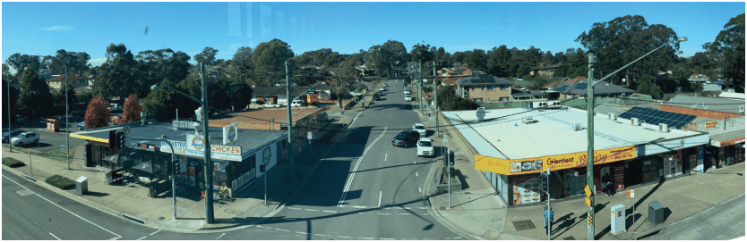
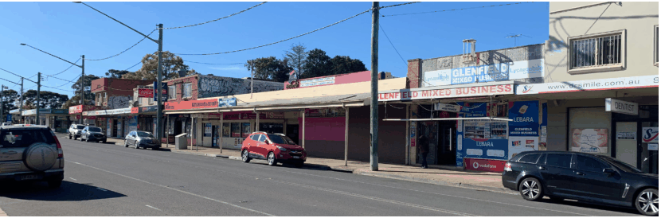
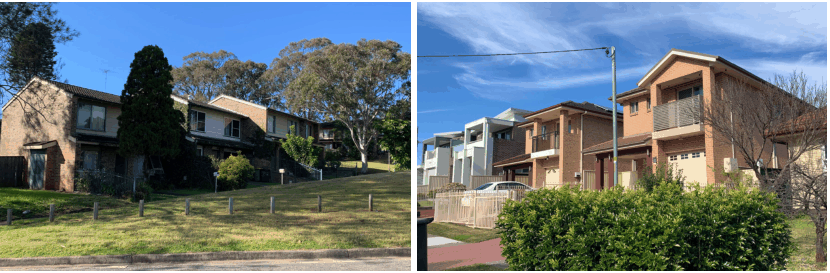
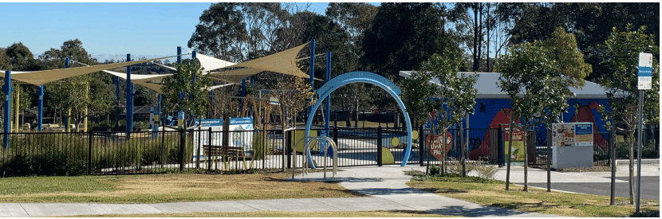

#### 15.2.1 Existing Character: Glenfield East

#### Strategic Context

#### and Vision The Glenfield East Precinct is a predominantly low-density residential community which

mainly comprises one to two storey detached dwellings of varying age and quality. Some larger blocks contain existing multi-dwelling housing developments that were constructed in the 1970s and 1980s which have also been strata-subdivided. The ownership pattern of land is fragmented while the residential street pattern is typified by angled perimeter/ collector roads with east-west connections, and includes several interior cul-de-sacs. This pattern results in many properties having splayed boundaries and irregular block shapes.

A small neighbourhood centre located opposite Glenfield Railway Station comprises several convenience shops and a commercial premises which currently services the local community. These premises are typically one and two storey aging structures which all share a collective frontage to Railway Parade; and the corners of Hosking Crescent and Trafalgar Street. Magee Lane allows rear access to some of these premises with a nearby existing Council owned car park which also provides suitable vehicular access to/from Railway Parade.

Glenfield Public School is located to the north of the shopping centre and is accessed from both Railway Parade and Waterloo Place.

The Glenfield East Precinct has two large open space areas and includes Seddon Park which comprises several active recreation fields located on the south-western edge of the Precinct, in close proximity to the railway station. Nearby Glenfield Park is also proposed to provide additional passive open recreational space which incorporates stands of mature trees and a children’s playground.

The precinct contains some scattered vegetation consisting of isolated/remnant mature trees which are interspersed throughout the neighbourhood. Street tree planting also appears limited with overhead electricity poles and wires currently constraining growth to the existing vegetation while there are very few opportunities for further planting within the road reserve.

> [Picture on page 9: a picture, saved as a picture (images/vol-2-part-15-glenfield-east-development-control-plan-page-9-30.gif, 150 dpi).]

Figure 15.2.1.1 - Looking west along Hosking Crescent, showing existing commercial properties and Council car park fronting Railway Parade (at far left). Taken from Glenfield Railway Station overpass.

#### Strategic Context

#### and Vision

> [Picture on page 10: a picture, saved as a picture (images/vol-2-part-15-glenfield-east-development-control-plan-page-10-3.gif, 150 dpi).]

Figure 15.2.1.2 - Existing commercial premises fronting Railway Parade.

> [Picture on page 10: a picture, saved as a picture (images/vol-2-part-15-glenfield-east-development-control-plan-page-10-5.gif, 150 dpi).]

Figure 15.2.1.3 - Glenfield East Precinct: Examples of typical existing low density residential street character and existing housing.

> [Picture on page 10: a picture, saved as a picture (images/vol-2-part-15-glenfield-east-development-control-plan-page-10-8.gif, 150 dpi).]

Figure 15.2.1.4 - Children’s Playground, Glenfield Park.

#### Important Note:

Council is in the process of preparing a Glenfield East Public Domain Strategy for the Glenfield East Precinct (GE PDS). The GE PDS will provide detailed information in relation to tree plantings, street furtniture, pavements and the like. The GE PDS will be placed on public exhibition prior to it being formally adopted  by Council. Any reference to the a public domain strategy in this Part, is a reference to this the GE PDS . Any requirements related to the GE PDS  will have effect, only upon the  adoption of the GE PDS by Council.

#### Strategic Context
