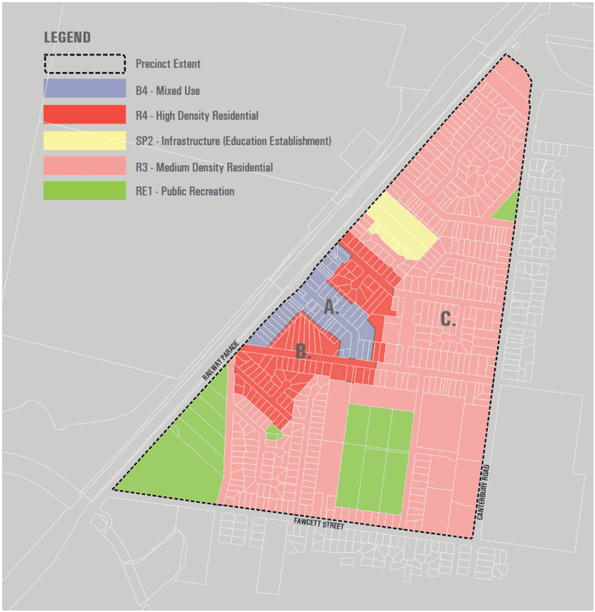

#### 15.2.2 Glenfield East: Vision Desired Future Character and Development Principles

#### and Vision

#### Vision

The acquired Vision for Glenfield East is that it transforms into a specialised higher density precinct which has the potential to accommodate much higher ‘mixed-use’ built forms, in close proximity to the Glenfield Railway station. The population of the Glenfield East Precinct is anticipated to grow and be accommodated in a variety of housing types such as multi-storey apartments, medium density housing and lower density detached dwellings with increased affordable housing options. This precinct is also proposed to contain a high quality public domain and vibrant commercial district with retail premises, schools and open spaces all located within close walking distance to the railway station. Pedestrian and bicycle linkages to the new Glenfield west employment precincts and amenities will provide excellent alternative access to rail transport, including facilitating vital connections to other major centres and the Airport.

#### Desired Future Character Areas

Figure 15.2.2.1 llustrates the three Desired Future Character Areas within Glenfield East Precinct. Character Statements and Controls for each are provided later in this Part In summary the character areas reflect the land use zoning for the land and comprise:

•	• Area A - Station East – will experience the most transformation with mixed-use

Area A - Station East – will experience the most transformation with mixed-use buildings up to 12 storeys with active street frontages adjacent to the Railway

buildings up to 12 storeys with active street frontages adjacent to the Railway Station.

Station.

•	• Area B - High Density Residential – will contain high quality residential apartment

Area B - High Density Residential – will contain high quality residential apartment buildings up to 8 storeys with a high level of amenity and accessibility to services

buildings up to 8 storeys with a high level of amenity and accessibility to services and transport.

and transport.

•	• Area C - Medium Density Residential will provide a range of housing choice and

Area C - Medium Density Residential will provide a range of housing choice and types at a lower scale with convenient connections to amenities within the

types at a lower scale with convenient connections to amenities within the suburb.

suburb.

An entry statement to Glenfield East precinct shall be provided in a suitable location at

An entry statement to Glenfield East precinct shall be provided in a suitable location at the Railway Parade and Canterbury Road entry points (north and south of precinct) that

the Railway Parade and Canterbury Road entry points (north and south of precinct) that defines the locality and provides a welcoming character setting by use of appropriate

defines the locality and provides a welcoming character setting by use of appropriate signage, wayfinding information for pedestrians and motorists and incorporates suitable

signage, wayfinding information for pedestrians and motorists and incorporates suitable materials and landscaping theme.  This could take the form of a public art installation

materials and landscaping theme.  This could take the form of a public art installation or structure.

or structure.

#### Strategic Context

#### and Vision

> [Picture on page 12: a picture, saved as a picture (images/vol-2-part-15-glenfield-east-development-control-plan-page-12-3.gif, 150 dpi).]

Figure 15.2.2.1 - Desired Future Character Areas

#### Strategic Context

#### and Vision

| Principles | Guiding Principle |
|---|---|
| A well designed place | Streets will be designed to incorporate a human scale with buildings being setback to encourage alfresco dining in key locations and to minimise any potential overshadowing and privacy impacts. Building heights will be reduced along the interfaces with schools with pedestrians being prioritised by discouraging all private vehicles from entering the main street and redirected to the laneways adjoining these school sites. |
| A green place | Streets will be lined with trees with quality open space areas that are located within 400m walking distance of all residents. |
| Deliver affordable and diverse housing | New homes will include a mix of dwelling types and sizes which provide a greater choice for future residents located within walking distance to public transport and community facilities. Density will be highest near the station and gradually transition down as the distance increases away from this area. |
| Two vibrant and connected centres | To the west of Glenfield Station, a mixed-use, vibrant commercial core and residential precinct will create new homes, jobs, schools and open space, with a proposed high street that facilitates better access to public space and transport. There will be pedestrian and cycling connections with view corridors being implemented between the two centres which are intended to further increase the sense of connectivity around the Glenfield East Precinct. |
| Create opportunities for new jobs | Mixed-use development around the station will support health and community services in addition to activating the main commercial street. A lively employment hub around Glenfield station will be easy to access and provide greater potential to create passing trade for local businesses. |
| An accessible place | Glenfield East is an important meeting place which is accessible by two-train lines that provides direct links to other major centres and airports. It is also anticipated that higher density development within this precinct will deliver more people in closer proximity to amenities by locating these structures within walking distance to services and other important infrastructure such as open-space and high-frequency public transport. |

Table 15.2 - Guiding Urban Design Principles (Adapted from Glenfield Place Strategy, DPIE p14)
