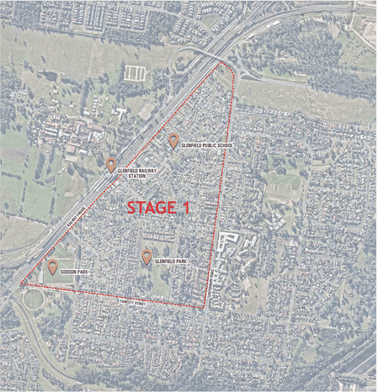

#### 15.3.1 Staging Plan

#### General

#### Controls

Controls 1.

1\.	 The development of this precinct will occur in one stage.

The development of this precinct will occur in one stage.

> [Picture on page 14: a picture, saved as a picture (images/vol-2-part-15-glenfield-east-development-control-plan-page-14-8.gif, 150 dpi).]

### STAGE 1
