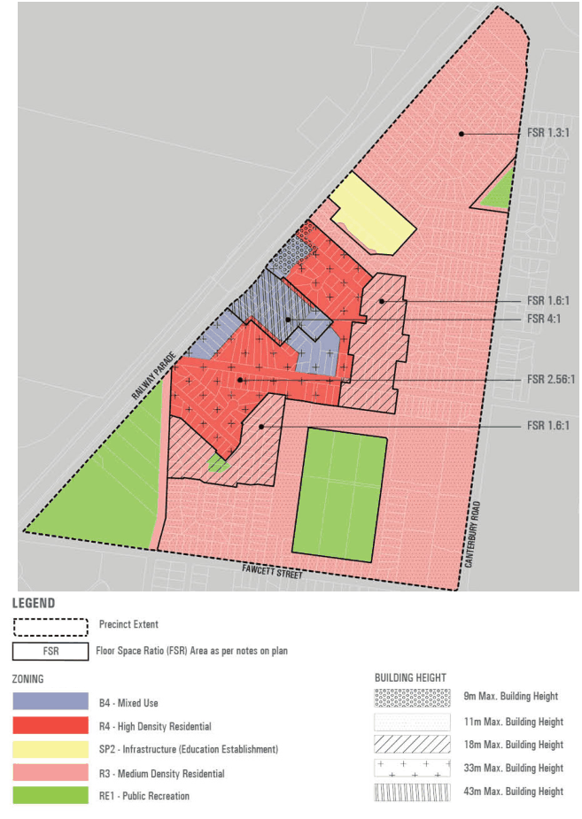

## 2.	 Where development is located within or adjacent to a site containing a change in

Where development is located within or adjacent to a site containing a change in zone and/or building height/FSR, an increased building setback and/or stepping

zone and/or building height/FSR, an increased building setback and/or stepping down between the two height controls is required. Refer to relevant Precinct(s) for

down between the two height controls is required. Refer to relevant Precinct(s) for numerical controls.

numerical controls.

#### General

#### Controls

| CLEP 2015 Land Use Zones Clause 2.3 - CLEP 2015 | Maximum Building Height Clause 4.3 - CLEP 2015 | Maximum Floor Space Ratio Clause 4.4 - CLEP 2015 |
|---|---|---|
| B4 Mixed-use | 43m, 33m and 9m | 4:1 and 2.56:1 |
| R4 High Density Residential | 33m and 9m | 2.56:1 |
| R3 Medium Density Residential* | 18m and 11m | 1.3:1 and 1.6:1 |

Table 15.3 - Zoning and Key Development Controls in Glenfield East

#### *Important Note:

The R3 Medium Density Zone  in the CLEP 2015 prohibits residential flat buildings

(RFBs).

> [Picture on page 15: a picture, saved as a picture (images/vol-2-part-15-glenfield-east-development-control-plan-page-15-8.gif, 150 dpi).]

Figure 15.3.1.1 - Zoning, Building Height and Floor Space Ratio - CLEP 2015
