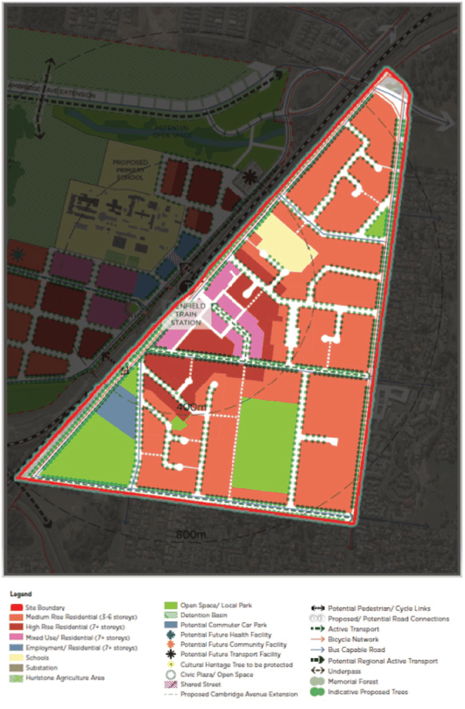
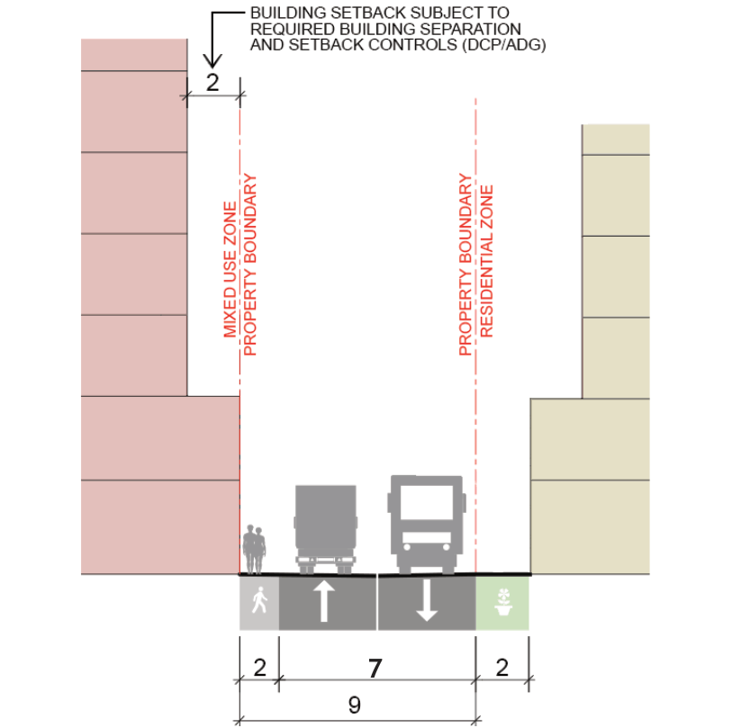

#### 15.3.3 Movement Network

#### Objectives:

#### General

#### Controls

■ To reinforce the railway and existing road network, in addition to improving the existing infrastructure and enhancing connectivity for future residents of Glenfield East

■ To provide for an efficient, connected and attractive street/footpath network which improves vehicular, pedestrian and cycling access through this Precinct.

■ To reduce reliance on private vehicles and encourage people to use alternative transport modes such as walking, cycling and public transport.

Controls

specified in Council’s Glenfield East Public Domain Plan.

1\.	 New development shall provide proposed service laneways and pedestrian pathway connections as indicated in the Glenfield Structure Plan in Figure 15.3.2.1 and in Figure

15.4.3.1 of this Part

6\.	 The technical design of all streets and pathways shall be in compliance with the Campbelltown City Council’s ‘Engineering Design Guide for Development’ and the Public Domain Plan.

2\.	 Existing Magee Lane and new service laneways shall be maintained for the provision of vehicular access to new buildings in the Station East Precinct and adjacent High Density Residential Precinct. Each laneway is to be a minimum of 9 metres wide.

3\.	 Laneways shall be inviting and will provide convenient and safe pedestrian linkages as well as vehicular access to mixed use and multi-storey residential development.

4\.	 Any floor level higher than two storeys of a mixed use building that is proposed adjacent to a residential area shall be set back as per the configuration in Figure 15.3.2.2 - typical section between the B4 Mixed-Use and R4 Medium Density Zones.

5\.	 New pedestrian pathways shall have a minimum of 3 metres width and shall be landscaped and finished in material

#### General

#### Controls

> [Picture on page 17: a picture, saved as a picture (images/vol-2-part-15-glenfield-east-development-control-plan-page-17-3.gif, 150 dpi).]

Figure 15.3.2.1 - Excerpt from the Glenfield Structure Plan showing proposed laneway and pathway connections

#### General

#### Controls

> [Picture on page 18: a picture, saved as a picture (images/vol-2-part-15-glenfield-east-development-control-plan-page-18-3.gif, 150 dpi).]

### 7

Figure 15.3.2.2 - Typical Laneway Section - B4 Mixed-use Zone to R4 Medium Density Residential Zone
