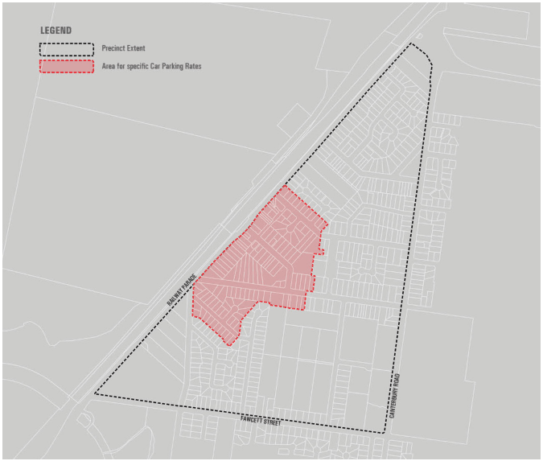

#### 15.3.4 Car Parking - Glenfield East Precinct

#### Objective:

#### General

#### Controls

■ Ensure appropriate off-street car parking facilities are available within Glenfield East Precinct to assist in reducing the amount of traffic congestion and promoting sustainable travel within this Precinct.

Controls

#### Note:

#### 15.3.3.1 On-site Parking Rates

Refer to Clause 8.3 (Carparking in Area A) in CLEP 2015 which provides the maximum carparking rates within Area A of the Glenfield East Precinct.

1\.	 The minimum car parking rates shall be in accordance with the relevant sections of Campbelltown Sustainable City DCP Volume 1.

Area A includes land zoned R4 and B4 within the Glenfield East Precinct.

2\.	 Where the minimum car parking rates under Campbelltown Sustainable City DCP Volume 1 equal or exceed the maximum car parking rates required under Clause 8.3 of the CLEP 2015, the CLEP’s 2015 rate shall be taken as the minimum required car parking rate.

3\.	 Development within the B4 and R4 Zones shall provide on-site parking within a basement and/or integrated within the site and associated building design.

#### General

#### Controls

> [Picture on page 20: a picture, saved as a picture (images/vol-2-part-15-glenfield-east-development-control-plan-page-20-3.gif, 150 dpi).]

Figure 15.3.3.1 - Area for specific Car Parking Rates - CLEP2015

| Column 1 Proposed Use | Column 2 Maximum number of parking spaces |
|---|---|
| Centre-based child care facility | 1 parking space for every 10 child care places plus 1 parking space for every 2 members of staff |
| Commercial premises other than retail premises | 1 parking space for every 25 square metres of gross floor area |
| Recreation facility (indoor) | 3 parking spaces for every 100 square metres of gross floor area |
| Residential flat building | 1 parking space for a studio apartment; 1 parking space for a 1 bedroom apartment; 1 parking space for a 2 bedroom apartment; 2 parking spaces for an apartment with 3 or more bedrooms; 1 visitor parking space for every 5 apartments |
| Retail premises with a gross floor area of up to 10,000 square metres | 6.1 parking spaces for every 100 square metres of gross floor area |
| Retail premises with a gross floor area of more than 10,000 square metres but not more than 20,000 square metre | 5.6 parking spaces for every 100 square metres of gross floor area |
| Retail premises with a gross floor area of more than 20,000 square metres but not more than 30,000 square metre | 4.3 parking spaces for every 100 square metres of gross floor area |
| Retail premises with a gross floor area of more than 30,000 square metres | 4.1 parking spaces for every 100 square metres of gross floor area |

Table 15.4 - Maximum Car Parking rates: Clause 8.3 of the CLEP 2015
