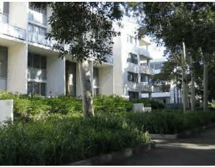
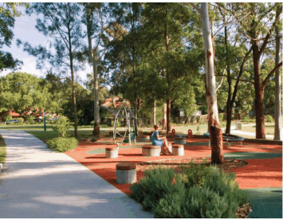

#### 15.3.5 Landscape Strategy and Character

#### Objectives:

#### General

#### Controls

■ Retain and enhance the leafy character of the Glenfield East Precinct by retaining existing vegetation which is considered significant to the local area.

■ Add value and quality of life for future residents and occupants proposing to live in the Precinct’s high and medium density areas

■ Enhance resdiential amenity including privacy, outlook, views and recreational opportunities.

■ Provide improved environmental outcomes which improve air and stormwater quality through reduced runoff and the implementation of suitable biodiversity

> [Picture on page 21: a picture, saved as a picture (images/vol-2-part-15-glenfield-east-development-control-plan-page-21-13.gif, 150 dpi).]

principles.

■ Improve the streetscape within the Precinct.

Controls

1\.	 Remnant native vegetation shall be retained, managed and incorporated into the landscape design, wherever practicable, including any significant trees that exist on-site.

Figure 15.3.4.1 - Existing vegetation retained and incorporated into Landscape design (source: DPE ADG,

2\.	 Works on public land is to be in accordance with the Glenfield East Public Domain Plan, which includes new street trees, footpath upgrades and improvements to existing open space areas.

2015)

> [Picture on page 21: a picture, saved as a picture (images/vol-2-part-15-glenfield-east-development-control-plan-page-21-32.gif, 150 dpi).]

3\.	 A landscaping plan showing proposed landscaping on site and in any adjacent public domain shall be submitted with any development application

Figure 15.3.4.2 - Enhancing open spaces through existing established vegetation (source: DPIE, 2021)
