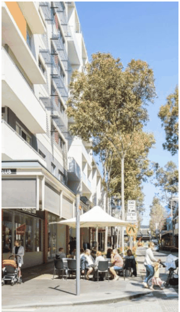

### 15.4 15.4 Area A - Station East (B4 Mixed Use Zone)

#### Station East

#### (B4 Mixed Use

#### 15.4.1 Desired Future Character Statement - Area A

#### Zone)

‘Area A’ will experience the most transformation within Glenfield East, where building heights up to 12 storeys can be supported in the Precinct’s B4 Mixed-Use zoned area. Quality urban design outcomes with active street frontages in this precinct are envisaged. Upper levels of buildings will be set back to create a more human scale feeling at the street level. Railway Parade and Hoskings Crescent will be pedestrian friendly and form the heart of the Precinct while future ground floor retail and commercial uses will activate this area with residential uses located above. Alfresco dining on footpaths with street-tree planting also needs to be delivered which will facilitate forming the acquired character in ‘Area A’. The proposed public domain will provide an attractive and pedestrian friendly main street with the other nearby roadways also serving as invaluable connections to the railway from different areas within the Precinct. Vehicle and service access via new rear laneways  have also been provided which facilitates safe ingress and egress to/from these properties.

> [Picture on page 23: a picture, saved as a picture (images/vol-2-part-15-glenfield-east-development-control-plan-page-23-20.gif, 150 dpi).]

Figure 15.4.1.1 - Example of desired character of Area A Station East (B4 Mixed Use Zone) (source: DPIE & Group GSA, 2020)
