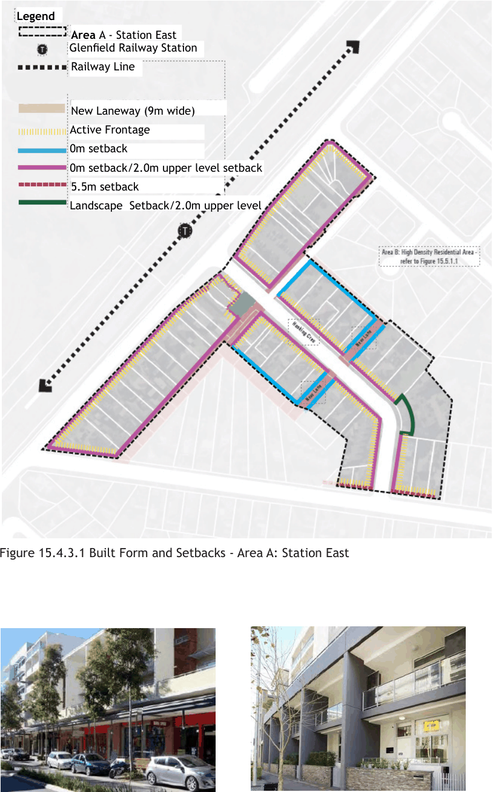
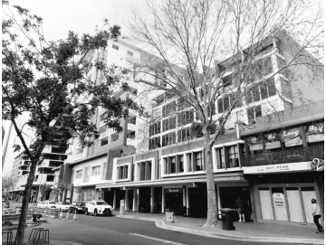
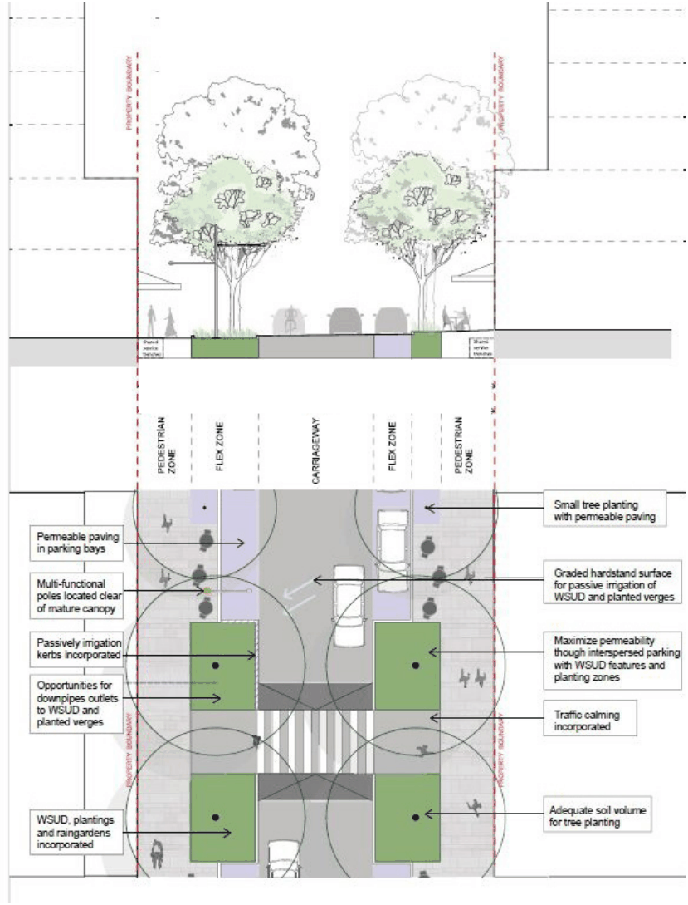

#### 15.4.3 Built Form -Area A

#### Objectives:

#### Station East

#### (B4 Mixed Use

#### Zone)

■ To mitigate the visual effects of tall buildings on the street.

■ To delineate the commercial aspect of a building from the residential by encouraging further front setbacks.

■ To ensure that Glenfield East is a vibrant and attractive commercial centre.

■ To encourage the activation of the streetscape by providing only retail/ commercial uses at the ground floor level.

■ To ensure all building facades are well articulated and appropriately designed to activate the streetscape.

■ To coordinate building massing along streets and across blocks.

■ To provide appropriate transition and minimise amenity impacts to adjacent residential development.

■ To integrate appropriate services within the design of the building.

■ To reduce/manage the occurrence of wind tunnels as a result of high rise development.

#### 15.4.3.1 Built Form and Setbacks

shall incorporate a finished floor

shall incorporate a finished floor level no greater than 500mm above

level no greater than 500mm above the adjacent footpath level where

the adjacent footpath level where appropriate.

appropriate.

1\.	 To achieve the desired built form and character envisioned for Glenfield East, any development proposed within this Precinct shall adhere to the Built Form 3.

3\.	 Where possible, other commercial

Where possible, other commercial

and Setbacks Plan contained in Figure 15.4.3.1.

#### 15.4.3.2 Active Street Frontages

uses which do not attract a high

uses which do not attract a high level of pedestrian movement shall

level of pedestrian movement shall be located on the building’s first

be located on the building’s first floor level or above.

floor level or above.

1.

1\.	 Buildings located on active street

Buildings located on active street frontages, as nominated on the

frontages, as nominated on the Built Form and Setbacks  plan in Figure

plan in Figure

15.4.3.1 of this DCP, shall only provide

15.4.3.1 of this DCP, shall only provide commercial/business uses on the

commercial/business uses on the ground level facing the street.

ground level facing the street. 2.

2\.	 Development at the ground floor level

Development at the ground floor level

4.

4\.	 The first floor of any proposed

The first floor of any proposed mixed-use buildings located on

mixed-use buildings located on Railway Parade and Hosking Crescent

Railway Parade and Hosking Crescent shall be designed with a minimum

shall be designed with a minimum floor to ceiling height of 3.3 metres

floor to ceiling height of 3.3 metres to allow for future adaptation for

to allow for future adaptation for commercial uses.

commercial uses.

#### Note:

All residential flat buildings and mixed-use development containing 3 or more storeys and 4 or more dwellings shall satisfy the standards of State Environmental Planning Policy No. 65 - Design Quality of Residential Apartment Development (SEPP 65) and the Apartment Design Guide (NSW Department of Planning and Environment, July 2015). SEPP 65 and the ADG shall prevail in the event of any inconsistency with this DCP.

#### Station East

#### (B4 Mixed Use

#### Zone)

> [Picture on page 26: a picture, saved as a picture (images/vol-2-part-15-glenfield-east-development-control-plan-page-26-4.gif, 150 dpi).]
> Words printed on the picture (title and legend, copied from the PDF):
> Legend
> Area A - Station East
> Glenfield Railway Station
> Railway Line
> New Laneway (9m wide)
> Active Frontage
> 0m setback
> 0m setback/2.0m upper level setback
> 5.5m setback
> Landscape  Setback/2.0m upper level

Figure 15.4.3.1 Built Form and Setbacks - Area A: Station East

Figure 15.4.3.2 - Example of mixed use development with active street frontages (source: DPE ADG, 2015)

Figure 15.4.3.3 - Commercial offices at ground floor of a mixed use building (source: DPE ADG, 2015)

#### 15.4.3.3 Setbacks

footpath for the full width of the

footpath for the full width of the street frontage.

street frontage.

#### Station East

#### (B4 Mixed Use

2.

2\.	 Awnings shall have a minimum width

Awnings shall have a minimum width of 3 metres.

of 3 metres.

#### Zone)

1\.	 Front, side and rear setbacks from streets and laneways shall be in accordance with the Built Form and Setbacks Plan at Figure 15.4.3.1 of this DCP.

3.

3\.	 Under awning lighting shall be

Under awning lighting shall be provided to illuminate the footpath

provided to illuminate the footpath area below

area below

#### 15.4.3.5 Entrances to Buildings

1.

1\.	 Main entrances and exits are to be

Main entrances and exits are to be located at the front of the site and

located at the front of the site and be visible from the street.

be visible from the street.

2\.	 A continuous street line/zero side setback is required for mixed-use development. A two storey street wall height is applicable where indicated in Figure 15.4.3.1 and as illustrated at Figure 15.4.3.5.

2.

2\.	 Entrances and exits shall be

Entrances and exits shall be incorporated into the overall

incorporated into the overall architectural design of a

architectural design of a development.

development.

3\.	 The side and rear building setback for any mixed-use development which adjoins land zoned R4 High Density Residential shall be:

3.

3\.	 Entrances are not to be obscured by

Entrances are not to be obscured by landscaping or other obstacles and

landscaping or other obstacles and shall have clear sight lines.

shall have clear sight lines.

a.

a.	 For buildings up to 4 storeys: 3m for

For buildings up to 4 storeys: 3m for a blank wall or non-habitable room,

a blank wall or non-habitable room, and 6m to a defined ‘habitable

and 6m to a defined ‘habitable room’ or balcony;

room’ or balcony;

4.

4\.	 Entrances shall be clearly

Entrances shall be clearly identifiable to reduce confusion and

identifiable to reduce confusion and unintentional entry by incorporating

unintentional entry by incorporating measures such as:

measures such as:

b.

b.	 For buildings 5 to 8 storeys: 4.5m

For buildings 5 to 8 storeys: 4.5m to a blank wall or non-habitable

to a blank wall or non-habitable room, and 9m to ‘habitable room’

room, and 9m to ‘habitable room’ or open balcony.

or open balcony.

• Architectural features and

Architectural features and articulation;

articulation;

• Awnings;

Awnings;

3\.	 Blank walls with minimal articulation which face any boundary will not be permitted.

• Variations in colours and

Variations in colours and materials;

materials;

#### 15.4.3.4 Building Design

• Changes in paving; and

Changes in paving; and

• Landscaping.

Landscaping.

4.

4\.	 The design of roof plant rooms and lift

The design of roof plant rooms and lift overruns shall be integrated into the

overruns shall be integrated into the overall architecture of the building.

overall architecture of the building.

These measures shall be shown on the building plans and the landscaping plan.

> [Picture on page 27: a picture, saved as a picture (images/vol-2-part-15-glenfield-east-development-control-plan-page-27-114.gif, 150 dpi).]

5.

5\.	 For development in close proximity to

For development in close proximity to the rail corridor, balconies and windows

the rail corridor, balconies and windows shall be designed to prevent objects

shall be designed to prevent objects being thrown onto RailCorp’s facilities,

being thrown onto RailCorp’s facilities, as required by the relevant Building

as required by the relevant Building Code of Australia (BCA) and RailCorp

Code of Australia (BCA) and RailCorp Electrical Standards

Electrical Standards

#### 15.4.1.4 Awnings

1.

1\.	 Buildings located on active street

Buildings located on active street frontages as labelled on the Built Form

frontages as labelled on the Built Form and Setbacks Plan in Figure 15.4.3.1

and Setbacks Plan in Figure 15.4.3.1 shall provide an awning over the

shall provide an awning over the

Figure 15.4.3.4 - Example of mixed-use building with two storey street wall height and upper level setback

#### Station East

#### (B4 Mixed Use

#### Zone)

> [Picture on page 28: a picture, saved as a picture (images/vol-2-part-15-glenfield-east-development-control-plan-page-28-4.gif, 150 dpi).]

Figure 15.4.3.5 - Hosking Crescent Typical Plan and Section showing street character including two storey street wall height (zero setback)
