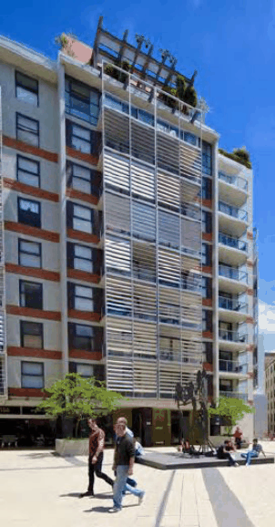

#### 15.4.5 Landscaping - Area A

#### Objectives:

#### Station East

#### (B4 Mixed Use

#### Zone)

■ To encourage a high standard of landscape design which enhances the streetscape and amenity of the zone.

■ To encourage innovative landscape design throughout the built form by enhancing

> [Picture on page 30: a picture, saved as a picture (images/vol-2-part-15-glenfield-east-development-control-plan-page-30-9.gif, 150 dpi).]

opportunities for rooftop landscaping.

#### 15.4.5.2 Landscaping

1\.	 Green roofs are encouraged on all buildings (including alterations and additions) which have a total gross floor area exceeding 2,000sqm. The required size of the green roof area, inclusive of any area for solar panels or the like, shall be in accordance with the following site areas:

b.	 2,000 to 4,999m²—20% of roof space;

c.	 5,000 to 9,999m²—30% of roof space;

d.	 10,000 to 14,999m²—40% of roof space;

e.	 15,000 to 19,999m²—50% of roof space; and

f.	 20,000m² or greater—60% of roof space.

2\.	 Green roof areas proposed to be used for communal open space shall be designed to a high standard in order to enhance the aesthetics of the building and include enough soil depth for planting. Note: Volume 1 of the SCDCP and the Apartment Design Guide have additional landscaping requirements.

Figure 15.4.5.1 - Example of urban square integrated with mixed use building (source: DPE ADG, 2015)
