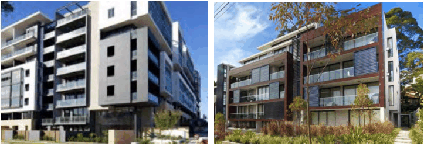
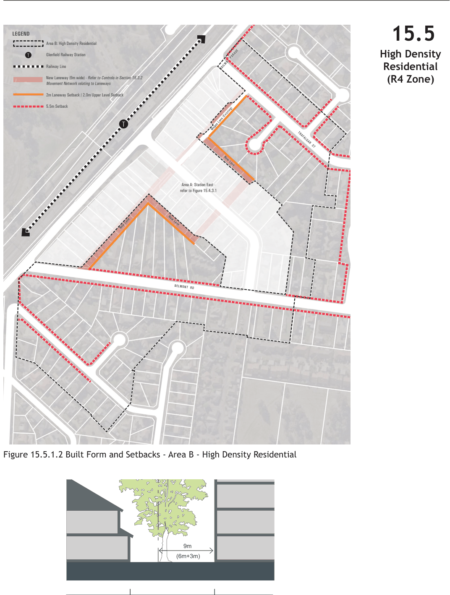

### 15.5 Area B - High Density Residential Character Area (R4 Zone)

#### High Density

#### Residential

#### 15.5.1 Desired Future Character Statement - Area B

#### (R4 Zone)

The areas adjacent to the B4 Mixed-use zone will provide high density residential development in the form of multi-storey apartment buildings up to 8 storeys in height. This area’s transformation will require the coordinated consolidation of properties to accommodate the scale of buildings proposed and intended densities. In addition, appropriate amenity for future residents is also required in terms of better solar access, additional communal open space and maintaining existing significant vegetation in the Precinct. Streets will be lined with trees and good pathway connections are proposed which are intended to provide better accessibility to transport, schools and quality open space areas located within 400m walking distance.

#### Objectives:

■ To provide building forms that have a high level of architectural merit and make a positive contribution to the local area.

■ To provide appropriate transition and minimise amenity impacts adjacent to lower density development.

■ To encourage a diversity of high density residential forms.

■ To facilitate residential forms that provide high quality residential living environments.

■ To provide integration with high intensity public transport forms and fine grained pedestrian/ cycleway networks.

■ To encourage a high quality public domain.

■ To provide articulated front facades with balconies and deep soil planting and landscaping of street frontages.

> [Picture on page 32: a picture, saved as a picture (images/vol-2-part-15-glenfield-east-development-control-plan-page-32-28.gif, 150 dpi).]

Figure 15.5.1.1 - Examples of High Density Residential Apartment Buildings (source: DPE ADG, 2015)

Controls

development on adjacent lands.

#### 15.5.1.1 General

#### High Density

#### Residential

4\.	 Blank walls with minimal articulation which face any boundary will not be permitted.

#### (R4 Zone)

1\.	 Residential development within the

R4 High Density residential zone shall be designed to reflect full compliance with Part 5: Residential Flat Buildings and Mixed-use Development of the Campbelltown (Sustainable City) Development Control Plan 2015.

#### 15.5.1.2 Built Form and Setbacks

1\.	 Front, side and rear setbacks from laneways shall be in accordance with the Built Form and Setbacks Plan at Figure 15.5.1.2 of this DCP.

#### Note:

2\.	 Provide increased setbacks (+3m) when adjacent to an R3 Medium Density Residential zone to address amenity impacts and allow for additional landscaping. Refer to Figure 15.5.1.3. Setbacks shall be provided in accordance with the following:

a.	 For buildings up to 4 storeys: 6.0m for a blank wall or non-habitable room, and 9m to a defined ‘habitable room’ or balcony;

b.	 For buildings 5 to 8 storeys: 7.5m for a blank wall or non-

Any permitted form of residential development containing 3 or more storeys and 4 or more dwellings shall satisfy the standards of State Environmental Planning Policy No. 65 - Design Quality of Residential Apartment Development (SEPP 65) and the Apartment Design Guide (NSW Department of Planning and Environment, July 2015). SEPP 65 and the ADG shall prevail in the event of any inconsistency with this DCP.

habitable room, and 12m to ‘habitable room’ or balcony.

3\.	 Amalgamation of sites will typically be required to achieve the required setbacks.  Variation to the above setbacks will only be considered where built form modelling is undertaken which demonstrates an appropriate transition between the proposed development and existing/future

> [Picture on page 34: a picture, saved as a picture (images/vol-2-part-15-glenfield-east-development-control-plan-page-34-1.gif, 150 dpi).]
> Words printed on the picture (title and legend, copied from the PDF):
> Objective 3F-1
> LEGEND
> Area B: High Density Residential
> Glenfield Railway Station
> T
> Adequate building separation distances are shar
> between neighbouring sites, to achieve reasonab
> external and internal visual privacy
> Railway Line
> RAILWAY  PARADE
> New Laneway (9m wide) - Refer to Controls in Section 15.3.2
> Movement Network relating to Laneways
> 2m Laneway Setback / 2.0m Upper Level Setback
> 5.5m Setback
> T
> 9m
> 5th
> Magee Lane (Existing) 5th
> 1\. Separation between windows and balco
> provided to ensure visual privacy is achi
> Minimum required separation distances
> buildings to the side and rear boundaries
> follows:
> 4th
> 4th
> TRAFALGAR  ST
> Side or rear  boundary
> 3rd
> 3rd
> could be
> Building height
> Habitable
> New Lane
> <6m 6m
> balconies
> 2nd
> 2nd
> up to 12m  (4 storeys) 6m
> 1st
> 1st
> Area A: Station East -
> refer to Figure 15.4.3.1
> up to 25m  (5-8 storeys) 9m
> Existing
> New development
> over 25m  (9+ storeys) 12m
> New Lane
> New Lane
> provide adequate separation distances to the boundary
> in accordance with the design criteria
> Note: Separation distances between buildings
> site should combine required building se
> depending on the type of room (see figu
> 8th
> BELMONT  RD
> 8th
> 7th
> 9m
> 9m
> 6th
> 7th
> Gallery access circulation should be trea
> habitable space when measuring privacy
> distances between neighbouring propert
> 5th
> 6th
> 6m
> 4th
> 9m
> 5th
> 4th
> 3rd
> 3rd
> 6m
> 2nd
> 6m
> Generally one step in the built form as the height
> due to building separations is desirable. Addition
> should be careful not to cause a 'ziggurat' appea
> 2nd
> 1st
> 1st For residential buildings next to commercial build
> separation distances should be measured as foll
> • for retail, office spaces and commercial balcon
> habitable room distances
> • for service and plant areas use the non-habita
> distances
> shared equitably between buildings. On sloping sites,
> appropriate separation distances ensure visual privacy
> for apartments on different levels
> New development should be located and oriente
> maximise visual privacy between buildings on sit
> neighbouring buildings. Design solutions include
> • site layout and building orientation to minimise
> impacts (see also section 3B Orientation)
> • on sloping sites, apartments on different level
> appropriate visual separation distances (see f
> 9m
> (6m+3m)
> Apartment buildings should have an increased s
> distance of 3m (in addition to the requirements s
> design criteria 1) when adjacent to a different zon
> permits lower density residential development to

Figure 3F.3 New development adjacent to existing buildings should

Figure 3F.4 Within the same site, minimum separation should be

Figure 15.5.1.2 Built Form and Setbacks - Area B - High Density Residential

#### High Density

#### Residential

#### Design criteria

#### (R4 Zone)

rooms and h

#### Design guidance

a transition in scale and increased landscaping (

Higher density

Lower density

Direct lines of sight should be avoided for window balconies across corners

Figure 15.5.1.3 - Increased setback adjacent to R3 Zone (source: DPE, ADG 2015)

Figure 3F.5 To resolve amenity impacts, apartment buildings should increase the building separation distance (+3m) when adjacent to a different zone that permits lower density residential development

No separation is required between blank walls

Apartment Design Gu

Apartment Design Gu
