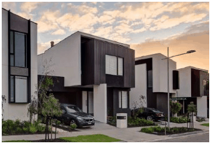
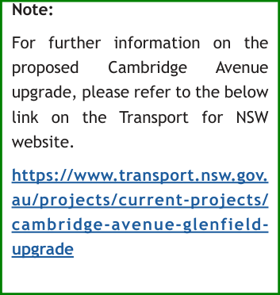

### 15.6 Area C - Medium Density Residential Character Area (R3 Zone)

#### Medium Density

#### Residential

#### (R3 Zone)

#### 15.6.1 Desired Future Character Statement - Area C

The remaining areas within the Glenfield East Precinct  are located in the R3 Medium Density Residential Zone. This will lead to the replacement of the aging dwelling stock within Area C with contemporary building forms which exhibit the highest levels of quality design. Consolidation of properties will also be encouraged to further facilitate providing a wider range of housing choices, in addition to creating further opportunities for attached dwellings and multi-dwelling housing to be constructed within this precinct. Safe, convenient pedestrian and suitably designed cycle connections will be constructed along key streets to the Glenfield railway station, school and nearby open-space areas while planting will further enhance Glenfield  East as an attractive and liveable precinct.

#### Objectives:

■ To provide medium density housing comprising two storey attached dwellings and multi dwelling housing in a landscaped setting with additional habitable areas provided within the roof space.

■ To provide appropriate transition in built form and reduce amenity impacts where a change in building height occurs.

■ To require development footprints that are sited to achieve setbacks to boundaries and provide for quality landscaping and private open space.

■ To encourage articulated front facades where garages and car parking spaces are setback and do not dominate the streetscapes.

■ To encourage active residential facades with balconies.

■ To promote soft landscaping along communal driveways and the front boundary.

■ To encourage a high standard of architectural merit with quality designed buildings.

■ To provide development that incorporates a mix of dwelling sizes to provide further housing choice.

Note: the R3 Medium Density Zone prohibits residential flat buildings (RFBs).

Controls

#### Note:

#### 15.6.1.1 General

#### Medium Density

#### Residential

#### (R3 Zone)

1\.	 Residential development within the

R3 Medium Density zone shall be designed in accordance with all the requirements specified in ‘Part 3: Low and Medium Density Residential Development and Ancillary Structures’ of the Campbelltown (Sustainable City) Development Control Plan 2015.

#### 15.6.1.2 Side and Rear Setbacks - For any

proposed development containing 3 or more storeys

Any permitted form of residential development containing 3 or more storeys and 4 or more dwellings shall satisfy the standards of State Environmental Planning Policy No. 65 - Design Quality of Residential Apartment Development (SEPP 65) and the Apartment Design Guide (NSW Department of Planning and Environment, July 2015). SEPP 65 and the ADG shall prevail in the event of any inconsistency with this DCP.

> [Picture on page 36: a picture, saved as a picture (images/vol-2-part-15-glenfield-east-development-control-plan-page-36-31.gif, 150 dpi).]

1\.	 The side and rear building setback shall provide the following setbacks to reduce amenity impacts and allow for additional landscaping:

b.	 For buildings up to 4 storeys: 3.0m for a blank wall or non-habitable room, and 6m to a ‘habitable room’ or balcony;

c.	 For buildings of over 5 storeys: 4.5m for a blank wall or non-habitable room, and 9m to a ‘habitable room’ or balcony.

Figure 15.6.1.1 - Examples of Medium Denisty Residential Development (source: DPIE, 2020)

> [Picture on page 36: a picture, saved as a picture (images/vol-2-part-15-glenfield-east-development-control-plan-page-36-47.gif, 150 dpi).]

2\.	 Amalgamation of sites may be required to achieve the required setbacks.

#### Note:

Variation to the above setbacks will only be considered where built form modelling is undertaken which demonstrates an appropriate transition between the proposed development and existing/future development on adjacent lands.

For further information on the proposed Cambridge Avenue upgrade, please refer to the below link on the Transport for NSW website. https://www.transport.nsw.gov. au/projects/current-projects/ cambridge-avenue-glenfield-upgrade

3\.	 For all new development applications that will be potentially impacted by the proposed Cambridge Avenue Upgrade and involves the construction of new buildings, the applicant shall provide evidence to Council of consultation with TfNSW on the required setbacks as part of the development applications.

### Page left blank

### intentionally

> [Picture on page 38: a picture, saved as a picture (images/vol-2-part-15-glenfield-east-development-control-plan-page-38-1.gif, 150 dpi).]

#### Campbelltown City Council, PO Box 57, Campbelltown, NSW 2560
