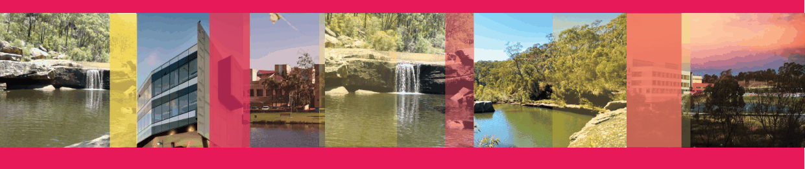

# Campbelltown Sustainable City Development Control Plan 2015 - Part 15 Glenfield East Development Control Plan

> This chapter is split into 22 section file(s), one per numbered heading, in the order they appear in the PDF.

Source PDF: [volume-2-part-15-glenfield-east.pdf](volume-2-part-15-glenfield-east.pdf)

### Campbelltown

### (Sustainable City)

### Development Control

### Plan 2015

> [Picture on page 1: a picture, saved as a picture (images/vol-2-part-15-glenfield-east-development-control-plan-page-1-5.gif, 150 dpi).]

### VOLUME 2

### VOLUME 2

### Site Specific DCPs

## Part 15:  Glenfield East

### Creating Campbelltown's Future 2025

| Table of Contents | 2 |
|---|---|
| 15.1.1 Glenfield Precinct | 2 |
| 15.1.2 Land to which this part applies | 2 |
| 15.1.3 Background and purpose of this part | 3 |
| 15.1.4 Background: A New Vision, Place Strategy and Structure Plan for Glenfield | 3 |
| 15.1.5 Relationship to Campbelltown (Sustainable City) DCP | 5 |
| 15.2.1 Existing Character: Glenfield East | 8 |
| 15.2.2 Glenfield East: Vision Desired Future Character and Development Principles | 10 |
| 15.3.1 Staging Plan | 13 |
| 15.3.2 Provisions of Height and Density - CLEP 2015 | 13 |
| 15.3.3 Movement Network | 15 |
| 15.3.4 Car Parking - Glenfield East | 18 |
| 15.3.5 Landscape Strategy and Character | 20 |
| 15.3.6 Flood-Affected Land | 21 |
| 15.4 Area A - Station East (B4 Mixed Use Zone) | 22 |
| 15.5 Area B - High Density Residential Character Area (R4 Zone) | 31 |
| 15.6 Area C - Medium Density Residential Character Area (R3 Zone) | 34 |
| 15.7 References List | 36 |

<!-- sections -->
## Sections

1. [15.1.1 Glenfield Precinct](01-15-1-1-glenfield-precinct.md)
2. [15.1.2 Land to which this part applies](02-15-1-2-land-to-which-this-part-applies.md)
3. [15.1.3 Background and purpose of this part](03-15-1-3-background-and-purpose-of-this-part.md)
4. [15.1.4 Background: A New Vision, Place Strategy and Structure](04-15-1-4-background-a-new-vision-place-strategy.md)
5. [15.1.5 Relationship to Campbelltown (Sustainable City) DCP](05-15-1-5-relationship-to-campbelltown-sustainable.md)
6. [15.2.1 Existing Character: Glenfield East](06-15-2-1-existing-character-glenfield-east.md)
7. [15.2.2 Glenfield East: Vision Desired Future Character and Development Principles](07-15-2-2-glenfield-east-vision-desired-future.md)
8. [15.3.1 Staging Plan](08-15-3-1-staging-plan.md)
9. [15.3.2 Provisions of Height and Density - CLEP 2015](09-15-3-2-provisions-of-height-and-density-clep.md)
10. [2 Where development is located within or adjacent to a site containing a change in](10-2-where-development-is-located-within-or.md)
11. [15.3.3 Movement Network](11-15-3-3-movement-network.md)
12. [15.3.4 Car Parking - Glenfield East Precinct](12-15-3-4-car-parking-glenfield-east-precinct.md)
13. [15.3.5 Landscape Strategy and Character](13-15-3-5-landscape-strategy-and-character.md)
14. [15.3.6 Flood-Affected Land](14-15-3-6-flood-affected-land.md)
15. [15.4.1 Desired Future Character Statement - Area A](15-15-4-1-desired-future-character-statement-area.md)
16. [15.4.2 Site Requirements - Area A](16-15-4-2-site-requirements-area-a.md)
17. [15.4.3 Built Form -Area A](17-15-4-3-built-form-area-a.md)
18. [15.4.4 Services, Safety and Amenity - Area A](18-15-4-4-services-safety-and-amenity-area-a.md)
19. [15.4.5 Landscaping - Area A](19-15-4-5-landscaping-area-a.md)
20. [15.4.6 Access and Connectivity - Area A](20-15-4-6-access-and-connectivity-area-a.md)
21. [15.5.1 Desired Future Character Statement - Area B](21-15-5-1-desired-future-character-statement-area.md)
22. [15.6.1 Desired Future Character Statement - Area C](22-15-6-1-desired-future-character-statement-area.md)
