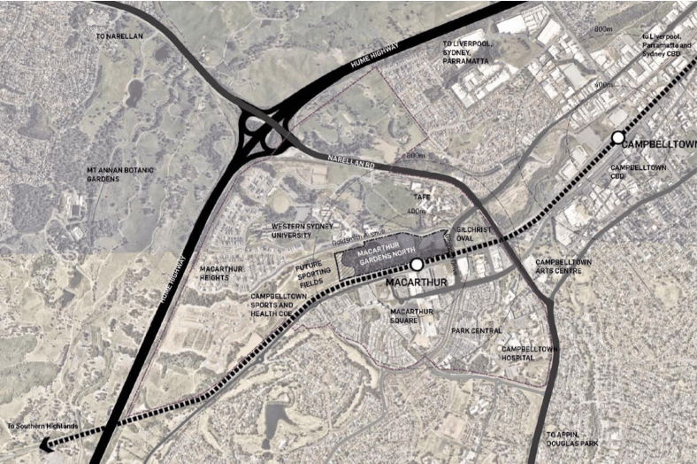
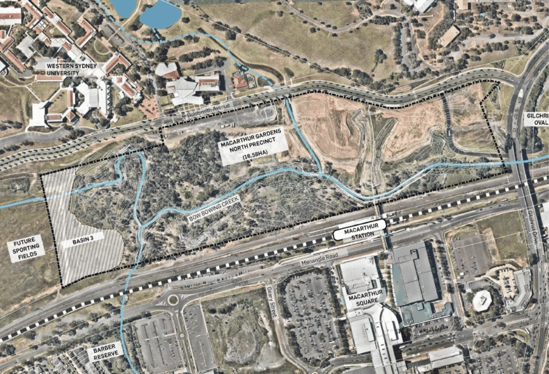
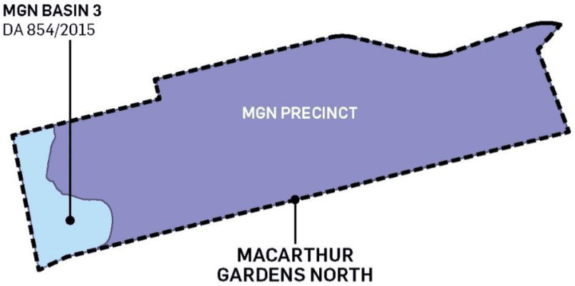
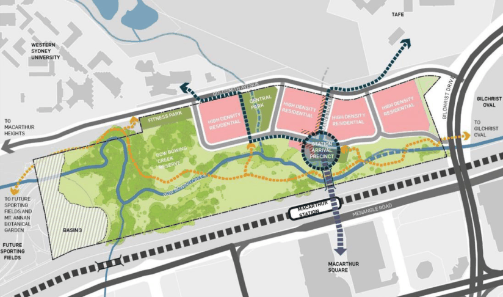
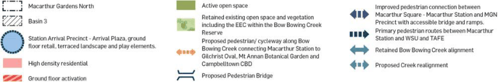

## Part 16 Macarthur Gardens

### North Precinct

### 16.1 Application

#### 16.1.1 Land to which this Part applies

#### Application

This Part applies to the Macarthur Gardens North Precinct which is located immediately north of the Macarthur train station and south of both the Western Sydney University and TAFE sites (refer Figure 16.1 and 16.2 below).

> [Picture on page 2: a picture, saved as a picture (images/vol-2-part-16-macarthur-gardens-north-precinct-page-2-7.gif, 150 dpi).]

Figure 16.1: Macarthur Gardens North Precinct

> [Picture on page 2: a picture, saved as a picture (images/vol-2-part-16-macarthur-gardens-north-precinct-page-2-9.gif, 150 dpi).]

Figure 16.2: Macarthur Gardens North Precinct

As illustrated above, the Macarthur Gardens North site comprises two separate

sub-precincts:

#### Application

i) Macarthur Gardens North Apartment Precinct (MGN Precinct): The subject site of this Part (Part 16)

ii) Macarthur Gardens North Basin 3 (MGN Basin 3 Precinct): Located to the western end of the Precinct.

Figure 1.3 below illustrates the 2 sub precincts that comprise Macarthur Gardens North.

> [Picture on page 3: a picture, saved as a picture (images/vol-2-part-16-macarthur-gardens-north-precinct-page-3-9.gif, 150 dpi).]

Figure 16.3: Macarthur Gardens North Sub Precincts

The following parts of the Campbelltown (Sustainable City) Development Control Plan apply to the land within the MGN Precinct (the subject of this Part) as shown in Figure

16.3 above:

Volume 1: Part 2 Requirements applying to all Types of Development

Volume 1: Part 9 Public Consultation, and

Volume 2: Part 16 Macarthur Gardens North Precinct.

Notes:

i) Where a site specific DCP does not include specific development controls for a certain type of development, the development controls under Volume 1 of Campbelltown City Councils' Sustainable City Development Control Plan (SCPDCP) shall be used to assess the development applications received by Council.

ii) Where there is an inconsistency between the provision of Part 16 and Volume 1 of the Plan, the provision under Part 16 shall prevail to the extent of the inconsistency.

iii) Campbelltown City Council Engineering Design Guide for Development also applies to development specified in this Part.

#### 16.1.2 Structure Plan

#### Application

The overall Macarthur Garden North Precinct (Lot 1097 / DP 1182558) is bound by Goldsmith Avenue to the North, Gilchrist Drive to the East and the southern railway line to the South. The site sits in the broader Macarthur region, which is a rapidly expanding and developing area. The region is the major destination for retail, tertiary education and health services.

The Precinct is located immediately north of the Macarthur train station and south of both the Western Sydney University and TAFE sites. In addition to public transport and education establishments MGN has good access to local services and amenities including the Macarthur Square Shopping Centre, Campbelltown Mall and Campbelltown Hospital and network of open spaces that includes Gilchrist Oval and new sporting fields on the south western end of the site.

The MGN Precinct is to be developed in accordance with the Structure Plan at Figure

16.4 below. The Structure Plan provides for the retention of the existing Bow Bowing Creek alignment and its biodiversity as an open space asset that is accessible and creates amenity to the future community. The plan provides for an arrival plaza and park to Macarthur Station that integrates the Precinct with the Western Sydney University and TAFE through a series of activated streets and open spaces. A regional east-west cycleway network traverses the open space to be retained along the existing creek which will enhance access to and an appreciation of the biodiversity values within the Precinct.

The overall Macarthur Garden North Precinct has an area of 18.52ha with the MGN Precinct (the subject of this Part) comprising 16.6ha centrally located within the Precinct. The sub-precinct is bookended to the east by Gilchrist Drive and to the west by Basin 3 and the future Macarthur Heights sporting fields. The MGN Precinct includes the Bow Bowing Creek and associated open space areas and the proposed Station Arrival Precinct located on the proposed north south spine connection and high density residential and mixed use development to the north adjacent to Goldsmith Avenue (as illustrated in Figure 16.4 below).

In summary the Structure Plan for the MGN provides for:

### Application • the retention of 87% of the existing Bow Bowing Creek alignment and its

biodiversity as an open space asset which is accessible and creates amenity to the future communities;

### • a station arrival plaza and park connected to Macarthur Station that integrates

the Western Sydney University and TAFE through a series of activated streets and open spaces

### • six (6) high density residential development lots located along Goldsmith Avenue

and anchored around the station;

### • a dedicated pedestrian/ cycleway along Bow Bowing Creek Reserve connecting

Gilchrist Oval to the new Sporting Field complex and ultimately to Mt Annan Botanical Garden to the west;

### • ground level retail / commercial along the station arrival plaza and main street

to provide vibrancy and activation;

### • three new active open spaces comprising the Station Arrival Plaza, Central Park

and Fitness Park; and

### • well-connected and permeable streets.

> [Picture on page 5: a picture, saved as a picture (images/vol-2-part-16-macarthur-gardens-north-precinct-page-5-18.gif, 150 dpi).]

> [Picture on page 5: a picture, saved as a picture (images/vol-2-part-16-macarthur-gardens-north-precinct-page-5-19.gif, 150 dpi).]

Figure 16.4: Macarthur Gardens North Overall Structure Plan
