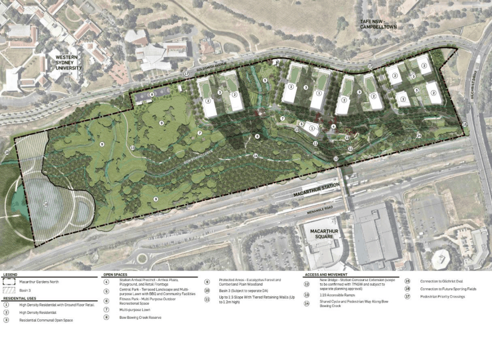

### 16.2 Vision and Objectives

#### 16.2.1 Guiding Principles

Vision and

#### Objectives

The MGN Precinct is to be developed having regard to the following guiding principles:

### • Celebrate the Natural Assets

Embrace the natural asset provided by Bow Bowing Creek Reserve, and extend the landscape feature across the whole precinct. This landscape feature enriches leisure and recreational opportunities at MGN whilst maintaining the natural frontage along the railway corridor;

### • Seamless Connections to Key Destinations

Create an active transport network that is well integrated with both the natural amenity of Bow Bowing Creek Reserve and Macarthur Station. This integration will enhance the pedestrian and cyclist experience, provide better connectivity to WSU and TAFE and ultimately, encourage the use of active transport;

### • A New Community with Access to Jobs

Provide a mix of dwelling typologies, close to the amenity of Bow Bowing Creek and with convenient access to Macarthur Station to support a diverse community;

### • Contextual Built Form Responses

Adopt a sensible building envelope that responds to the surrounding context and public domain to optimise visual and solar amenity within the Precinct; and

### • Activated Places for People

Create a series of activated places that includes a station arrival precinct at the heart of MGN, a community park that integrates the north south tributary to Bow Bowing Creek and a fitness park close to WSU.

#### 16.2.2 Vision

Vision and

#### Objectives

The MGN Precinct will celebrate the natural assets of Bow Bowing Creek and connect this to the community. It will be an attractive urban place for people to live in - a diverse, healthy, vibrant and sustainable new neighbourhood. Designed with ‘place’ in mind, the new community is underpinned by sustainability principles and high-quality public domain and built form outcomes.

To enable this vision, the MGN Precinct will deliver:

• A new residential community who will live in high-density apartment buildings;

• Ground floor retail to support the new community and active the public domain;

• An arrival plaza and park on the northern side of Macarthur Station that links to the precinct’s key destinations being Western Sydney University, TAFE, MGN and Bow Bowing Creek;

### • Active transport via a regional East-West cycle network and walking paths around

significant area of open space that retains the existing creek and biodiversity values;

• Safer and more comfortable connections from the site to the station, WSU, TAFE, Gilchrist Oval and the new Sporting Field complex through a series of high quality new open spaces such as the Bow Bowing Creek Reserve;

• Attractive and tree covered streets and public places; and

### • Retention and enhancement of Bow Bowing Creek, the local blue grid.

#### 16.2.3 Masterplan

Vision and

#### Objectives

The MGN Precinct is to be developed generally in accordance with the Masterplan illustrated at Figure 16.5:

> [Picture on page 8: a picture, saved as a picture (images/vol-2-part-16-macarthur-gardens-north-precinct-page-8-6.gif, 150 dpi).]

Figure 16.5: Macarthur Gardens North Precinct Masterplan

Development within the site is to be in accordance with the strategies and controls outlined below under the key headings of:

• Natural Systems;

• Access and Movement;

• Land Use;

• Built form; and

### • Landscape and Public Domain

as well as other relevant controls outlined herein.
