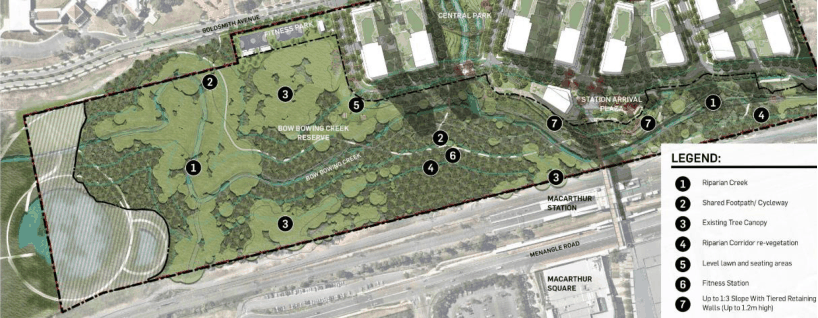
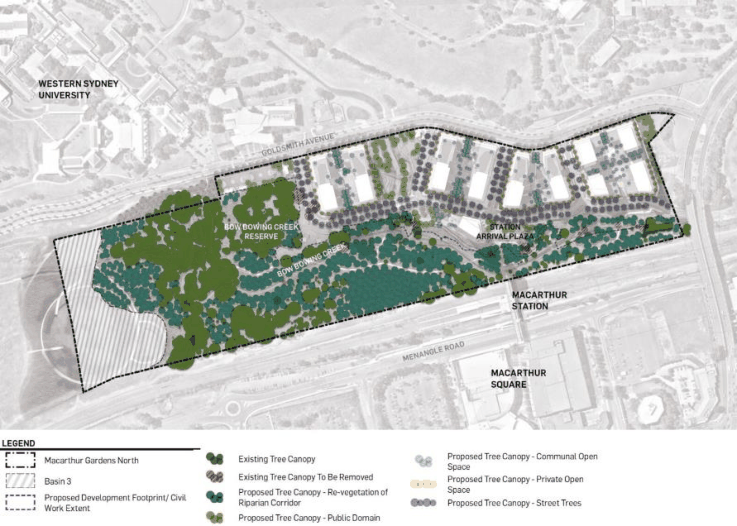

### 16.3 Natural Systems

#### 16.3.1 Objectives

#### Natural Systems

3.1.1 Protect and enhance MGN’s natural assets including Bow Bowing Creek and its biodiversity values.

3.1.2 Provide new open spaces around this amenity and increase tree canopy cover.

3.1.3 Maintain and enhance the existing ‘green edge’ north of the railway line.

#### 16.3.2 Required Outcomes

Bow Bowing Creek Reserve and Riparian Corridor

3.2.1 Development is to provide for the protection and enhancement of the Bow Bowing Creek Reserve generally in accordance with Figure 16.6.

3.2.2 Bow Bowing Creek Reserve is to serve as a passive recreational amenity for the surrounding communities and include a shared pedestrian / cycleway that runs along the creek.

3.2.3 A native vegetation buffer is to be provided adjacent to the rail corridor to reduce its visual impact and provide a landscape setting for the future development.

3.2.4 All riparian and revegetation works are to be in accordance with the Riparian Assessment (Eco Logical Australia, 2021) and Bushfire Protection Assessment (Eco Logical, 2021) and are to improve the biodiversity corridor for the native flora and fauna by offsetting and revegetating impacted riparian zones.

> [Picture on page 9: a picture, saved as a picture (images/vol-2-part-16-macarthur-gardens-north-precinct-page-9-22.gif, 150 dpi).]

Figure 16.6: Bow Bowing Creek Reserve

#### Vegetation and Tree Canopy Cover

#### Natural Systems

3.2.5 Development on site is to provide for an increase in the tree canopy cover (over and above the standard minimum of 40%) to greater than 50% of the Precinct generally in accordance with Figure 16.7.

#### 3.2.6 Strategies to increase tree canopy cover are to include:

a) Revegetation of Bow Bowing Creek Reserve with native species, and

b) Implementation of a tree planting strategy within the public and private domains including the streetscape, active parks, private open space and communal open space.

3.2.7 Cumberland Plain Woodland & Riverflat Eucalyptus vegetation communities that are classified as Endangered Ecological Communities (EECs) are to be managed in accordance with the Biodiversity Development Assessment Report prepared by Eco Logical (2021).

> [Picture on page 10: a picture, saved as a picture (images/vol-2-part-16-macarthur-gardens-north-precinct-page-10-16.gif, 150 dpi).]

Figure 16.7: Proposed Tree Canopy Cover
