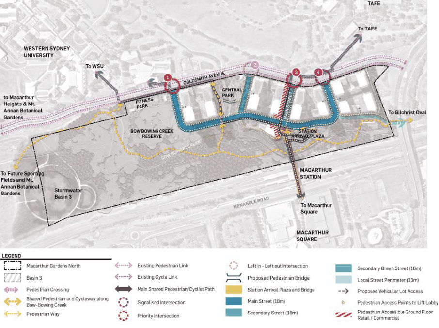

### 16.4 Access and Movement

Access and

#### 16.4.1 Objectives

#### Movement

4.1.1 Ensure integration of a variety of transport modes and ensure safety and accessibility for pedestrians and cyclists.

4.1.2 Prioritise public and active transport as a mode of transport  over private motor vehicles.

#### 16.4.2 Required Outcomes

4.2.1 Development within the Precinct is to be generally in accordance with the access and movement strategy illustrated in Figure 16.8.

> [Picture on page 11: a picture, saved as a picture (images/vol-2-part-16-macarthur-gardens-north-precinct-page-11-12.gif, 150 dpi).]

Figure 16.8: Access and movement strategy

#### Active Transport Network

Access and

#### Movement

4.2.2 A shared pedestrian/ cycleway is to be provided along Bow Bowing Creek connecting Macarthur Station to future sporting fields and Mt. Annan Botanical Gardens to the west and Gilchrist Oval to the east. It is also to link to the main street network within the Precinct and existing cycleway along Goldsmith Avenue.

4.2.3 A permeable and continuous pedestrian network along streets and public open spaces is to be provided to create connectivity with Macarthur Station, the University and TAFE, and surrounding residential areas that promotes a safe pedestrian environment with including three main pedestrian priority crossings along Goldsmith Avenue generally as illustrated on Figure 16.8.

4.2.4 An accessible pedestrian access is to be provided from Macarthur Station to the Station Arrival Plaza via an appropriate bridge and ramps.

Note: It is recommended to consult with TfNSW and Sydney Trains as part of the design and construction phases of the Pedestrian Bridge.

4.2.5 Accessible pedestrian access is to be provided to lift lobbies within the northern and southern part of the residential blocks.

#### Street Network

4.2.6 An interconnected street network is to be provided that promotes a safe pedestrian environment with varied typologies based on the lot frontage and streetscape treatment.

4.2.7 All street sections are to provide a min. 6.0m carriageway and to be generally in accordance with the key plan and relevant sections illustrated in Figures 16.9 –
