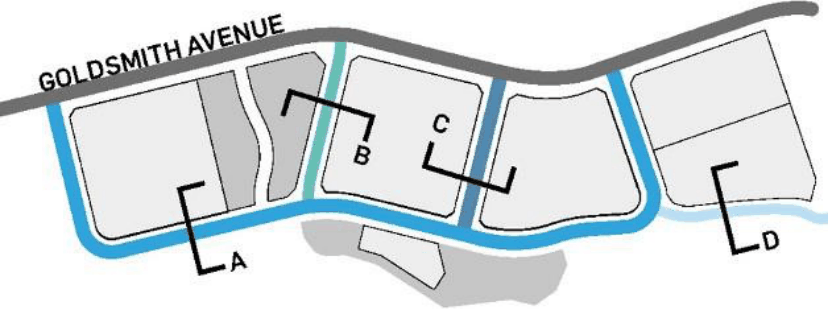
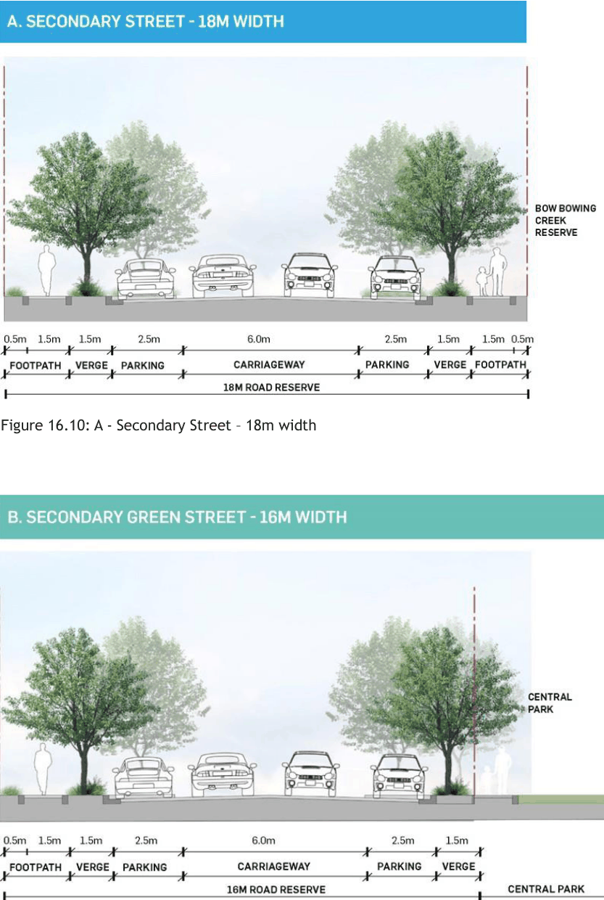
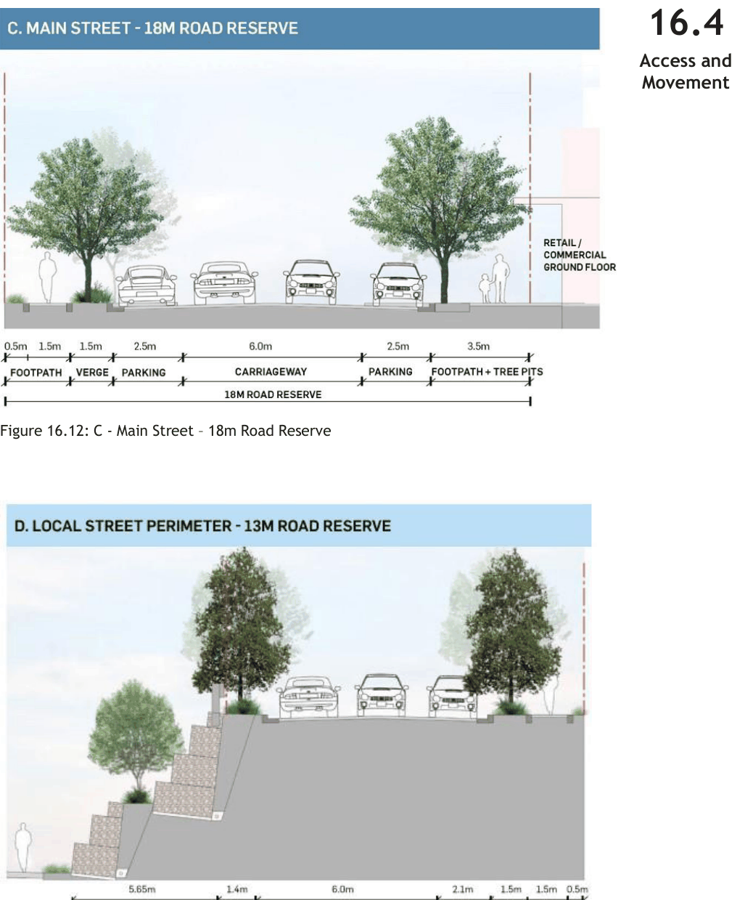

### 16.12 (incl.) below:

> [Picture on page 12: a picture, saved as a picture (images/vol-2-part-16-macarthur-gardens-north-precinct-page-12-26.gif, 150 dpi).]

Figure 16.9: Street section key plan

Access and

#### Movement

> [Picture on page 13: a picture, saved as a picture (images/vol-2-part-16-macarthur-gardens-north-precinct-page-13-3.gif, 150 dpi).]

Figure 16.10: A - Secondary Street – 18m width

Figure 16.11: B - Secondary Green Street – 16m width

> [Picture on page 14: a picture, saved as a picture (images/vol-2-part-16-macarthur-gardens-north-precinct-page-14-1.gif, 150 dpi).]

Access and

#### Movement

Figure 16.12: C - Main Street – 18m Road Reserve

Figure 16.13: D – Local Street Perimeter – 13m Road Reserve

#### Parking Requirements

Access and

#### 4.2.8 Car parking is to be provided at a rate of:

#### Movement

a) 0.6 Car Parking Space / Studio Unit / 1 BR Unit

b) 0.9 Car Parking Space / 2BR Unit

c) 1.4 Car Parking Space / 3BR Unit

d) 0.1 Car Visitor Parking Space / Dwelling

e) 1 space per 95m2 of retail GFA

4.2.9 A minimum of 10 car share spaces are to be provided within the development.

4.2.10 Bicycle parking is to be provided at a rate of one space per 3 apartments and one visitor space per 12 apartments.

4.2.11 All car parking and access for vehicles, including disabled access spaces, shall be in accordance with AS2890 parts 1 and 2 (as amended), except as otherwise specified in this Plan.

4.2.12 For development incorporating 20 or more dwellings, the DA shall be accompanied

by a ‘Traffic Impact Assessment Report’.

Note: For requirements relating to the preparation of a ‘Traffic Impact Assessment Report’ refer to Appendix 12 of Volume 1 of the SCDCP.’

4.2.13 All required private car parking is to be provided at basement level.

4.2.14 Pedestrian access to residential flats shall be separated from the commercial/

retail uses.

4.2.15 Development shall provide adequate space for the on-site parking, loading and unloading of all delivery/ service vehicles.

4.2.16 The design of car parking spaces shall take into consideration the principles of Crime Prevention Through Environmental Design (CPTED) to minimise opportunities for crime and enhance security.
