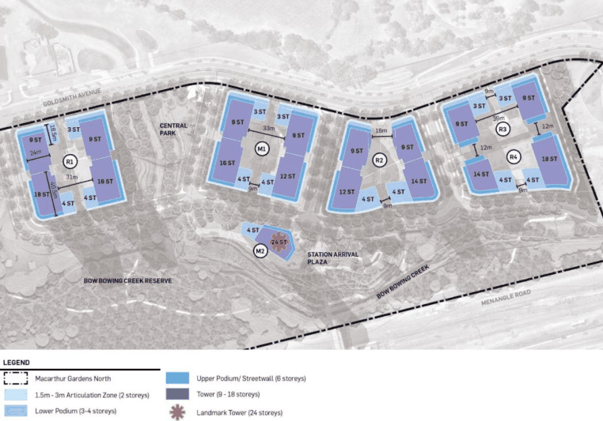
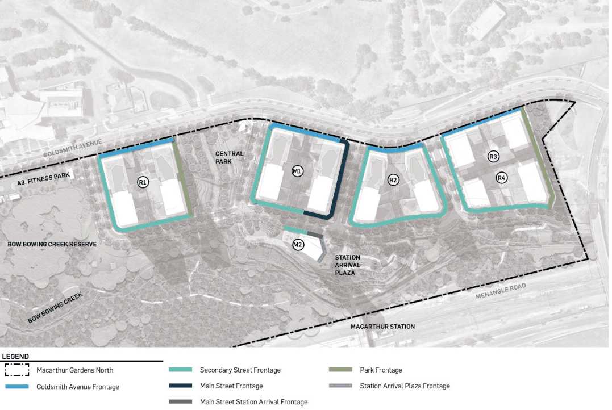
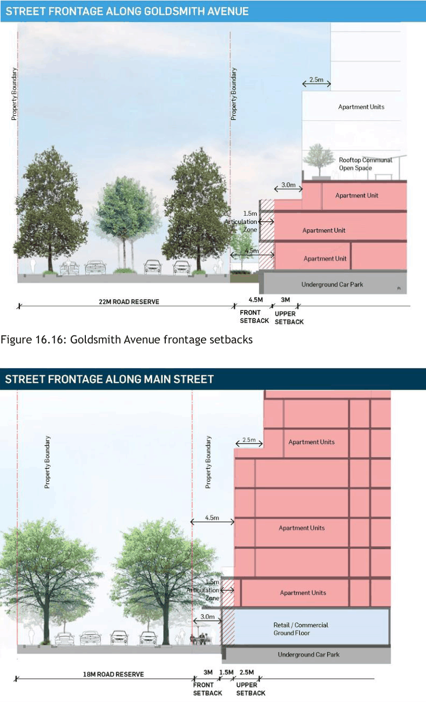
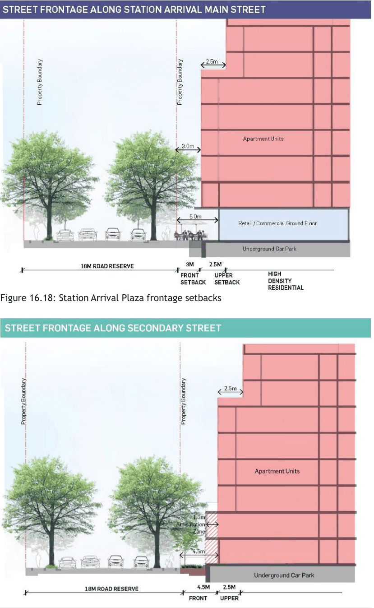
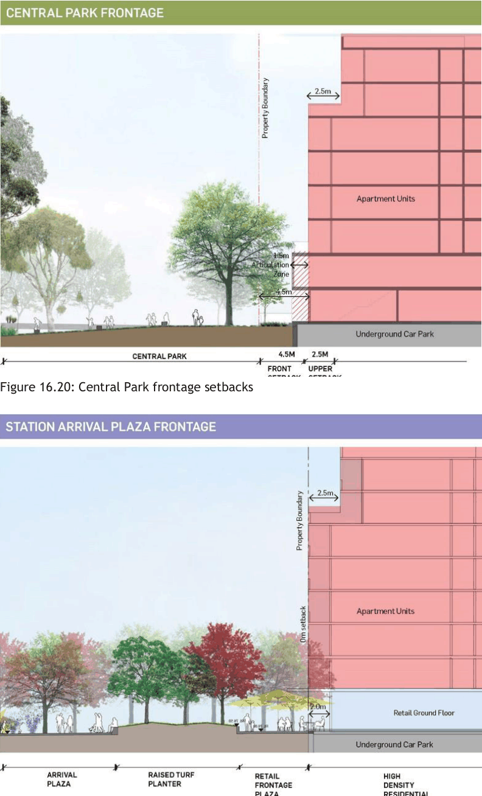
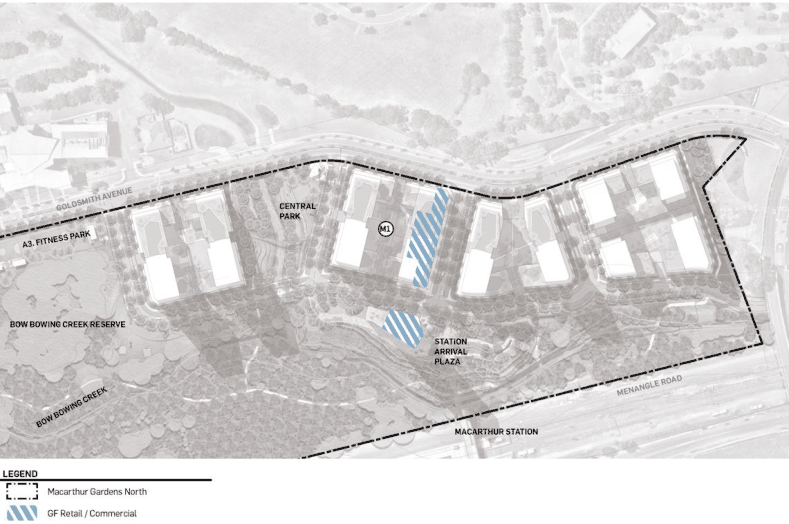

### 16.5 Built Form

#### 16.5.1 Objectives

#### Built Form

5.1.1 Provide for development of the site in accordance with the principles of design excellence and best practice consistent with the Apartment Design Guide (ADG).

5.1.2 Ensure territorial definition between private and public realm to ensure privacy, passive surveillance and safety.

#### 16.5.2 Required Outcomes

5.2.1 Development within the Precinct is to be generally in accordance with the Built Form Strategy illustrated in Figure 16.13 below in terms of maximum height in storeys and building footprint.

5.2.2 Residential flat and mixed use buildings are to comply with the requirements of the Apartment Design Guide.

5.2.3 Building setbacks are to comply with Table 16.1, Figure 16.14 and street sections Figures 16.15 – 20 below

> [Picture on page 16: a picture, saved as a picture (images/vol-2-part-16-macarthur-gardens-north-precinct-page-16-16.gif, 150 dpi).]

Figure 16.14: Built Form Strategy

Note:

All residential flat buildings and mixed-use development containing 3 or more storeys and 4 or more dwellings shall satisfy the standards of SEPP 65 - Design Quality of Residential Apartment Development and the Apartment Design Guide (NSW Department of Planning and Environment, July 2015). SEPP 65 and the ADG shall prevail in the event of any inconsistency with this DCP.

#### Built Form

| Goldsmith Main Street Station Avenue frontage Arrival frontage Main Street frontage | Secondary Street and Central Park frontage | Station Arrival Plaza frontage |
|---|---|---|
| GF | 4.5m 3.0m 5.0m 4.5m 2.0m |  |
| L1 | 4.5m with 4.5m with 3.0m 4.5m with 0m (zero 1.5m 1.5m 1.5m setback) articulation articulation articulation zone zone zone |  |
| L2-L5 | 7.5m 4.5m 3.0m 4.5m 0m (zero setback) |  |
| L6 – L9 | +2.5m +2.5m +2.5m +2.5m +2.5m |  |

Note: this provision takes precedence over setback controls contained in Campbelltown DCP 2015 in respect of the subject land.

> [Picture on page 17: a picture, saved as a picture (images/vol-2-part-16-macarthur-gardens-north-precinct-page-17-5.gif, 150 dpi).]

Figure 16.15: Setback Strategy

#### Built Form

> [Picture on page 18: a picture, saved as a picture (images/vol-2-part-16-macarthur-gardens-north-precinct-page-18-2.gif, 150 dpi).]

Figure 16.16: Goldsmith Avenue frontage setbacks

Figure 16.17: Main Street frontage setbacks

#### Built Form

> [Picture on page 19: a picture, saved as a picture (images/vol-2-part-16-macarthur-gardens-north-precinct-page-19-2.gif, 150 dpi).]

Figure 16.18: Station Arrival Plaza frontage setbacks

Figure 16.19: Secondary Street frontage setbacks

#### Built Form

> [Picture on page 20: a picture, saved as a picture (images/vol-2-part-16-macarthur-gardens-north-precinct-page-20-2.gif, 150 dpi).]

Figure 16.20: Central Park frontage setbacks

Figure 16.21: Station Arrival Plaza frontage setbacks

Residential buildings should preferably be oriented north south to maximise internal residential amenity to apartments.

#### Built Form

5.2.4 East west oriented podium buildings (as shown light blue in Figure 16.14 above) are to be limited to a maximum height of 3-4 storeys to maximise solar access to communal open space.

5.2.5 Building frontage length shall be generally consistent with Figure 16.22 and Figure 16.23 below, and must include articulation, to avoid one continuous building plane.

5.2.6 East west oriented buildings (maximum 3-4 storey podium buildings – refer Figure

16.13 above) are to have a depth of not greater than 18.5m to allow for single loaded typologies and to enable corner apartments.

5.2.7 The mixed use buildings M1 and M2 (as shown in light blue in Figure 16.22 below) shall provide the commercial GFA as shown in Figure 16.23.

> [Picture on page 21: a picture, saved as a picture (images/vol-2-part-16-macarthur-gardens-north-precinct-page-21-15.gif, 150 dpi).]

Figure 16.22: Commercial Floorspace (indicative location in blue)

| Lot | Use Land | (SQM) Area Land | (%) Area Land | Stories Max | Height Total | GFA Residential (SQM) | GFA Commercial | (SQM) | GFA Total | FSR |
|---|---|---|---|---|---|---|---|---|---|---|
| M1 | High Density Residential with GF Retail / Commercial | 8,101 | 4.9% | 16 | 56.0 | 29,981 | 1,608 |  | 31, 589 | 3.9 |
| M2 | High Density Residential with GF Retail / Commercial | 1,208 | 0.7% | 24 | 85.0 | 11,331 | 352 |  | 11,683 | 9.7 |
| R1 | High Density Residential | 7,885 | 4.8% | 18 | 62.0 | 34,438 | - |  | 34,438 | 4.4 |
| R2 | High Density Residential | 7,336 | 4.4% | 14 | 49.0 | 26,699 | - |  | 26,699 | 3.6 |
| R3 | High Density Residential | 4,895 | 3.0% | 9 | 32.0 | 12,585 | - |  | 12,585 | 2.6 |
| R4 | High Density Residential | 4,955 | 3.0% | 18 | 62.0 | 21,203 | - |  | 21,203 | 4.3 |
| Sub-total Developable Area |  | 34,380 | 20.7% | 24 | 85.0 | 136,237 | 1,960 |  | 138,197 | 4.0 |
| Total | MGN Precinct DA Area | 165,782 | 100.0% | 24 | 85.0 |  | 1,960 |  |  |  |

Figure 16.23: Macarthur Gardens North Precinct Area Calculations
