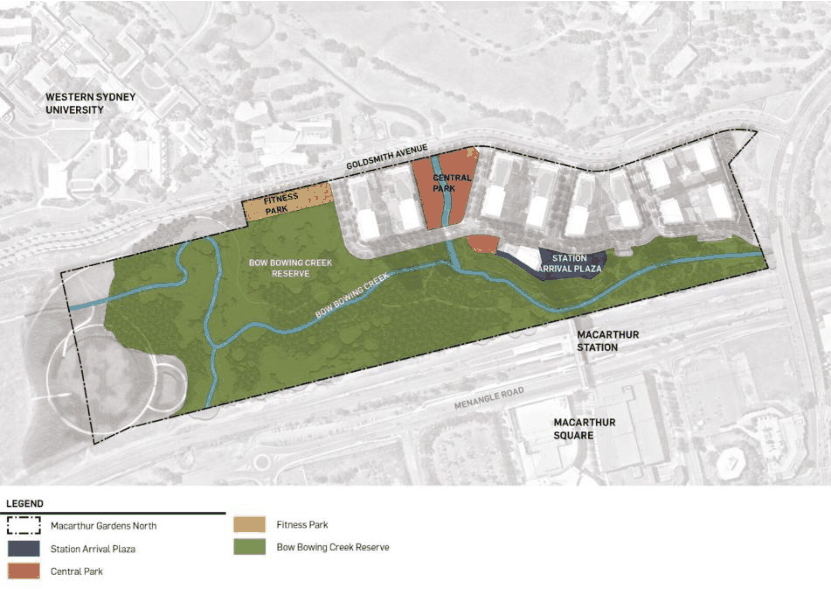

### 16.7 Landscape and Public Domain

Landscape and

#### 16.7.1 Objectives

#### Public Domain

7.1.1 Create a natural environment for residents and visitors to enjoy that is people centred and that aims to form a sanctuary for human interaction.

7.1.2 Create an exemplar urban landscape that will set a new benchmark and act as a catalyst to change the urban landscape of Macarthur and beyond.

7.1.3 Define residential communal open spaces from public places and provide activities to enhance recreational amenity and vibrancy.

7.1.4 Create ground floor landscape spaces for people to connect to the wider precinct in varying scales of form, function and planting to offer a variety of outdoor experiences to residents and visitors.

7.1.5 Create four key landscape places (in addition to the Bow Bowing Creek Reserve) within the development generally in accordance with Figure 16.21 below comprising:

#### Public Domain

a) Station Arrival Park;

b) Central Park; and

c) Fitness Park.

#### Private Domain

d) Communal Open Space (Ground level and podium rooftop)

7.1.1 Use plants in such a way to foster energy efficient development that relies on passive energy principles for heating and cooling.

7.1.2 Reduce maintenance and water consumption through appropriate species selection;

7.1.3 Create buffer zones and add to existing areas of remnant vegetation with locally indigenous species including supplementary River-Flat Eucalyptus Forest on Cumberland Plain Woodland planting.

Landscape and

#### Public Domain

> [Picture on page 27: a picture, saved as a picture (images/vol-2-part-16-macarthur-gardens-north-precinct-page-27-3.gif, 150 dpi).]

Figure 16.21: Landscape and Public Domain Strategy

#### 16.7.2 Required Outcomes

#### Station Arrival Precinct

7.2.1 The ‘Station Arrival Precinct’ will act as the primary civic place and front door of the Precinct when accessed from Macarthur station with an area of approximately 5,200m2.

The entry space will offer residents and visitors a vibrant public space with associated retail and food and beverage break out spaces designed to offer flexibility and activation.

The space is generally to include features such as:

a) Ground floor activation through retail / commercial frontages and food and beverage offers;

b) Flexible plaza spaces allowing for marketing and gatherings;

c) Adventure playground for informal and programmed play;

d) Terracing to alleviate level changes and provide passive surveillance to adjacent plaza and play area;

e) Accessible bridge and ramp from station concourse to the arrival plaza with integrated edges for seating;

f) incidental seating opportunities and feature shade trees

g) or the like.

50% of the Station Arrival Plaza will receive at minimum 2 hours of solar access during mid-winter

#### Central Park

Landscape and

#### Public Domain

7.2.2 The ‘Central Park’ is to be the main green active open space with an area of approximately 2,300m2 situated next to Goldsmith Avenue. It will provide visitors with informal open space, vegetated retreat spaces and a connection with nature.

The Park will be connected through a secondary creek that runs north to south connecting back to Bow Bowing Creek. The design will integrate water sensitive urban design principles for stormwater management whilst providing an attractive place to the residents and visitors. The space is generally to include features such as:

a) Terraced amphitheatre walls to connect & improve the connection to the creek;

b) Open lawn areas for informal play and recreation;

c) BBQ area and amenity block with handstand corner to Goldsmith Ave;

d) Wetland detention basins incorporating WSUD principles;

e) Suspended board walk with viewing platforms improving North South access between lots and providing a lookout opportunity to the creek or the like. 50% of the Central Park will receive at minimum 3 hours of solar access during mid-winter

#### Fitness Park

7.2.3 A ‘Fitness Park’ - Multi Purpose Outdoor Recreational Space is also to be provided with an area of approximately 3,000m2 adjacent to Goldsmith Ave and WSU that will offer fitness and active recreational facilities for all ages.

The space is generally to include features such as:

a) basketball courts;

b) terraced seating edges and breakout recreational spaces;

c) multi purpose outdoor space including table tennis and fitness equipment; or the like. 50% of the fitness park will receive at minimum 3 hours of solar access during mid-winter

#### Communal Open Spaces

7.2.4 ‘Communal open spaces’ within residential lots are to be located centrally on ground level and/or at rooftops to provide shared amenity for residents. These communal spaces are to be designed in accordance with the ADG.

Key features of these spaces may include:

a) Seating areas;

b) Shade areas;

c) BBQ/picnic areas;

d) Play areas;

e) Primary tree canopy within deep soil zone ;

f) Secondary tree canopy within ground level and podium rooftop;

g) Balance of private and open spaces;

h) Rooftop decide to maximise elevated views;

i) Community gardens or the like

### 16.7

#### Public Domain Materials and Quality

Landscape and

#### Public Domain

7.2.5 Development is to adopt a landscape design strategy to provide a durable and high quality landscaped building setting with a consistency of quality and treatments across the site selected to complement the character of the architecture. Considerations are to include durability and practicality for ongoing maintenance.

7.2.6 Feature granite paving is to be provided throughout. Paving in the public domain is to be in accordance Council’s standards for public domain works. Material, finishes, furniture and fixtures are to be selected with consideration to whole of life costs, detailed and installed to minimize ongoing maintenance needs.

7.2.7 Furniture is to be durable, easily cleaned and include anti-graffiti coatings where necessary to reduce vandalism. Tactiles and other pedestrian safety devices are to be installed as required by the relevant standards. Bike racks are to be provided on Entry thresholds to facilitate to bike parking provisions.

#### Accessibility and Safety

7.2.9 Paving materials, inclusion of tactiles and other relevant measures are to be implemented as part of the landscape works for compliance with the relevant standards.

7.2.10 The proposed landscape design is to consider the principles of Crime Prevention Through Environmental Design (CPTED) and enhancement of personal safety throughout the site. Places of concealment are to be minimised and clear signage / way-finding is to be incorporated. The main thoroughfare and internal street is to have direct access through the site and maintain a clear visual link to the wider context.

7.2.11 Planting treatments will maintain clear sight lines through the use of clear trunked trees and lower level under story species where visibility for safety is required.

7.2.12 An integrated approach to safety is to be incorporated into the landscape design to improve actual and perceived personal security in pedestrian public domain areas. Measures include:

a) All paths are to be overlooked from adjoining buildings and adjacent streets to provide a high level of passive surveillance;

b) All external spaces will have multiple clear sight lines without obstacles and proposed shrub planting is low level which to prevent avoid predator traps;

c) All paths will be well lit at night time and designed to meet relevant Australian Lighting Standards; and

d) Signage will be provided across the precinct to assist with wayfinding and navigation through the site.

7.2.13 All external areas are to be designed to meet   relevant   Australian Lighting Standards.

Landscape and

#### Public Domain

7.2.14 Relative to their particular mounting orientation all external public lighting luminaries within the site boundary must have an Upward Light Output Ratio less than 5%. (Public Lighting — Any light not on private property and includes street lights, path lighting, public space lighting and public sports field lighting. Event and temporary lighting are excluded. Upward Light Output Ratio (ULOR) — The ratio of the luminous flux emitted by a luminaire above the horizontal to that emitted by the lamp, as defined in AS/NZS 1158.0:2005 – Lighting for roads and public spaces.

#### Drainage and Water Management

7.2.15 Water sensitive urban design (WSUD) principles are to be incorporated into the landscape design in a way that celebrates a sustainable water cycle. WSUD measures may include:

a) Irrigation systems comprising subsurface drip systems and automatic timers with rainwater / soil moisture sensor controls;

b) Where possible storm water runoff will be directed to the lawn and garden beds;

c) Irrigation will be provided to all soft landscape areas;

d) Low water demand shrub planting.

#### Landscaping

7.2.16 Landscape planting for the site is to comprise a minimum of 75% of indigenous / water sensitive planting species and extensive native canopy;

7.2.17 Water sensitive design principles and environmentally sensitive design such as a WSUD swale and riparian zones will be incorporated into the landscape design to create a low maintenance, environmentally sensitive landscape that has a distinctive tree canopy with diverse low shrub groundcover.

7.2.18 Landscape planting is to be in accordance with the signature Indicative Plant List at Appendix 1 and is to complement the existing CDCP 2015 planting list.
