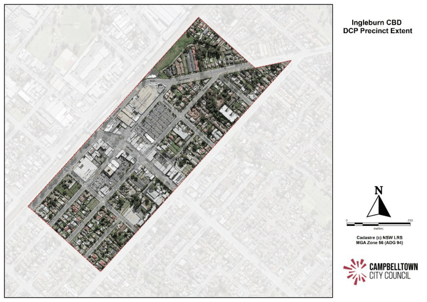
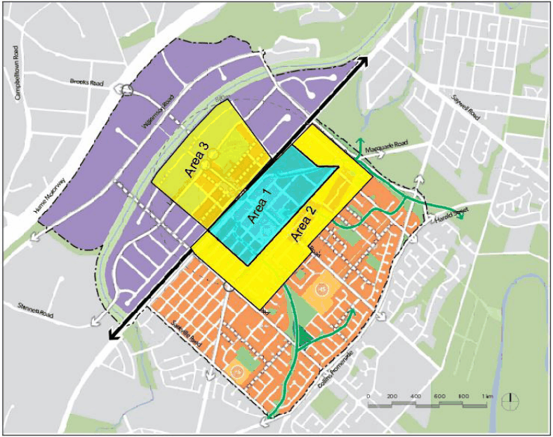

### 17.1 Application

### Application

This Part applies to the land shown in Figure 17.1.1 – the Ingleburn CBD - The Core Precinct which includes land zoned MU1 Mixed Use (MU1); R3 Medium Density Residential (R3) and surrounding high density residential land zoned R4 High Density Residential (R4). It relies on other relevant Parts in Volume 1 of Campbelltown (Sustainable City) DCP 2015 (CDCP2015) including:

• Part 2 Requirements Applying to All Types of Development;

• Part 3 (Low and Medium Density Residential Development (applies to land zoned R3 within the Ingleburn CBD Area).

• Ancillary Residential Structures)

• Part 5 Residential Flat Buildings and Mixed-Use Development; and

• Part 6 Commercial Development.

• Part 8 to Part 19 as they provide development controls that relate to specific land uses and vegetation management that are not covered by this site specific DCP.

This Part provides requirements additional to Volume 1 to achieve the specific vision established for the future development of Ingleburn CBD and applies to the land shown in Figure 17.1.1 below.

Part 17 sets out the following:

- Desired future character for high density residential neighbourhoods in areas zoned R4.

- Desired future character for mixed use development in the area zoned MU1.

- Development controls for:

• residential flat buildings in areas zoned R4;and

• mixed use development in the area zoned MU1;

- Desired outcome for the public domain.

- Development controls and special provisions for flooding.

> [Picture on page 3: a picture, saved as a picture (images/vol-2-part-17-ingleburn-cbd-development-control-plan-page-3-31.gif, 150 dpi).]

#### Figure 17.1.1 Ingleburn CBD

#### Background

In December 2017, the NSW Government released the final Glenfield to Macarthur Urban Renewal Corridor Strategy which included a Precinct Plan for Ingleburn.

The Ingleburn Precinct is divided into three distinct areas as shown in Figure 17.1.2 below:

Area 1: The CBD Precinct — Eastern Side of railway ( where this DCP applies) Area 2: Area around the CBD — Eastern Side of railway Area 3: Western Side Precinct — West of the railway

Area 1 is the subject of this DCP and Areas 2 and 3 will be further investigated as part of future reviews of Campbelltown Local Environment Plan 2015.

> [Picture on page 4: a picture, saved as a picture (images/vol-2-part-17-ingleburn-cbd-development-control-plan-page-4-11.gif, 150 dpi).]

#### Figure 17.1.2 Ingleburn Precinct Plan

The Structure of Part 17

Ingleburn Town Centre - The Core Precinct

17.1 Application

17.5 Development in

17.7 Public Domain

17.8 Flooding

17.9 Solar Access

17.2 Desired Future Character Mixed

17.3 Desired Future Character High

17.4 Residential Flat Buildings in the the Mixed Use

Use Precinct

High Density

Precinct

Density Residential Residential Precinct

Precinct

Whole Precinct

MU1

R4

R4

MU1 and

Whole CBD Whole CBD Whole CBD Precinct

Precinct

Precinct
