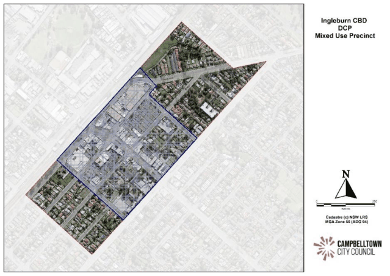
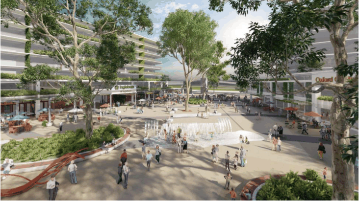
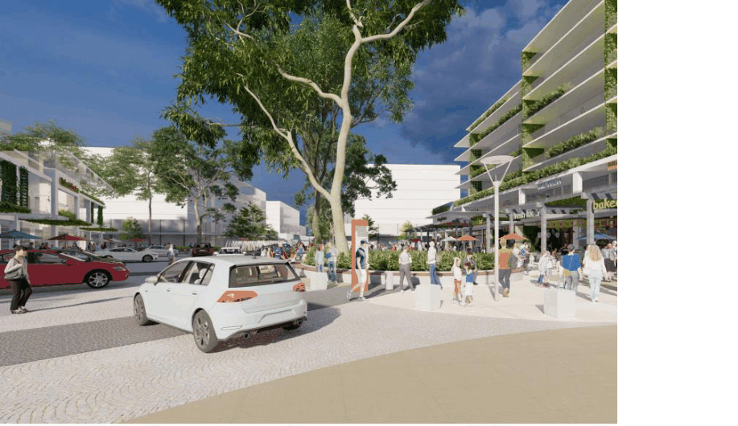

### 17.2 Desired Future Character - Mixed Use Precinct

#### The Ingleburn Vision

#### “To create a vibrant town centre that strengthens Ingleburn’s

unique urban village character and desirability as a place to live.”

#### Desired Future Character - Mixed Use Precinct

(Zone MU1)

Glenfield to Macarthur Urban Renewal Corridor Ingleburn Precinct – DPIE November 2017

“Ingleburn town centre will retain its village atmosphere and provide a vibrant attractive destination for business, leisure and social engagement.”

Ingleburn CBD Urban Design and Public Domain Strategy – July 2021

#### Mixed Use Retail, Commercial & Residential

This area (shown edged blue in Figure 17.2.1 below) will accommodate a mix of retail, commercial and residential uses. Ingleburn will evolve as a prominent retail and employment centre within the Glenfield to Macarthur Urban Renewal Corridor. New buildings will be carefully designed to achieve excellence in built form, sustainability and user amenity. The first two storeys of high rise buildings will be commercial and their presentation to the public domain will contribute to achieving high amenity, pedestrian friendly outcomes for all public roads and especially for Oxford Road. Additional storeys will be further set back to maintain an appropriate scale and amenity and establish the primacy of retail and commercial development at the street level.

> [Picture on page 6: a picture, saved as a picture (images/vol-2-part-17-ingleburn-cbd-development-control-plan-page-6-32.gif, 150 dpi).]

#### Figure 17.2.1: Mixed Use area  Ingleburn  Precinct Plan

> [Picture on page 7: a picture, saved as a picture (images/vol-2-part-17-ingleburn-cbd-development-control-plan-page-7-1.gif, 150 dpi).]

> [Picture on page 7: a picture, saved as a picture (images/vol-2-part-17-ingleburn-cbd-development-control-plan-page-7-2.gif, 150 dpi).]

#### Figure 17.2.2: Vibrant town centre – Visionary Perspectives

### 17.3
