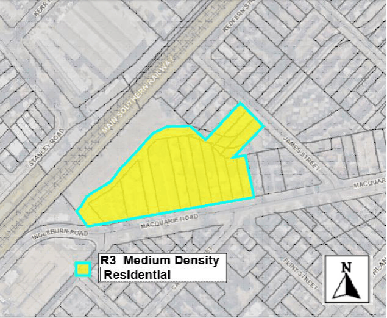
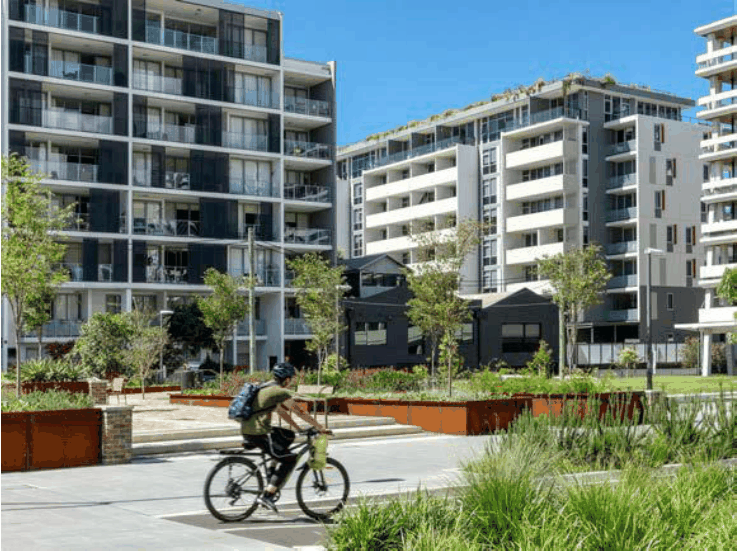

### 17.3 Desired Future Character -  High Density Residential Precinct

#### Desired Future Character High Density Residential (Zones R4)

#### High Rise Residential

This area will provide apartment housing with a high level of amenity for residents. The precincts will be characterised by typically 8 storey apartment buildings (apart from the area zoned R3 Medium Density Residential shown on Figure 17.3.1 below) with apartment design, communal open spaces and shared facilities delivering a first class standard of apartment living. Apartment buildings will be designed to maximise sustainability outcomes and to capitalise on district views.

Volume 1, Part 3 (Low and Medium  Density Residential  Development and Ancillary Residential Structures) of the plan will apply to the areas  zoned

R3 Medium Density Residential within the Ingleburn CBD Precinct in relation to any proposal for future medium density development applications within these sites. In addition, the flooding provisions within this Part will apply too.  All flooding requirements under this Part of Volume 2 (Ingleburn CBD) will also apply to any future development within the areas zoned R3 medium density.

> [Picture on page 8: a picture, saved as a picture (images/vol-2-part-17-ingleburn-cbd-development-control-plan-page-8-26.gif, 150 dpi).]

#### Figure 17.3.1: Medium Density (R3) residential area in Precinct Plan

> [Picture on page 9: a picture, saved as a picture (images/vol-2-part-17-ingleburn-cbd-development-control-plan-page-9-1.gif, 150 dpi).]

#### Figure 17.3.2: Potential style of high density residential development
