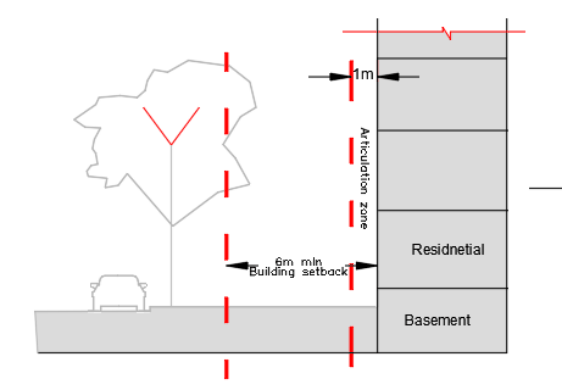

### 17.4 Residential Flat Buildings in the High Density Residential Precinct

#### Residential Flat Buildings

#### 17.4.1 Allotment Requirements

a) Sites shall be amalgamated where required, to achieve the minimum site area of 1800sqm and minimum width requirement of 30m.

| For the purpose of Part 17.4 of | 17.4.1.1 Site Consolidation and Development of Isolated Allotments |
|---|---|
| this DCP, an |  |
| isolated | a) Development shall not result in an isolated allotment adjoining the |
| allotment is an allotment that has a site area of less | development site. b) Council will require appropriate documentary evidence to demonstrate that a genuine and reasonable attempt has been |
| than 1800 | made to purchase an isolated site based on a fair market |
| square metres | value. |
| and/or a width at the front property boundary of | c) At least one recent independent valuation is to be submitted as part of that evidence and is to account for reasonable expenses likely to be incurred by the owner of the isolated site |
| less than 30 | in the sale of the property. |
| metres that has no immediate potential for | d) Where amalgamation of the isolated site is not feasible, applicants will be required to demonstrate that an orderly and economic use and development of the separate sites can be |
| amalgamation | achieved. |
| with any other adjoining allotments to achieve a | e) For the isolated sites, the Applicant shall prepare the following and submit them to Council as part of the application: I. a building envelope for the isolated site, indicating height, |
| minimum site | setbacks, resultant site coverage (building and basement), |
| area of 1800 square metres and a width at the front | deep soil planting with sufficient information to understand the relationship between the application and the isolated site. |
| property | II. The likely impacts the developments will have on each |
| boundary of 30 metres. | other, such as solar access, visual and acoustic privacy and the impact of development of the isolated site on the |

streetscape must also be addressed.

f) The development of existing isolated sites is not to detract from the character of the streetscape and is to achieve a satisfactory level of amenity including solar access, visual and acoustic privacy.

g) Development of existing isolated sites may not achieve the maximum potential, particularly height and floor space ratio, and will be assessed on merit.

#### 17.4.1.2 Building Setbacks for Residential Flat Buildings – Areas Zoned R4

a) Residential flat buildings shall be setback a minimum of:

i. 6 metres from any street boundary; and

ii. 6 metres from any side boundary; and

iii. 8 metres from the rear boundary

b) The basement shall be setback at least 5 metres from the rear boundary and 2 metres from the front boundary to allow for deep soil planting and to create green interface with the streets.

c) Vegetable gardens within the communal open space are encouraged.

#### 17.4.1.3 Building Design

a) Residential flat buildings, where the dimensions of the site permits, shall have  L-shaped, or U-shaped building layout, to maximise solar access, ventilation and residential amenity.

b) A 1 metre articulation zone is permitted forward of the front building setback, in which building elements may occupy a maximum of one third of the area of the facade. Services or lift shafts are not permitted in the articulation zone as shown in Figure 17.4.1.

c) The setbacks under this Part are subject to building separation controls under the ADG.

d) Building design should aim to create a clear delineation between public, communal and private open space

> [Picture on page 11: a picture, saved as a picture (images/vol-2-part-17-ingleburn-cbd-development-control-plan-page-11-25.gif, 150 dpi).]

#### Figure 17.4.1: Street Setback – Residential Flat Buildings
