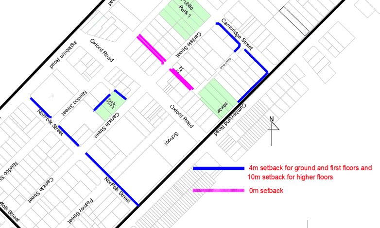

### 17.5 Development in the Mixed Use Precinct

#### 17.5.1  Mixed Use Development Setbacks – Areas Zoned MU1

a) Mixed Use development shall be setback a minimum of: I. 0 metres from any street boundary for the ground and first floors and 6 metres for second and higher floors.

II. 0 metres from side setback; III. 0 metres from rear setbacks.

b) Despite section 17.5.1 a) above, setbacks for certain sites within the Ingleburn CBD shall be in accordance with Figure 17.5.1 below.

> [Picture on page 12: a picture, saved as a picture (images/vol-2-part-17-ingleburn-cbd-development-control-plan-page-12-10.gif, 150 dpi).]

#### Figure 17.5.1 Setbacks Map

#### 17.5.2 Mix of Uses

a) Mixed use buildings must have at least one story of, and encouraged to have at least two storeys (ground and first floor) of commercial and/or retail uses (including centre based childcare, recreation facilities (indoor), places and public worship ). Residential development shall not be undertaken on the first or second storeys (ground and first floor) of a building in this precinct.

#### 17.5.3 Adaptability of car parking floors

a) Where car parking is provided on the ground first floor or above within mixed use buildings, then it must be capable of being redesigned for later conversion to retail, commercial or residential purposes as appropriate for that level.

#### 17.5.4 Awnings

a) All new mixed use buildings within the MU1 Zone shall have awnings on their street frontages, excluding mixed use development along Cumberland Road.

#### Mixed Use Development

#### 17.5.5 Pedestrian Bridge Access

a) As part of any new major redevelopment of Lot 101, DP613509, known as Ingleburn Fair Shopping Centre, 100 Macquarie Road, Ingleburn, a pedestrian access bridge connecting the site to the proposed multi deck car parking building (at Lots 7-9 and 19-23 Section 4 DP 2913) at level one or above shall be provided. Where the redevelopment of the shopping Centre occurs prior to the redevelopment of the multi deck car park, the design of the new shopping centre shall facilitate a future pedestrian connection. Where the multi deck car park development occurs prior to the redevelopment of the subject Shopping Centre, the design of the multi deck car parking shall facilitate a future pedestrian bridge connection/linkage.

#### 17.5.6  Site Consolidation and Development Isolated Allotments

a) Sites shall be amalgamated where required, to achieve the minimum site area of 1200 sqm and width requirement of 30m.

b) Despite section 17.5.6 a) above, consolidation of lots will be required to

For the purpose of Part 17.5.6  of this DCP, an isolated allotment is an allotment that has a site area of less than 1200 square metres and  has no immediate potential for amalgamation with any other adjoining allotments to achieve a minimum site area of 1200 square metres and a width at the front property boundary

of 30 metres.

provide low flood hazard evacuation access for sites identified with no safe vehicle and pedestrian access. Refer to the Summary Flood Information Report under Index 1 of this DCP for more information on this matter.(The graphics/maps showing amalgamation patterns within the Summary Flood Information Report are hypothetical scenarios only, and by no means should be undertaken as the preferred amalgamation outcomes.)

c) Development shall not result in an isolated allotment adjoining the development site.

d) Council will require appropriate documentary evidence to demonstrate that a genuine and reasonable attempt has been made to purchase an isolated site based on a fair market value.

e) At least one recent independent valuation is to be submitted as part of that evidence and is to account for reasonable expenses likely to be incurred by the owner of the isolated site in the sale of the property.

f) Where amalgamation of the isolated site is not feasible, applicants will be required to demonstrate that an orderly and economic use and development of the separate sites can be achieved.

g) For the isolated sites. The Applicant shall prepare the following and submit them to Council as part of the application:

I. a building envelope for the isolated site, indicating height, setbacks, resultant site coverage (building and basement), deep soil planting with sufficient information to understand the relationship between the application and the isolated site.

II. The likely impacts the developments will have on each other, such as solar access, visual and acoustic privacy and the impact of development of the isolated site on the streetscape must also be addressed.

h) The development of existing isolated sites is not to detract from the character of the streetscape and is to achieve a satisfactory level of amenity including solar access, visual and acoustic privacy.

Development of existing isolated sites may not achieve the maximum potential, particularly height and floor space ratio, and will be assessed on merit.

#### 17.5.7 Commercial development - car parking rates

a) Commercial development shall be provided with one car parking space per 50sqm of Gross Floor Area

#### 17.5.8 Building Design

a) Setbacks above the street podium  on corner sites apply to both streets

b) The minimum floor to floor height for commercial floor levels shall be 4.5m

c) The minimum floor to floor height for above ground car parking shall be 3.1m

d) All front facades shall be articulated with depth, relief and shadow on the street façade.

e) No blank walls shall be permitted. Where the blank wall is on the side and is intended to be attached to the side wall of future development on the side boundary, the side wall shall be articulated.
