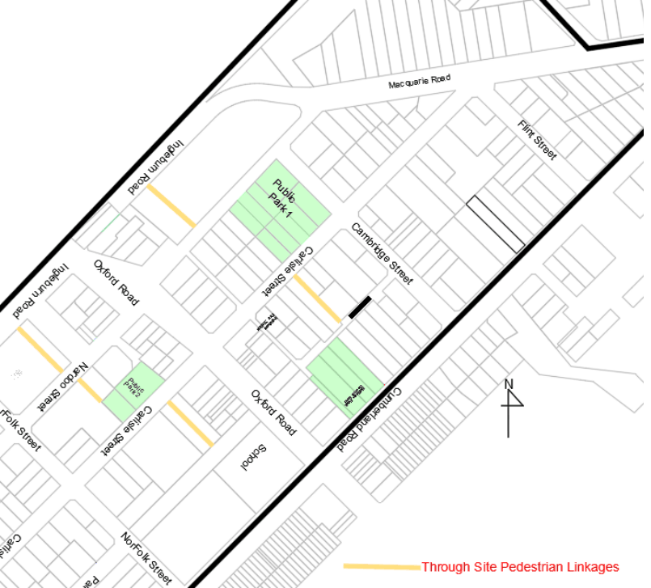
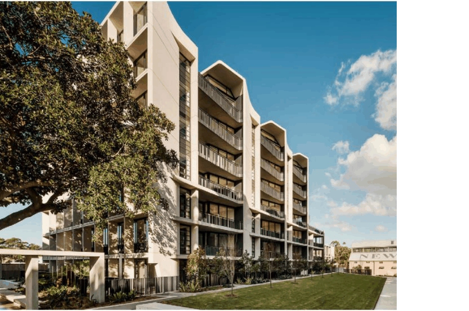

### 17.6 Public Domain

#### Public

#### Domain 17.6.1 Ingleburn CBD

Ingleburn CBD is focused on Ingleburn Railway Station and will be characterised by a vibrant and active mixed use core with high density residential adjoining.

The Ingleburn CBD will be characterised by mixed use development with commercial, business and retail on the ground and first floors with up to 6 storeys of residential apartments above.

New and refurbished open space areas will be complimented by an improved permeable pedestrian network that focuses people on the centre, open space and railway station. About 90% of the area currently lies within a 400m walking distance of open space. About 50% is within 200m walking distance of open space and almost all is within a 400m radius of open space. Improved pedestrian infiltration, in combination with new development, can improve these proportions.

Redevelopment will help provide a first floor access between the Ingleburn Shopping Fair and the Multi deck car park. Larger blocks can be broken down and pedestrian access can be provided along active and interesting laneways.

The provision of larger setbacks and improved street furniture, awnings and tree canopy will provide an attractive public domain where people can meet, carry out business and safely enjoy the town centre.

#### 17.6.2 Objectives for the Public Domain Improvements in Ingleburn

Objectives for the public domain of Ingleburn CBD are:

• To provide a safe, attractive and comfortable place to meet, work, socialise, shop and access public transport both during the day and at night;

• To enable ease of movement in, around and through Ingleburn CBD for cars, pedestrians and cyclists;

• To provide quality open space within 400m of all residents;

• To provide an active commercial centre that encourages business activity;

• To provide a variety of communal recreation facilities within residential flat buildings and mixed use development readily accessible to all residents, in addition to and complimenting facilities in the public domain.

#### 17.6.3 Pedestrian Connections and Laneways

a) Existing pedestrian connections and laneways should be enhanced to:

i. Have active ground floor frontages and encourage outdoor dining opportunities;

ii. Be legible and direct throughways for pedestrians, clear of obstructions (including columns, stairs and escalators);

iii. Provide access 24 hours, 7 days per week;

iv. Be open to the air above and at each end, except where a connecting public pedestrian access is provided on level one between buildings (refer to section 17.5.5 above) ;

v. Council may consider an ‘arcade style’ walkway;

vi. Have signage at the street entries indicating public accessibility and the street and activities to which the through site link connects.

d) New pedestrian only connections are to be provided along the areas marked through site linkages in the figure 17.6.1 below. Pedestrian linkages across the site must have a minimum width of 3 metres. If these linkages are located along the perimeter of a newly proposed development/building, the development shall be designed to accommodate the entire width of the walkway – i.e the site that is developed first, must provide for the full width and length of the pedestrian link.

> [Picture on page 16: a picture, saved as a picture (images/vol-2-part-17-ingleburn-cbd-development-control-plan-page-16-15.gif, 150 dpi).]

Figure 17.6.1 Pedestrian linkages

> [Picture on page 17: a picture, saved as a picture (images/vol-2-part-17-ingleburn-cbd-development-control-plan-page-17-1.gif, 150 dpi).]

#### Figure 17.6.2 Figtree Pocket Newmarket Randwick - residential

apartment building addressing the open space and street network (Source: newmarketrandwick.com.au)
