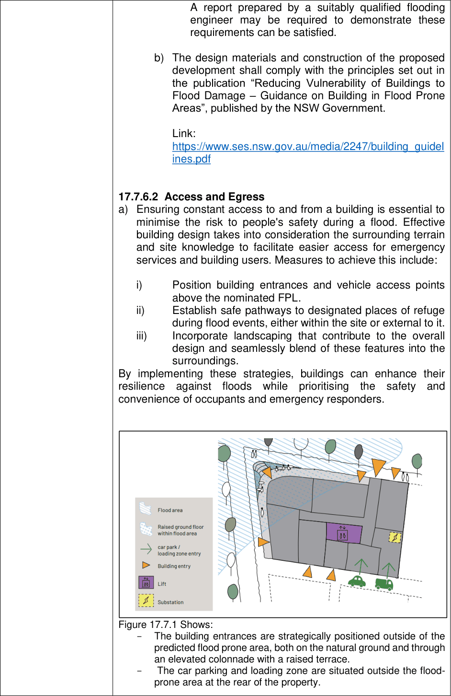
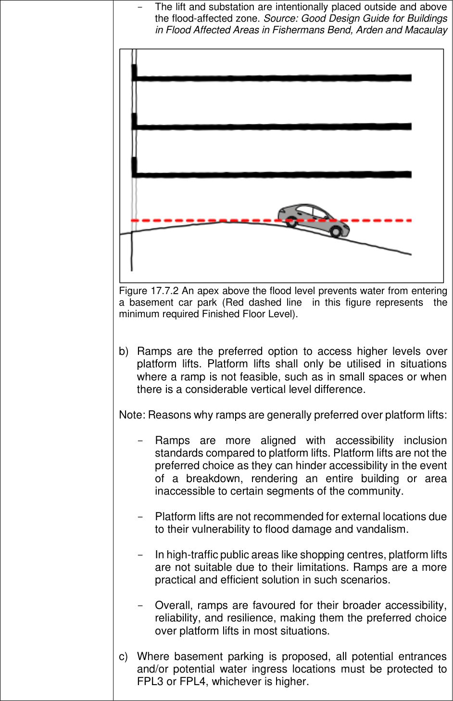
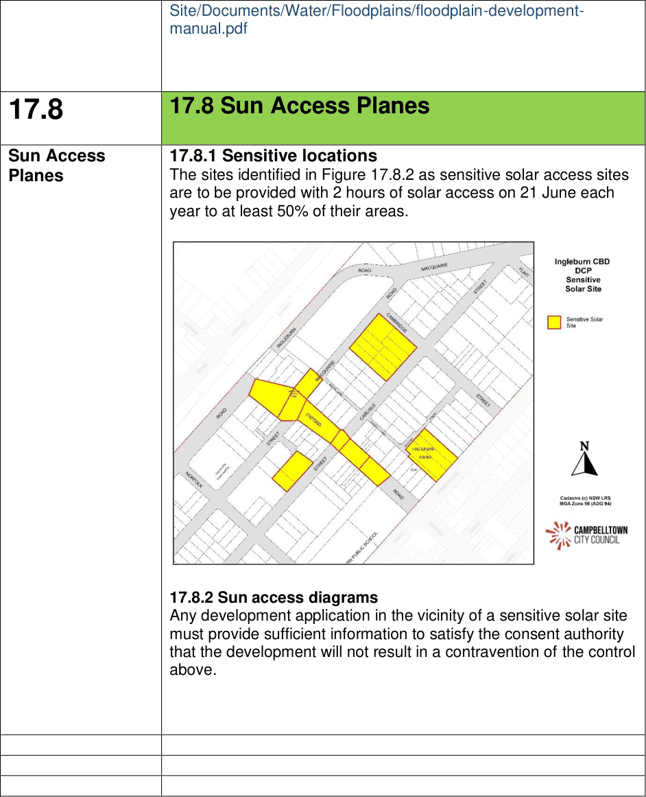

### 17.6. Blank Walls on Zero setback of side boundaries

> [Picture on page 17: a picture, saved as a picture (images/vol-2-part-17-ingleburn-cbd-development-control-plan-page-17-6.gif, 150 dpi).]

a) To prevent the presence of blank walls along the side boundaries of zero setback buildings, all new buildings must incorporate minor articulation elements on the adjoining

wall. The blank wall surface must be broken up by introducing features such as changes in texture and/or colour and/or LED lights. This development standard is included to ensure that blank walls on zero setback boundaries are designed so that they are slightly articulated. These side walls will not be visible once the adjacent site is re-developed and attached to these side boundary walls.

Figure 17.6.3 Example of sidewall articulation

| 17.7 | 17.7 Flooding |
|---|---|
| Flooding Note: “Ingleburn on the other hand has considerable flood risks for both residential and non- residential buildings and, as discussed, urban renewal provides a real opportunity to provide significant flood mitigation benefits.” Draft BBBCC Strategic Floodplain Risk Management Study and Plan 2019 | 17.7.1 Background Flooding is a significant issue that affects existing and future development in the Ingleburn CBD. This Section establishes Council’s approach to development control for the Ingleburn CBD. Council’s approach to flooding has regard to and complies with the New South Wales Government’s Floodplain Development Manual (FDM 2005). The criteria for determining applications for proposals potentially affected by flooding are structured to recognise that different controls can be applied to different land uses and different levels of potential flood inundation and hazard. As a first step in the development consent process, proponents are strongly advised to consult with Council officers, particularly for proposals significantly affected by flooding. The Bow Bowing Bunbury Curran Creek Strategic Floodplain Risk Management Study and Plan (BBBCC) was adopted by Council on 12 February, 2019. Significant flooding is identified in parts of the Ingleburn Town Centre, with notable depths during floods as frequent as the 20 percent AEP (5 year average recurrence interval) event. Substantial drainage upgrade work is proposed within the Ingleburn CBD area to alleviate the flooding impact. However, even if this work is undertaken, it would not fully resolve the flooding issue within Ingleburn CBD. As development has already occurred and further development is permissible and desirable, the planning controls, in addition to any drainage upgrades, will be needed to address safety to life and property and respond to likely flooding events. The proposed flooding requirements within this section of the DCP, shall apply to any development within Ingleburn CBD that is impacted by flooding. Completion of the drainage upgrade would facilitate development within Ingleburn CBD by reducing flooding and so facilitating compliance with the controls in this DCP. Proponents should also read relevant parts of Council’s “Campbelltown (Sustainable City) Development Control Plan 2009 Volume 2 Engineering Design for Development June 2009 Engineering Design for Development” Link: https://www.campbelltown.nsw.gov.au/files/assets/public/document -resources/builddevelop/dcps/dcp2014v3/scdcp2009volume2- 1engineeringdesignfordevelopment.pdf |

#### 17.7.2 Flood Planning Levels

A range of flood planning levels (FPL) may be applied depending on the type of land use and the part of the development in consideration. In principle, a higher FPL will apply to land uses considered more sensitive to flood hazards or which may be critical to emergency management operations or the recovery of the community after a flood event.

Different FPLs are also considered appropriate for different parts of development. For example, the non-habitable floor levels of a dwelling can be at a lower level relative to the habitable floor level as the potential for significant flood damage costs is reduced.

The following table outlines those FPLs to be applied to the development controls outlined later in this part of the DCP.

#### Table 17.7.3 – Flood Planning Levels

| Reference | Flood Planning Level |
|---|---|
| FPL1 | 5% AEP |
| FPL2 | 1% AEP |
| FPL3 | 1% AEP + • 0.3m Freeboard for flows < 0.3m deep • 0.5m Freeboard for flows > 0.3m deep |
| FPL4 | PMF |

#### Notes:

1\. FPL1, FPL2 and FPL 4 have zero freeboard.

2\. The design flood levels and FPLs in Table 1 may be obtained from Council if available or otherwise will be required to be determined by the proponent. These levels will normally be ‘rounded up’ to the nearest 0.1m and be referenced relative to Australian Height Datum (AHD). FPL= Flood Planning Level. AEP = Annual Exceedance Probability. PMF = Probable Maximum Flood

#### 17.7.4 Flood Hazard Categories

Flood hazard categorisation is based on the depth and velocity of floodwaters, and it is a way to define what risks are presented to life and property in a major flood event.

For the purpose of this DCP, flood modelling for Ingleburn CBD has been undertaken and the following categories have been used, where H1 represents the lowest flood hazard and H6 represents the most severe flood hazard. These categories are defined as:

• H1 – generally safe for people, vehicles and buildings

• H2 – unsafe for small vehicles

• H3 – unsafe for vehicles, children and the elderly

• H4 – unsafe for vehicles and people

• H5 – Unsafe for vehicles and people. All building types vulnerable to structural damage.

• H6: Unsafe for vehicles and people. All building types considered vulnerable to failure.

As a result of the flood modelling that has been undertaken for Ingleburn CBD, certain sites have also been identified with unsafe access for pedestrian and vehicles.

#### 17.7.5 Objectives

• To ensure the safety of existing and future occupants and property of Ingleburn CBD by ensuring that flood risk associated with development is minimised and/or not increased beyond the level that is acceptable to the community.

• To ensure the proponents of development and the community in general are fully aware of the potential flood hazard and consequent risk associated with the use and development of land within Ingleburn CBD.

• Maximise development potential for Ingleburn.

• To reduce the impact of flooding on Ingleburn.

• To design development, in full knowledge of the flooding risk, to alleviate flooding and risk.

• To minimise the risk to life by ensuring the provision of appropriate evacuation measures are available.

• To enable safe pedestrian movement between buildings during flooding.

• To maximise the potential for buildings to be returned to use as quickly and efficiently as possible after being affected by flooding.

• To ensure that developments with high sensitivity to flood risk

(eg. critical public utilities) are sited and designed to provide reliable access and minimise risk from flooding.

• To allow development with a lower sensitivity to the flood hazard to be located within flood affected areas, subject to appropriate design and siting controls and provided that the potential consequences that could still arise from flooding remain acceptable.

#### 17.7.6 Development Controls

#### 17.7.6.1 General Development Controls

The following development controls apply to all land use categories:

a) The flood impact of the development is to be considered to ensure that the development will not increase flood effects elsewhere, having regard to:

- loss of flood storage;

- changes in flood hazards, flood  levels and flood velocities caused by alterations to the flood conveyance, including the effect of fencing styles; and

- the cumulative impact of multiple potential developments in the Ingleburn CBD.

> [Picture on page 21: a picture, saved as a picture (images/vol-2-part-17-ingleburn-cbd-development-control-plan-page-21-1.gif, 150 dpi).]
> Words printed on the picture (title and legend, copied from the PDF):
> Link:
> https://www.ses.nsw.gov.au/media/2247/building_guidel
> ines.pdf
> above the nominated FPL.
> - The building entrances are strategically positioned outside of the
> predicted flood prone area, both on the natural ground and through
> an elevated colonnade with a raised terrace.
> - The car parking and loading zone are situated outside the flood-
> prone area at the rear of the property.

Figure 17.7.1 Shows:

A report prepared by a suitably qualified flooding engineer may be required to demonstrate these requirements can be satisfied.

b) The design materials and construction of the proposed development shall comply with the principles set out in the publication “Reducing Vulnerability of Buildings to Flood Damage – Guidance on Building in Flood Prone Areas”, published by the NSW Government.

#### 17.7.6.2  Access and Egress

a) Ensuring constant access to and from a building is essential to minimise the risk to people's safety during a flood. Effective building design takes into consideration the surrounding terrain and site knowledge to facilitate easier access for emergency services and building users. Measures to achieve this include:

i) Position building entrances and vehicle access points

ii) Establish safe pathways to designated places of refuge during flood events, either within the site or external to it.

iii) Incorporate landscaping that contribute to the overall design and seamlessly blend of these features into the surroundings.

By implementing these strategies, buildings can enhance their resilience against floods while prioritising the safety and convenience of occupants and emergency responders.

> [Picture on page 22: a picture, saved as a picture (images/vol-2-part-17-ingleburn-cbd-development-control-plan-page-22-1.gif, 150 dpi).]
> Words printed on the picture (title and legend, copied from the PDF):
> - The lift and substation are intentionally placed outside and above
> the flood-affected zone. Source: Good Design Guide for Buildings
> in Flood Affected Areas in Fishermans Bend, Arden and Macaulay
> a basement car park (Red dashed line  in this figure represents  the
> minimum required Finished Floor Level).

Figure 17.7.2 An apex above the flood level prevents water from entering

b) Ramps are the preferred option to access higher levels over platform lifts. Platform lifts shall only be utilised in situations where a ramp is not feasible, such as in small spaces or when there is a considerable vertical level difference.

Note: Reasons why ramps are generally preferred over platform lifts:

- Ramps are more aligned with accessibility inclusion standards compared to platform lifts. Platform lifts are not the preferred choice as they can hinder accessibility in the event of a breakdown, rendering an entire building or area inaccessible to certain segments of the community.

- Platform lifts are not recommended for external locations due to their vulnerability to flood damage and vandalism.

- In high-traffic public areas like shopping centres, platform lifts are not suitable due to their limitations. Ramps are a more practical and efficient solution in such scenarios.

- Overall, ramps are favoured for their broader accessibility, reliability, and resilience, making them the preferred choice over platform lifts in most situations.

c) Where basement parking is proposed, all potential entrances and/or potential water ingress locations must be protected to FPL3 or FPL4, whichever is higher.

d) Areas with basement car parking will need to provide evacuation routes at or above FPL3 or FPL4 (whichever is higher) to a safe area or, where it is provided, to connect to the first level pedestrian access.

e) For newly proposed commercial buildings and mixed use buildings a suitable storage area shall be provided to store goods at or above FPL3 or FPL4 (whichever is higher).

#### 17.7.6.3  Flood Emergency Response Planning

a) Low hazard, horizontal evacuation from the building must be demonstrated for residents, workers and visitors for all floods up to and including FPL2.  Low hazard is defined as no greater than H2 hazard as defined in Section 7.2.7 of Book 6 of ‘Australian Rainfall & Runoff’ (Ball et al, 2019)

b) For floods larger than FPL2 (up to and including FPL4), horizontal evacuation measures are still preferred for all building occupants (residents, workers and visitors) where the following can be satisfied:

i) Pedestrians can evacuate safely from a building via a ‘rising road’ to an area of refuge located above the PMF. The evacuation pathway must not require passage through H2 hazard areas or areas of deepening water.

ii) An exit from a building is provided above the PMF that is accessible internally to all occupants.

iii) Requirements for accessibility are available for all occupants (where possible)

iv) Do not rely on lifts, elevators etc.

v) Appropriate consideration has been given to access into the property during floods by Emergency Services such as SES, Ambulance, Fire and Rescue.

c) Where horizontal evacuation is not feasible during FPL4, Shelter In Place or vertical evacuation must be provided for all building occupants (residents, workers and visitors) that offers access to a safe indoor area of refuge above the PMF where they can remain until the flood event has passed and any subsequent disruption after the flood has been rendered safe and serviceable.

d) Shelter In Place or vertical evacuation measures must satisfy the following requirements:

i) Refuge shelters must be adequate and fit for purpose (size, design, equipment, supplies) and maintained as such in perpetuity.

ii) Unless otherwise advised by Council, facilities must be designed for a refuge stay of at least 48 hours.

iii) It is recommended that large residential buildings be provided with emergency back-up power, water supply and sewerage for all residential units and common facilities including lifts.

iv) Where the building design and back-up systems enable some residents to safely remain in their own apartments for extended periods during floods, all such residents

must still have access to a communal refuge area of adequate size where support from other residents and emergency supplies are available.

v) The communal safe area of refuge must be permanently provided with, as a minimum:

i) emergency electricity supply, and lighting,

ii) clean water for drinking, washing and toilet flushing,

iii) working bathroom and toilets,

iv) suitable food,

v) personal washing and drying facilities,

vi) medical equipment including a first aid kit,

vii) a battery-powered radio and relevant communications equipment.

e) All development involving the construction of a new building or significant alterations to an existing building, and or intensification of a use must be supported by a flood emergency response plan (FERP) detailing the preferred emergency response strategy.  FERPs submitted with Development Applications must include:

i) measures to prevent evacuation from the site by private vehicle if external floodwater are not safe;

ii) the most appropriate emergency response for flood and fire events that occur together;

iii) a building flood emergency response plan, similar to a building fire evacuation drill, and measures to ensure this is tested at least annually; and

iv) evidence of consultation undertaken with relevant state and local agencies in the preparation of the FERP.

The flood plan should be consistent with the relevant NSW SES “FloodSafe” Guide.

#### 17.7.6.4  Building Design and Refuge

a) Integrate access elements such as stairs, ramps, and sloping walkways seamlessly into the overall design, ensuring a human-scale approach and creating a welcoming atmosphere. When incorporating ramps, ensure they are logically placed and easily accessible without obstructing circulation or sightlines.

b) Enhance the architectural features by incorporating elements like terraces, colonnades, seating, or landscaping to bridge the gap between elevated ground and street level. These elements not only contribute to the aesthetics but also activate the streetscape, making it more vibrant and encourage the development of external transitions as part of the overall streetscape design.

c) Whenever possible, connect terraces and colonnades with adjacent buildings to create areas of refuge and secondary circulation in case of a flood event.

d) Streamline access to multiple sites or tenancies by providing a shared, accessible transition space located at FPL4 or higher.

e) Utilise terraces and colonnades for less sensitive uses like cafes and retail establishments, and provide seating opportunities on ledges and stairs wherever possible. This adds to the functionality and appeal of the space.

f) All new mixed-use buildings, shall be provided with a designated gathering refuge area for the public, located at a floor level that is at least 500mm above the Probable Maximum Flood (PMF) level. This room or gathering space shall be clearly identifiable and easily accessible to the public. Signage must be provided at street level, guiding the public to access this area during any flood event.  Sufficient resources should be available within the refuge area including running water, drinking water and toilets to support temporary refuge without reliance on emergency services.

#### 17.7.6.5 Critical Uses and Facilities

a) For the purpose of this Part, Critical land uses and facilities include - emergency services facilities; public administration buildings that may provide an important contribution to the notification, management or evacuation of the community during and following flood events (e.g. SES headquarters, police stations, hospitals) and any other development that in the opinion of Council is considered to be a critical land use facility.

b) Critical land uses and facilities are unsuitable land uses on any land affected by flooding up to FPL4.

#### 17.7.6.6 Sensitive Uses and Facilities

a) For the purpose of this Part, Sensitive uses and facilities include

- community facilities; educational establishments; public utility undertakings (including electricity generating works; sewerage systems; telecommunications facilities and water treatment facilities); child care centres, residential care facilities; schools, seniors housing, group homes and any other development that in the opinion of Council is considered to be a sensitive land use facility (i.e., facilities whose occupants may be more vulnerable to the impacts of flooding, facilities which are essential to evacuation during periods of flood or if affected would unreasonably affect the ability of the community to return to normal activities after flood events).

b) No development is to occur in or over a floodway area, a flow path or within a H5/H6 hazard area (as defined in Section 7.2.7 of Book 6 of ‘Australian Rainfall & Runoff’ (Ball et al, 2019))

c) Habitable floor levels to be no lower than FPL4.

d) Non-habitable floor levels to be no lower than FPL3 unless justified by a site specific assessment.

e) All structures to have flood compatible building components below FPL4.

f) Applicant to demonstrate that any structure can withstand the forces of floodwater, debris and buoyancy up to and including FPL4. An engineer’s report may be required.

g) The minimum surface level of open car parking spaces or carports shall be as high as practical, and not below FPL1.

h) Garages or enclosed car parking must be protected from inundation by flood waters up to FPL2. Where 20 or more vehicles are potentially at risk, protection shall be provided to FPL3.

i) Where the level of the driveway providing access between the road and parking space is lower than 0.3m below FPL2, the following condition must be satisfied - when the flood levels reach FPL2, the depth of inundation on the driveway shall not exceed:

- the depth at the road; or

- the depth at the car parking space.

j) Reliable access for pedestrians and vehicles is required from the building, commencing at a minimum level equal to the lowest habitable floor level to a refuge area above FPL4. In the case of alterations or additions to an existing development, this may require retro-fitting the existing structures if required to support a refuge area above FPL4.

k) Applicant to demonstrate that an area is available to store goods above FPL4.

l) Materials which may cause pollution or are potentially hazardous during any flood must not be stored externally below FPL4.

#### 17.7.6.7 Residential development

For the purpose of this part, residential development includes - Additions or alterations to existing dwellings greater than 10% to the habitable floor area which existed at the date of commencement of this Plan; affordable housing; attached dwellings; backpackers accommodation; bed and breakfast accommodation; boarding houses; child care centres; dual occupancies; dwelling houses; exhibition homes; garages or

outbuildings with a floor area exceeding 40sqm, group homes; home based child care centres; home businesses; home industries; home occupancies; home occupations (sex services); hostels; hotel or motel accommodation; moveable dwellings; neighbourhood shops; residential flat buildings; secondary dwellings; semi-detached dwellings and serviced apartments.

a) No development is to occur in a floodway area, a flow path or a high hazard area or within a H5/H6 hazard area (as defined in Section 7.2.7 of Book 6 of ‘Australian Rainfall & Runoff’ (Ball et al, 2019) unless justified by a site-specific assessment, to Council’s satisfaction.

b) Habitable floor levels to be no lower than FPL3.

c) Non-habitable floor levels to be no lower than FPL3 unless justified by a site specific assessment.

d) A restriction is to be placed on the title of the land, pursuant to S.88B of the Conveyancing Act, where the lowest habitable floor area is elevated above finished ground level, confirming that the under croft area is not to be enclosed, where Council considers this may potentially occur.

e) All structures to have flood compatible building components below FPL3.

f) Applicant to demonstrate that the structure can withstand the forces of floodwater, debris and buoyancy up to and including FPL4. An engineer's report prepared by a suitably qualified flood engineer may be required.

g) The minimum surface level of open car parking spaces or carports shall be as high as practical, and not below FPL1.

h) Garages or enclosed car parking must be protected from inundation by flood waters up to FPL2. Where 20 or more vehicles are potentially at risk, protection shall be provided to FPL3.

i) Where underground carparks are proposed, consideration must be given to escape routes, pumpout drainage systems (which must include backup pumpout systems), location of service utilities (including power, phone, lifts) for FPL4. Refer to Volume 2 Engineering Design for Development for additional requirements.

j) Where the level of the driveway providing access between the road and parking space is lower than 0.3m below FPL2, the following condition must be satisfied - when the flood levels reach FPL2, the depth of inundation on the driveway shall not exceed:

i. the depth at the road; or

ii. the depth at the car parking space.

k) All service conduits located below FPL3 are to be made fully flood compatible and suitable for continuous underwater immersion. Conduits are to be self-draining if subject to flooding.

#### 17.7.6.8 Commercial Development

Commercial development includes - amusement centres; brothels; business premises; car parks; community facilities (other than sensitive uses and facilities); entertainment facilities; food and drink premises; function centres; hardware and building supplies, health care professionals; health consulting rooms; medical centres; mixed use development; mortuaries; office premises; passenger transport facilities; places of public worship; pubs; public administration buildings (other than critical uses and facilities); recreation facilities (major); registered clubs; restaurants; restricted premises; service stations; sex services premises; shops; shop top housing; take away food or drink premises; veterinary hospitals.

| a) | No development is to occur in or over a floodway area, a flow path or within a H5/H6 hazard area (as defined in Section 7.2.7 of Book 6 of ‘Australian Rainfall & Runoff’ (Ball et al, 2019) generated by flooding up to FPL2, unless justified by a site specific assessment to Council’s satisfaction. |
|---|---|
| b) | Habitable floor levels are to be at FPL3 or higher. |
| c) | Non-habitable floor levels to be equal to or greater than FPL3 where possible, or otherwise no lower than FPL2 unless justified by a site specific assessment. |
| d) | All structures to have flood compatible building components below FPL3. |

| e) | Applicant to demonstrate that the structure can withstand the forces of floodwater, debris and buoyancy up to and including FPL4. An engineer's report will be required for sites impacted by H5/H6 hazard area (as defined in Section 7.2.7 of Book 6 of ‘Australian Rainfall & Runoff’ (Ball et al, 2019) |
|---|---|
| f) | The minimum surface level of open car parking spaces or carports shall be as high as practical, and not below FPL1. |
| g) | Where underground carparks are proposed, consideration must be given to escape routes, pumpout drainage systems (which must include backup pumpout systems), location of service utilities (including power, phone, lifts) for FPL4, as well as the PMF. Refer to Volume 2 Engineering Design for Development for additional requirements. |
| h) | Garages or enclosed car parking must be protected from inundation by flood waters up to FPL2. Where 20 or more vehicles are potentially at risk, protection shall be provided to FPL3. |

i) Where the level of the driveway providing access between the road and parking space is lower than 0.3m below FPL2, the following condition must be satisfied - when the flood levels reach FPL2, the depth of inundation on the driveway shall not exceed:

i) the depth at the road; or

ii) the depth at the car parking space.

j) All service conduits located below FPL3 are to be made fully flood compatible and suitable for continuous underwater immersion. Conduits are to be self-draining if subject to flooding.

k) No external storage of materials below FPL3 which may cause pollution or be potentially hazardous during any flood.

#### 17.7.6.9 Concessional Development

a) For the purpose of this part, Concessional Development is –

- Additions or alterations to an existing dwelling up to 10% to the ground floor area which existed at the date of commencement of this Plan;

- Garages or outbuildings with a maximum floor area of 40m²; or

- Redevelopment for the purposes of substantially reducing the extent of flood affectation to the existing building.

b) No development is to occur in a floodway area, a flowpath or a H5/H6 hazard area (as defined in Section 7.2.7 of Book 6 of ‘Australian Rainfall & Runoff’ (Ball et al, 2019) generated by flooding up to FPL2, unless justified by a site specific assessment to Council’s satisfaction.

c) New habitable floor levels to be no lower than FPL3. Where this is not practical due to compatibility with the height of adjacent buildings, or compatibility with the floor level of existing buildings, or the need for access for persons with disabilities, a lower floor level may be considered. In these circumstances, the floor level is to be as high as practical, and, when undertaking alterations or additions shall be no lower than the existing floor level.

d) A restriction is to be placed on the title of the land, pursuant to S.88B of the Conveyancing Act, where the lowest habitable floor area is elevated above finished ground level, confirming that the under croft area is not to be enclosed, where Council considers this may potentially occur.

e) All new structures to have flood compatible building components below FPL3.

f) Applicant to demonstrate that the structure can withstand the forces of floodwater, debris and buoyancy up to and including FPL4. An engineer's report prepared by a suitably qualified flood engineer may be required.

g) Driveway and parking space levels to be no lower than the design floor level or ground level. Where this is not practical, a lower level may be considered. In these circumstances, the level is to be as high as practical, and, when undertaking alterations or additions shall be no lower than the existing level.

h) All service conduits located below FPL3 are to be made fully flood compatible and suitable for continuous underwater immersion. Conduits are to be self-draining if subject to flooding.

i) Applicant to demonstrate that area is available to store goods above FPL3.

j) No external storage of materials below FPL3 which may cause pollution or be potentially hazardous during any flood.

#### 17.7.6.10 Other Development Fencing

a) Fencing within a floodway or a flow path must be of an open style that that will not impede the flow of floodwaters.

#### Filling

a) Filling on flood affected land is not permitted unless a report from a suitably qualified civil engineer is submitted to Council that certifies that the development will not increase flood affectation elsewhere, or Council otherwise determines that a report is not required.

b) Filling of floodway areas or land that conveys an existing overland flow path is not permitted.

c) Filling of individual sites in isolation, without consideration of the cumulative effects is not permitted. A case by case decision making approach cannot take into account the cumulative impact of flooding behaviour, and associated risks, caused by individual developments. Any proposal to fill a site must be accompanied by an analysis of the effect on flood levels of similar filling of developable sites in the area.

#### 17.7.6.11 Further Information

Bow Bowing Bunbury Curran Creek Strategic Floodplain Risk Management Study and Plan. View at:

https://www.campbelltown.nsw.gov.au/files/assets/public/document

-resources/cityimprovements/draftbbbcfrmspvol1.pdf

https://www.campbelltown.nsw.gov.au/files/assets/public/document

-resources/cityimprovements/draftbbbcfrmspvol2.pdf

NSW Government’s Floodplain Development Manual 2005 – https://www.environment.nsw.gov.au/-/media/OEH/Corporate-

> [Picture on page 31: a picture, saved as a picture (images/vol-2-part-17-ingleburn-cbd-development-control-plan-page-31-1.gif, 150 dpi).]
> Words printed on the picture (title and legend, copied from the PDF):
> Site/Documents/Water/Floodplains/floodplain-development-
> manual.pdf
