### 17.8 Sun Access Planes

### 17.8

#### Sun Access Planes

#### 17.8.1 Sensitive locations

The sites identified in Figure 17.8.2 as sensitive solar access sites are to be provided with 2 hours of solar access on 21 June each year to at least 50% of their areas.

#### 17.8.2 Sun access diagrams

Any development application in the vicinity of a sensitive solar site must provide sufficient information to satisfy the consent authority that the development will not result in a contravention of the control above.

#### Appendix 1: Summary of Flood Information Report

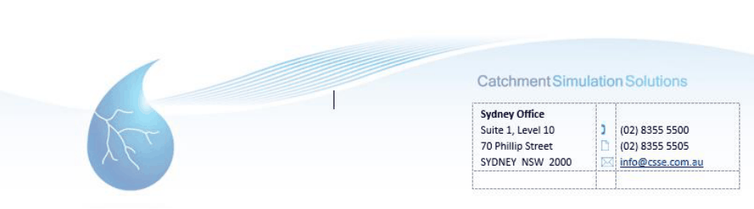

> [Picture on page 32: a picture, saved as a picture (images/vol-2-part-17-ingleburn-cbd-development-control-plan-page-32-2.gif, 150 dpi).]

25 August, 2023

Ingleburn CBD Planning Proposal Summary of Flood Information Provided to Support Planning Proposal and DCP Updates

### Introduction

Catchment Simulation Solutions (CSS) has been working with Campbelltown City Council to support a Planning Proposal (PP) for the Ingleburn CBD and the development of a site-specific Development Control Plan (DCP).  CSS has been involved to assist in addressing a range of flood-related issues that have been raised by NSW State Emergency Services and the Department of Planning and environment, Environment and Heritage Group (EHG).

The following report summarises the flood information that has been provided to Council to support the PP and DCP updates.

### PMF Flood Hazard

The NSW SES expressed concerns that the PP may bring additional people into a high hazard area and may also introduce additional evacuation difficulties/extended periods of isolation for that population.  Therefore, CSS extracted flood hazard information for the 20% AEP, 1% AEP and PMF design floods to help understand the potential flood risk.

The flood hazard maps are provided in Figure 1, Figure 2 and Figure 3 for the 20% AEP, 1% AEP and PMF design floods respectively.

The duration of greater than H1 hazard was also extracted from the full time series of simulation results and is provided in Figure 4, Figure 5 and Figure 6.  This provides an

understanding of the amount of time that evacuation would not be possible (i.e., duration of isolation).

Finally, hazard versus time charts were extracted at four locations across the Ingleburn CBD.  The locations where the hydrographs were extracted is shown in Figure 1, Figure 2 and Figure 3, while the hazard charts for each location are provided in Figure 7, Figure 8, Figure 9 and Figure 10.  The total duration of >H1 hazard (i.e., potential duration of isolation) was also extracted for each design flood and is provided in Table 1.

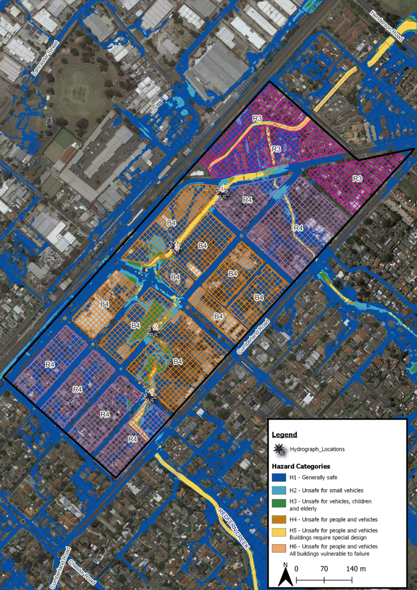

> [Picture on page 34: a picture, saved as a picture (images/vol-2-part-17-ingleburn-cbd-development-control-plan-page-34-1.gif, 150 dpi).]

#### Figure 1 Peak Flood Hazard for 20% AEP Design Flood

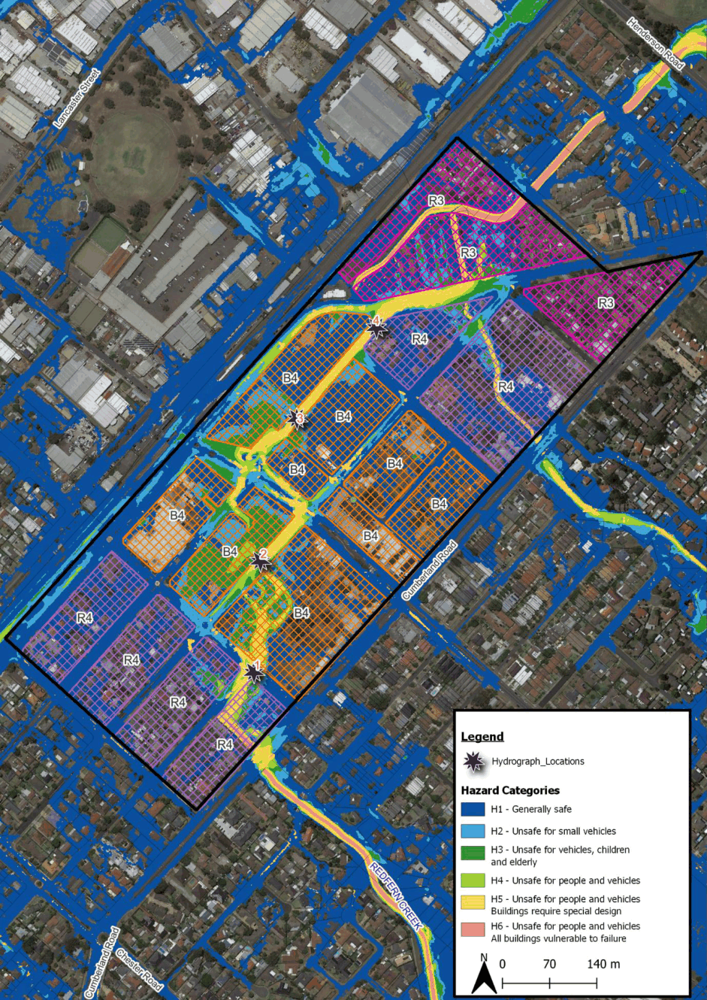

> [Picture on page 35: a picture, saved as a picture (images/vol-2-part-17-ingleburn-cbd-development-control-plan-page-35-1.gif, 150 dpi).]

#### Figure 2 Peak Flood Hazard for 1% AEP Design Flood

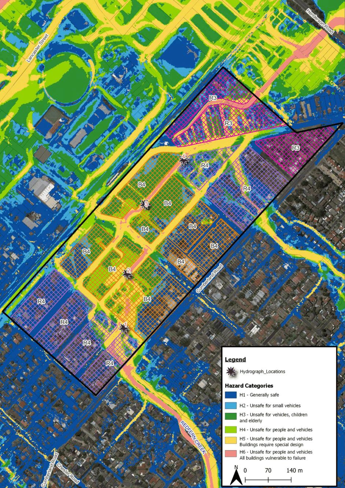

> [Picture on page 36: a picture, saved as a picture (images/vol-2-part-17-ingleburn-cbd-development-control-plan-page-36-1.gif, 150 dpi).]

#### Figure 3 Peak Flood Hazard for PMF

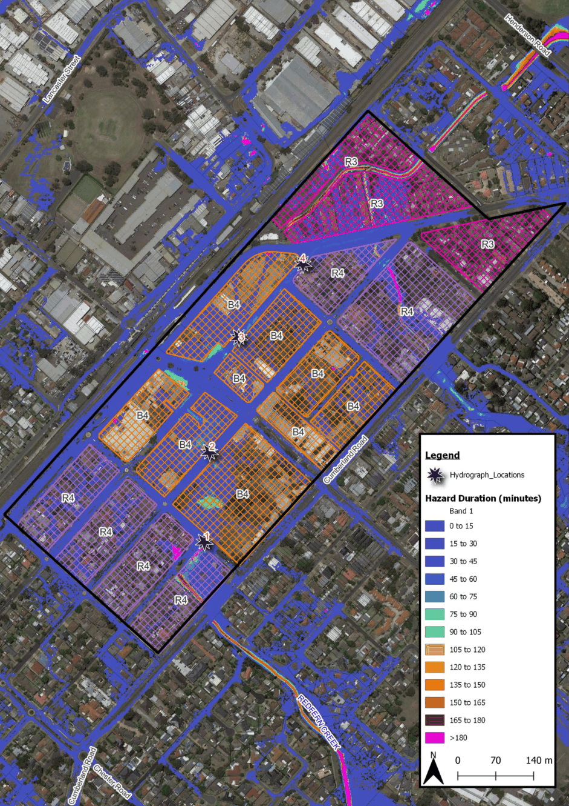

> [Picture on page 37: a picture, saved as a picture (images/vol-2-part-17-ingleburn-cbd-development-control-plan-page-37-1.gif, 150 dpi).]

#### Figure 4 Duration of >H1 hazard for 20% AEP Design Flood

> [Picture on page 38: a picture, saved as a picture (images/vol-2-part-17-ingleburn-cbd-development-control-plan-page-38-1.gif, 150 dpi).]

#### Figure 5 Duration of >H1 hazard for 1% AEP Design Flood

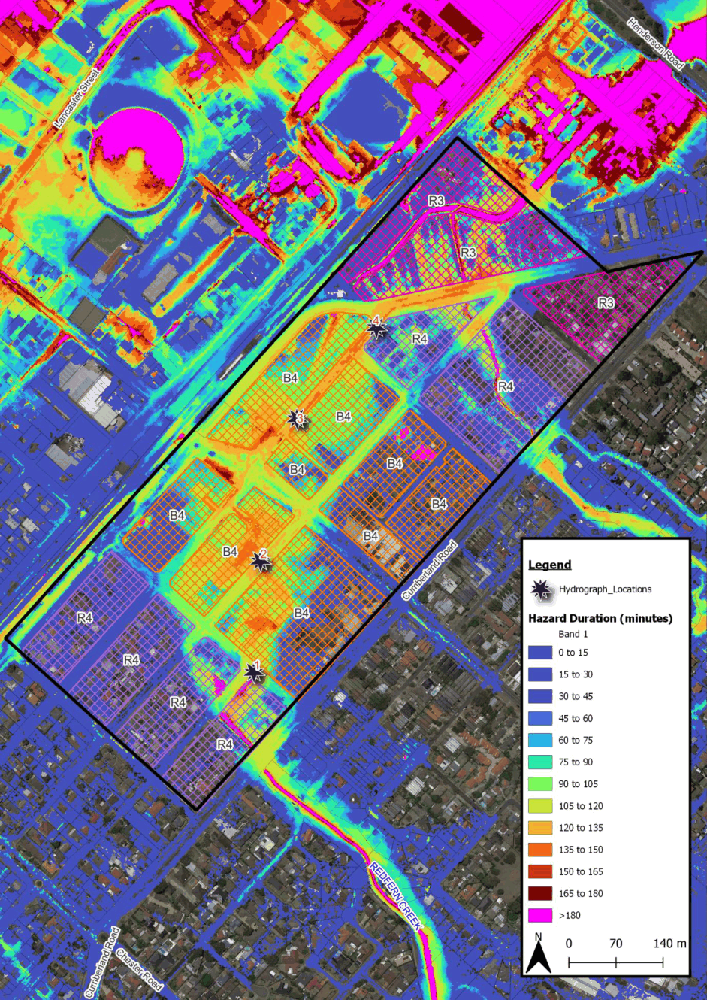

> [Picture on page 39: a picture, saved as a picture (images/vol-2-part-17-ingleburn-cbd-development-control-plan-page-39-1.gif, 150 dpi).]

#### Figure 6 Duration of >H1 hazard for PMF

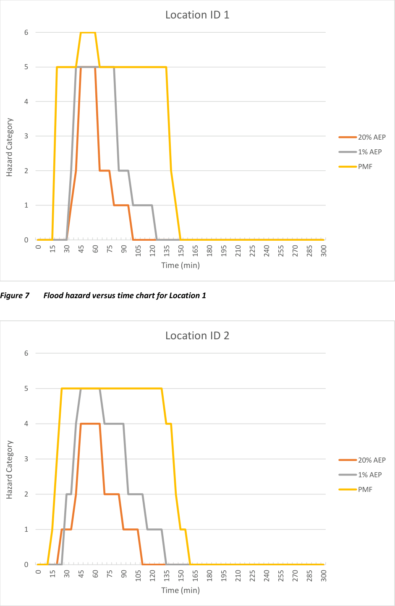

> [Picture on page 40: a map, saved as a picture (images/vol-2-part-17-ingleburn-cbd-development-control-plan-page-40-1.gif, 150 dpi); the street names and other small labels are on the picture.]
> Words printed on the picture (title and legend, copied from the PDF):
> 15 30 45 60 75 90
> 105 120 135 150 165 180 195 210 225 240 255 270 285 300

#### Location ID 1

#### Figure 7 Flood hazard versus time chart for Location 1

> Words printed on the picture (title and legend, copied from the PDF):
> 15 30 45 60 75 90
> 105 120 135 150 165 180 195 210 225 240 255 270 285 300

#### Location ID 2

#### Figure 8 Flood hazard versus time chart for Location 2

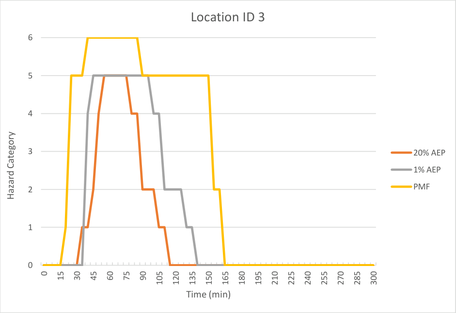

> [Picture on page 41: a map, saved as a picture (images/vol-2-part-17-ingleburn-cbd-development-control-plan-page-41-2.gif, 150 dpi); the street names and other small labels are on the picture.]
> Words printed on the picture (title and legend, copied from the PDF):
> 15 30 45 60 75 90
> 105 120 135 150 165 180 195 210 225 240 255 270 285 300

#### Location ID 3

#### Figure 9 Flood hazard versus time chart for Location 3

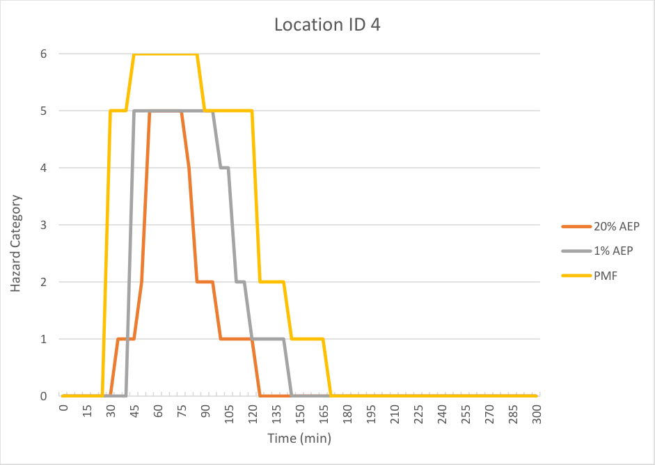

> [Picture on page 42: a map, saved as a picture (images/vol-2-part-17-ingleburn-cbd-development-control-plan-page-42-1.gif, 150 dpi); the street names and other small labels are on the picture.]
> Words printed on the picture (title and legend, copied from the PDF):
> 15 30 45 60 75 90
> 105 120 135 150 165 180 195 210 225 240 255 270 285 300

#### Location ID 4

Figure 10 Flood hazard versus time chart for Location 4 Table 1 >H1 Hazard Duration

| Location ID | Event | Duration >H1 (mins) |
|---|---|---|
| 1 | 20%AEP 1%AEP PMF | 40 65 125 |
| 2 | 20%AEP 1%AEP PMF | 50 85 130 |
| 3 | 20%AEP 1%AEP PMF | 60 90 140 |
| 4 | 20%AEP 1%AEP PMF | 50 75 115 |

### Identification of High Hazard Lots

The SES also expressed concerns regarding inclusion of lots exposed to H5 and H6 hazard in the PP as there is potential for structural damage to buildings.  Therefore, CSS analysed the flood hazard at the peak of the PMF to identify lots exposed to high (H5 or H6) hazard conditions that should be excluded from the PP.  These lots are identified in green in Figure 11.

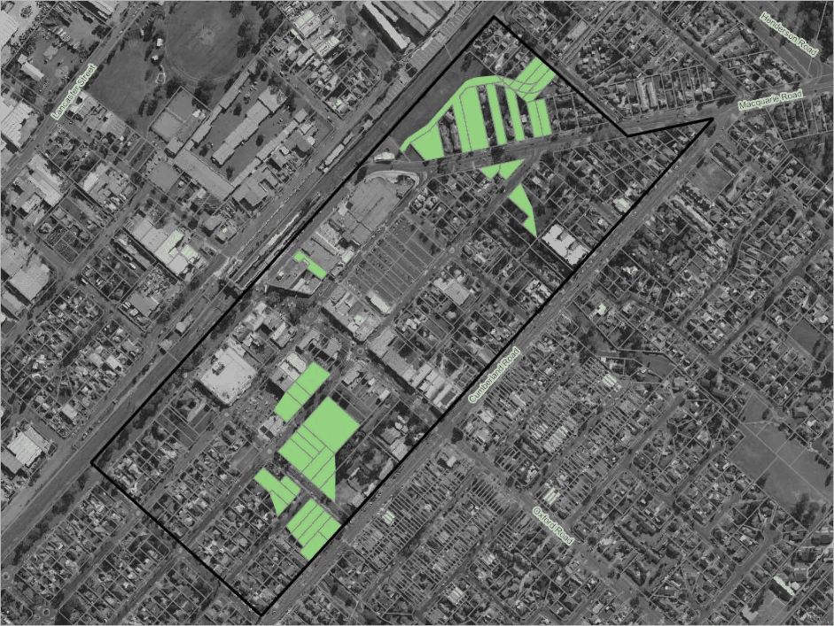

> [Picture on page 43: a picture, saved as a picture (images/vol-2-part-17-ingleburn-cbd-development-control-plan-page-43-7.gif, 150 dpi).]

#### Figure 11 Lots exposed to H5 or H6 hazard at the peak of the PMF (Green)

### Identification of Lots with Flood Evacuation Constraints

DPE:EHG noted that the PP would introduce a greater density of people into the Ingleburn DCP.  This will potentially increase the population at risk if they are unable to evacuate through low hazard (i.e., no greater than H1 hazard) floodwater.  Therefore, an additional review of the 1% AEP flood hazard mapping was completed to identify:

Lots where evacuation by vehicle may not be possible (i.e., >H1 hazard) Lots where evacuation on foot may not be possible (i.e., >H2 hazard)

These lots are included on Figure 12.  The high hazard lots previously identified on Figure 11 are also retained.

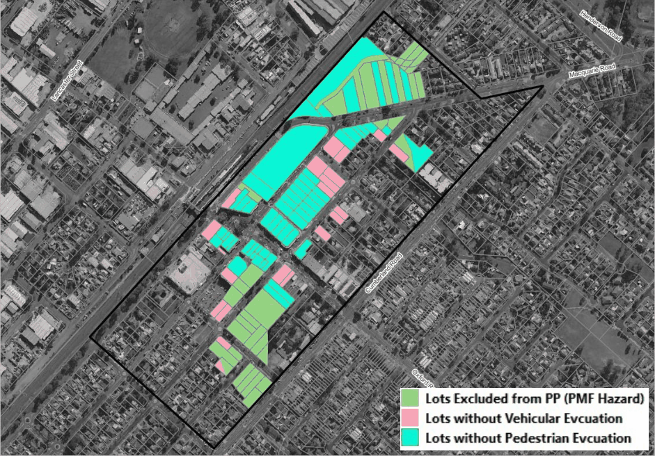

> [Picture on page 44: a picture, saved as a picture (images/vol-2-part-17-ingleburn-cbd-development-control-plan-page-44-1.gif, 150 dpi).]

Figure 12 Lots exposed to H5 or H6 hazard at the peak of the PMF or with evacuation difficulties in the

#### 1% AEP Flood

### Impact of Potential Drainage Upgrades

The Bow Bowing Bunbury Curran Creek Strategic Floodplain Risk Management Study and Plan (2019) noted the existing flood risk across the Ingleburn CBD and recommended drainage upgrades as one option to assist in reducing the existing flood risk.  Further concept design work on the potential drainage upgrades has been completed.

DPE:EHG noted that, if these drainage upgrades were to proceed, it would reduce the existing hazard and evacuation constraints considerably.  Therefore, based on revised hazard mapping supplied by DPE:EHG with the concept drainage upgrades in place, the lots exposed to evacuation difficulties were re-evaluated assuming that the current drainage upgrade plans were to proceed.  The updated map is shown in Figure 13.

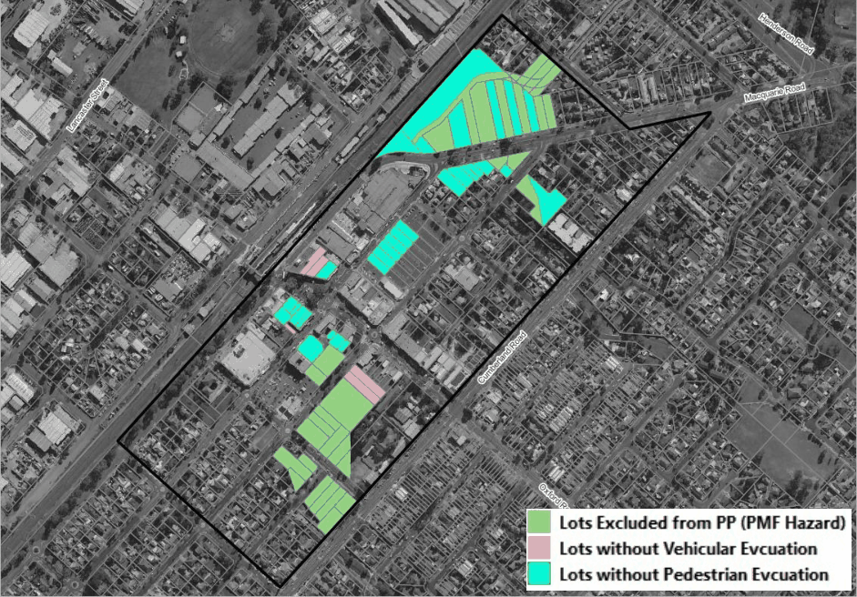

> [Picture on page 45: a picture, saved as a picture (images/vol-2-part-17-ingleburn-cbd-development-control-plan-page-45-1.gif, 150 dpi).]

Figure 13 Lots exposed to H5 or H6 hazard at the peak of the PMF or with evacuation difficulties in the

#### 1% AEP Flood, assuming drainage upgrades proceed.

### Potential Lot Consolidation

Council and DPE:EHG noted that there were opportunities for evacuation difficulties to be overcome if some lots were consolidated with adjacent lots that had access to low hazard evacuation routes.  Therefore, a review of the lots with evacuation difficulties identified in Figure 12 and Figure 13 was completed to identify lot consolidation opportunities.

The outcomes of this assessment are presented in Figure 14 (no drainage upgrades) and Figure 15 (including drainage upgrades).

-----------------------------------------------------------------------

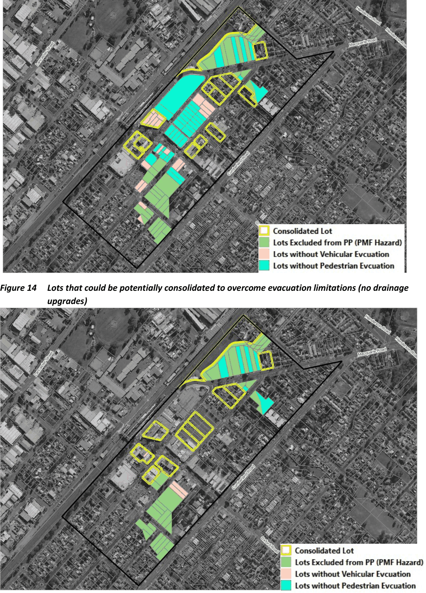

> [Picture on page 46: a picture, saved as a picture (images/vol-2-part-17-ingleburn-cbd-development-control-plan-page-46-1.gif, 150 dpi).]

Figure 14 Lots that could be potentially consolidated to overcome evacuation limitations (no drainage upgrades)

Figure 15 Lots that could be potentially consolidated to overcome evacuation limitations (with drainage upgrades)

#### End of Summary report

#### Catchment Simulation Solution

> [Picture on page 47: a picture, saved as a picture (images/vol-2-part-17-ingleburn-cbd-development-control-plan-page-47-1.gif, 150 dpi).]

Campbelltown City Council, PO Box 57, Campbelltown, NSW 2560
