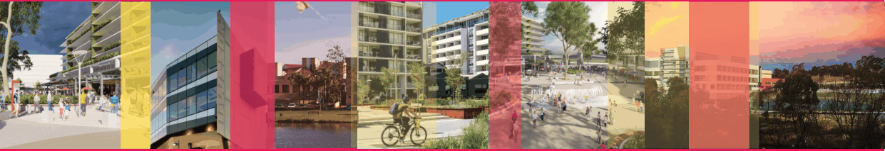

# Campbelltown Sustainable City Development Control Plan 2015 - Part 17 Ingleburn CBD Development Control Plan

> This chapter is split into 8 section file(s), one per numbered heading, in the order they appear in the PDF.

Source PDF: [part-17-ingleburn-cbd-development-control-plan-volume-2.pdf](part-17-ingleburn-cbd-development-control-plan-volume-2.pdf)

### DRAFT

> [Picture on page 1: a picture, saved as a picture (images/vol-2-part-17-ingleburn-cbd-development-control-plan-page-1-2.gif, 150 dpi).]

### Campbelltown

### (Sustainable City)

### Development Control

### Plan 2015

> [Picture on page 1: a picture, saved as a picture (images/vol-2-part-17-ingleburn-cbd-development-control-plan-page-1-7.gif, 150 dpi).]

### VOLUME 2

### VOLUME 2

### Site Specific DCPs DRAFT Part 17:  Ingleburn CBD

### Creating Campbelltown's Future 2025

Note: The Ingleburn CBD Development Control Plan (DCP) came into effect on 15 December 2023 and has been incorporated as Part 17, Volume 2 of Campbelltown (Sustainable City) DCP 2015. It should be read in conjunction with relevant Parts in Volume 1. In the case of any inconsistencies this Part will prevail to the extent of that inconsistency.

### 17.1

<!-- sections -->
## Sections

1. [17.1 Application](01-17-1-application.md)
2. [17.2 Desired Future Character - Mixed Use Precinct](02-17-2-desired-future-character-mixed-use.md)
3. [17.3 Desired Future Character -  High Density Residential Precinct](03-17-3-desired-future-character-high-density.md)
4. [17.4 Residential Flat Buildings in the High Density Residential Precinct](04-17-4-residential-flat-buildings-in-the-high.md)
5. [17.5 Development in the Mixed Use Precinct](05-17-5-development-in-the-mixed-use-precinct.md)
6. [17.6 Public Domain](06-17-6-public-domain.md)
7. [17.6 Blank Walls on Zero setback of side boundaries](07-17-6-blank-walls-on-zero-setback-of-side.md)
8. [17.8 Sun Access Planes](08-17-8-sun-access-planes.md)
