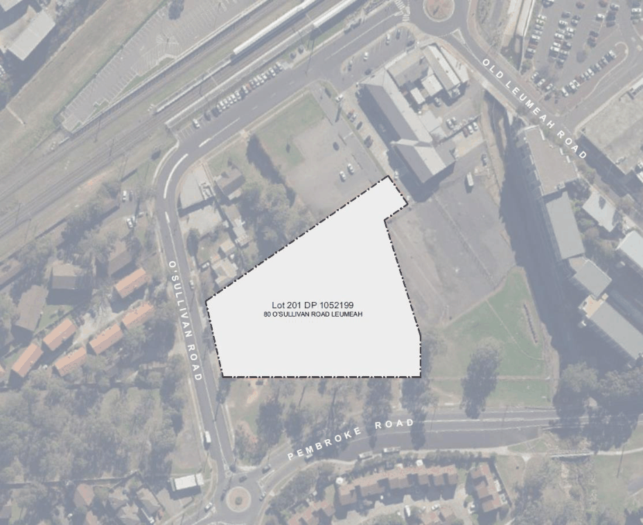

### 18.1 Application

#### 18.1.1 Land to which this Part applies

This Development Control Plan (DCP) applies to land at 80 O’Sullivan Road, Leumeah being identified in Figure 1. The subject site comprises a single lot known legally as Lot 201 in DP 1052199. The land is situated in the Leumeah town centre. The site forms part of the mixed-use core of the Leumeah town centre which is largely made up of other small retail and commercial premises, open space, car parking, as well as some established higher density residential development. The site is located close to Leumeah train station and currently accommodates the Leumeah Hotel and a bottle shop. The site is 8,117sqm, is generally flat and has a frontage to O’Sullivan Road.

> [Picture on page 4: a picture, saved as a picture (images/vol-2-part-18-80-o-sullivan-road-development-control-plan-page-4-12.gif, 150 dpi).]

Figure 1 - Land Application Map

#### 18.1.2 Purpose of this Part

The purpose of this Part is to establish a supplementary planning framework (beyond the general provisions of the Campbelltown (Sustainable City) DCP (‘CSCDCP’) for achieving the Council endorsed proposal for the subject land (Leumeah Hotel) at 80 O’Sullivan Road, through the establishment of site-specific objectives, development controls and indicative layout for the future development of the site. In doing so it provides a platform against which Council will assess future development applications for a mixed-use development at the site.

#### 18.1.3 Relationship with Campbelltown (Sustainable City) DCP

This DCP forms part of the CSCDCP and provides additional controls and guidelines that apply specifically to development at 80 O’Sullivan Road, Leumeah. Where a development control is not specified in this Part, development is subject to all other relevant controls of Volume 1 of the CSCDCP. Where there is an inconsistency between this Part and any other provision of the CSCDCP, this Part prevails to the extent of the inconsistency.
