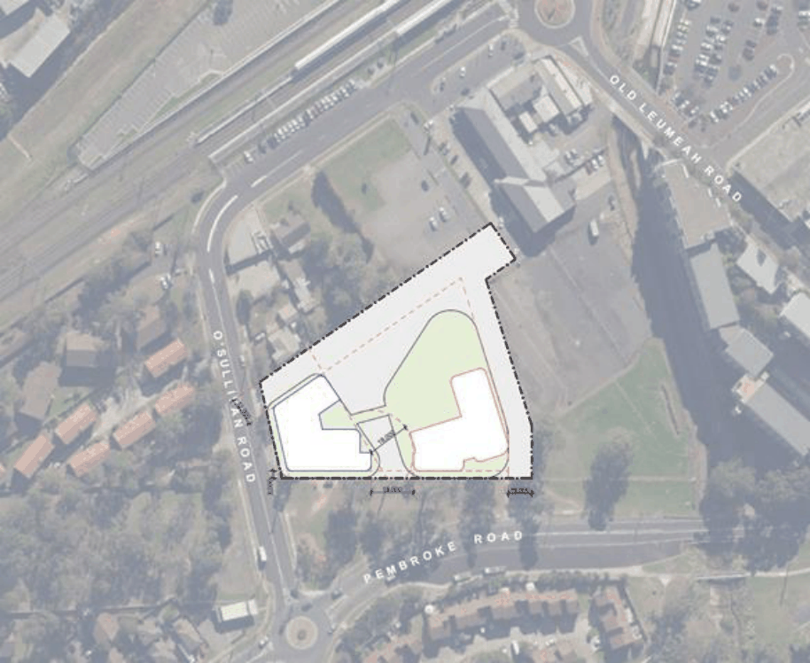

### 18.2    Vision and Development Objectives

#### 18.2.1 Vision

The key vision is to deliver a high-quality mixed-use site which provides opportunities for delivering additional housing supply in a highly accessible location to support the increased residential density, and the provision of highly activated streetscapes and practical private and publicly accessible open spaces. The site forms part of the Leumeah town centre which is identified for significant urban renewal which aims to support a mixed-use precinct with an increased residential population in the future. The site is located less than 200 metres to Leumeah train station and is close to the Campbelltown Sports Stadium and West Leagues Club which together form part of a major sports and entertainment precinct. With a major train station, easy access to the M5 Hume Motorway, and a direct link to the Campbelltown CBD, future development should explore opportunities for redevelopment of the Leumeah town centre that is generally consistent with the vision of the ‘Reimagining Campbelltown City Centre Masterplan’. The envisaged future redevelopment of the site will supply residential and retail floor space in a highly accessible location, benefiting from existing public transport connections and nearby growing employment centres. Development should seek to provide a mix of uses including a retail hub for the locality supported by significant increase in residential densities. A crucial aspect of the vision entails establishing an active pedestrian link traversing through the site to establish links to Leumeah train station, the future Civic Square and the emerging sports and entertainment precinct. An Indicative Building Footprint is provided at Figure 2 to demonstrate how future built form can be accommodated within the site.

> [Picture on page 7: a picture, saved as a picture (images/vol-2-part-18-80-o-sullivan-road-development-control-plan-page-7-1.gif, 150 dpi).]

Figure 2 - Indicative Building Footprint

#### 18.2.2 Development Objectives

#### Objectives:

■ To ensure new development on the site responds to its context, including streetscape and adjoining properties, and provides appropriate levels of amenity for the private and public domain.

■ To ensure the new development on the site enhances the public domain through active street frontages, modulation, articulation and the use of high-quality materials and finishes.

■ To ensure the new development on the site complies with the standards outlined in the Housing SEPP and the Apartment Design Guide (published by the NSW Department of Planning, Housing and Industry), in addition to meeting the requirements of this DCP.

■ To provide vibrant and active pedestrian links connecting the site to Leumeah train station and the rest of the suburb of Leumeah.

■ To encourage a building form that is conducive to the creation of a vibrant, mixed-use town centre that provides a range of retail, business, and residential uses.

■ To provide a high level of ground floor activation, through site connections to streets and important places, pedestrian amenity, and new public domain in the town centre.

■ To ensure podium and tower relationships on the site retain pedestrian scale in the articulation and detailing of the lower levels of the buildings.

■ To create a fine-grained pattern of development which is generally oriented to maximise solar access.

■ To ensure the development contributes to the realisation of the Re-imagining Campbelltown City Centre Master Plan.
