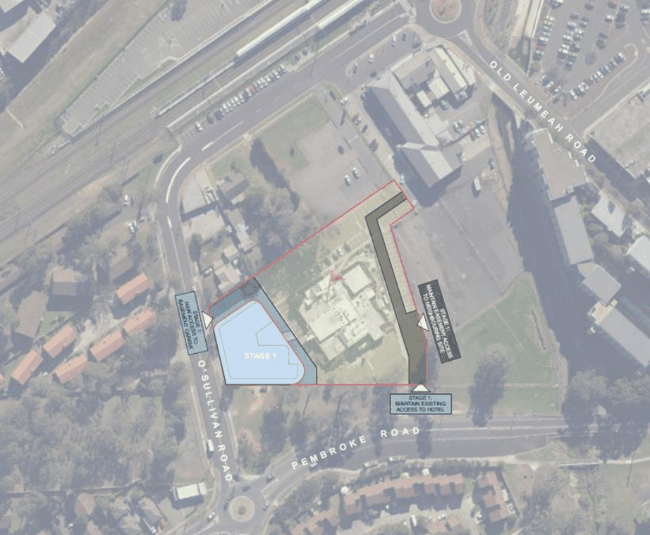
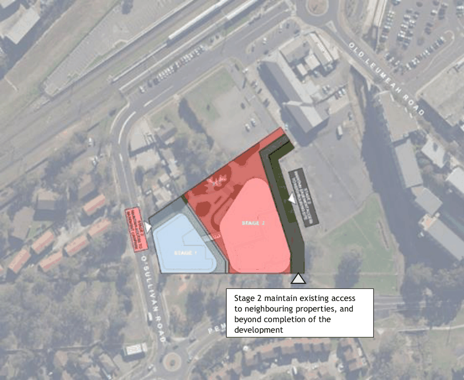
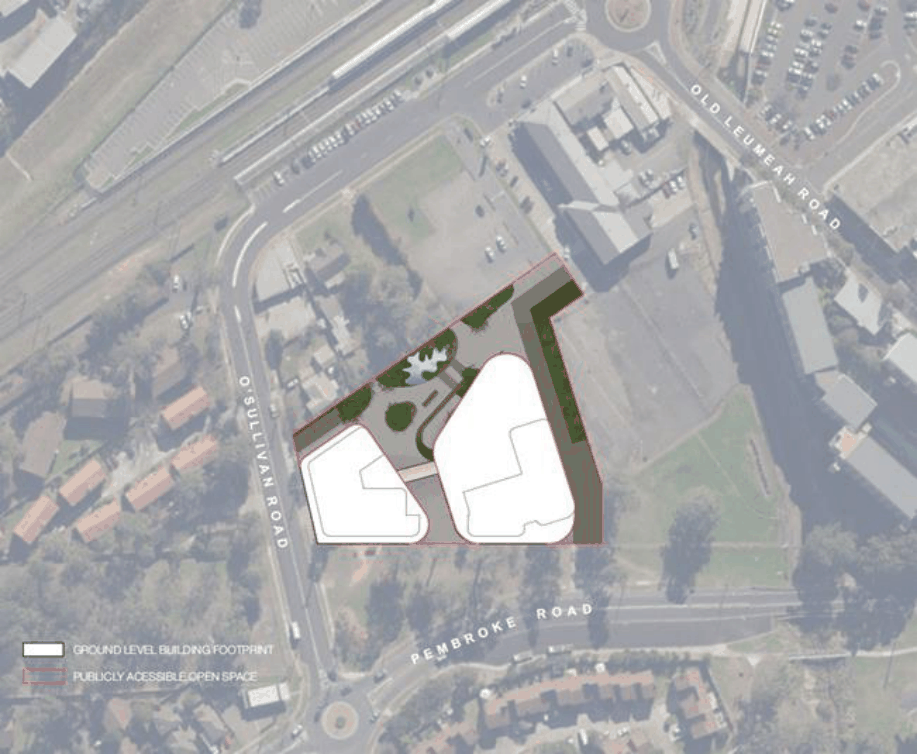
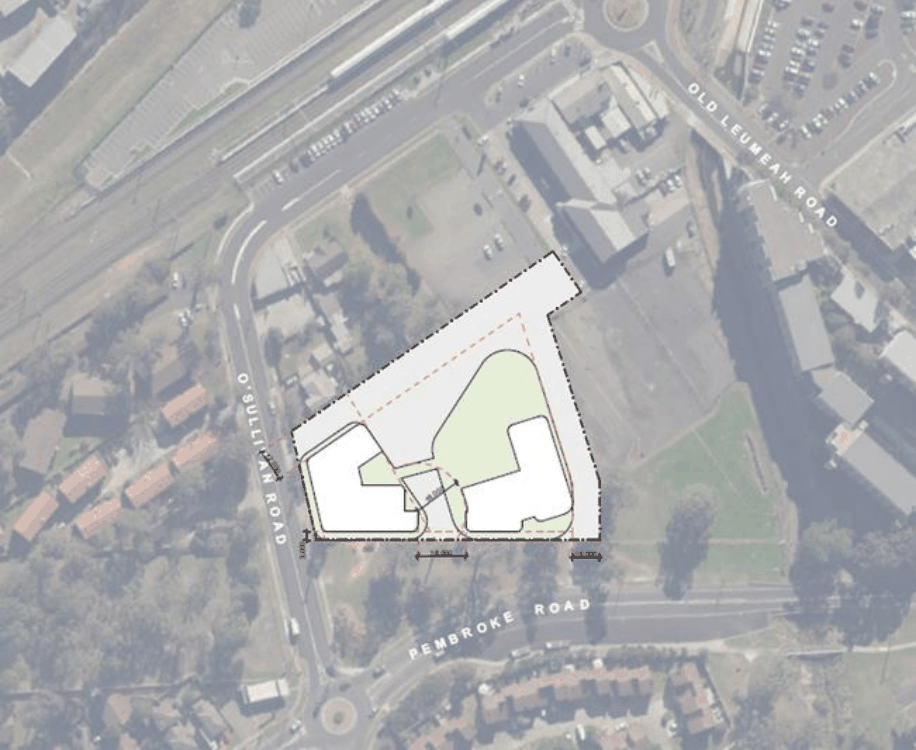
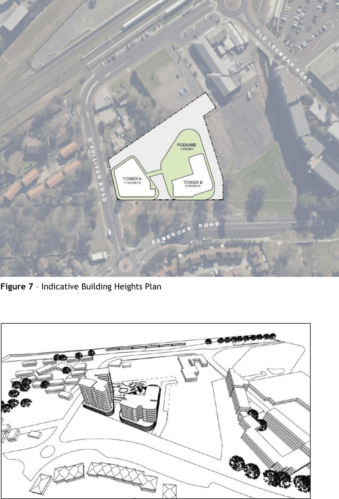
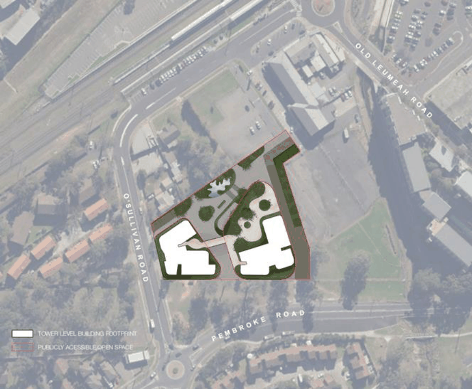
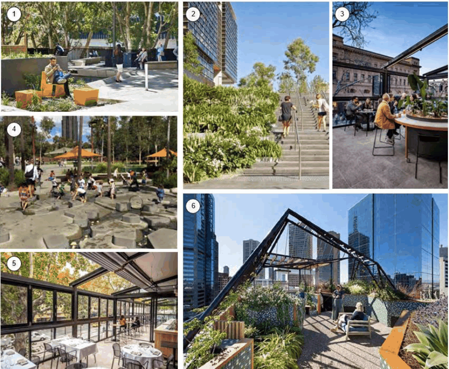
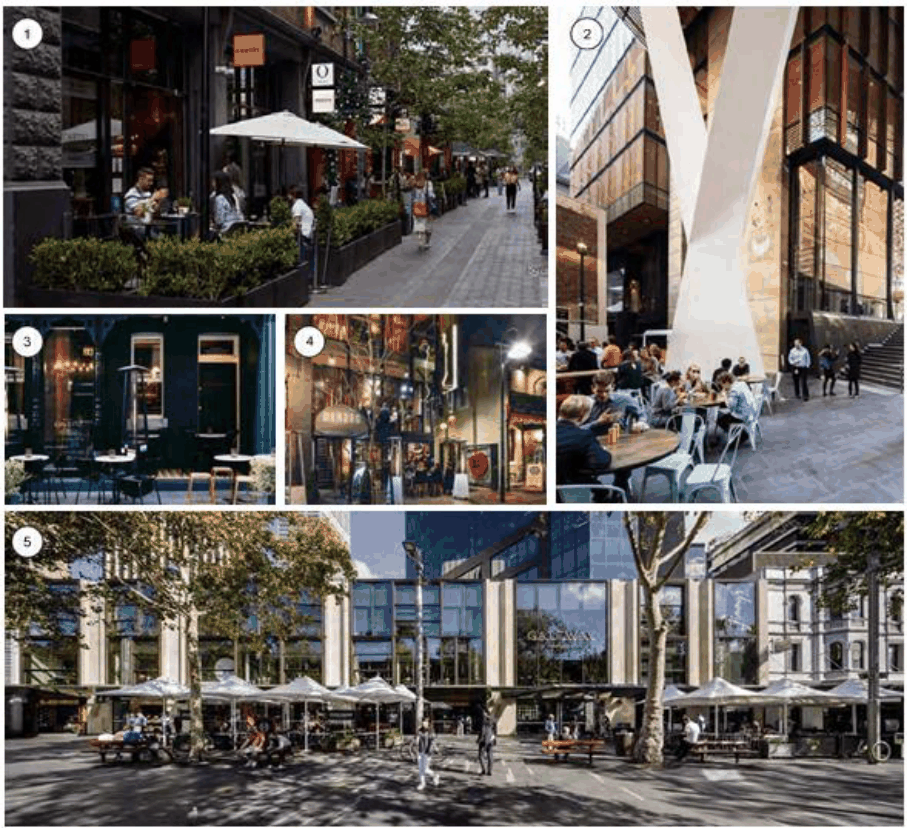

### 18.3    Development Objectives and Controls

#### 18.3.1 Staging of Development

#### Controls

1\. Development is to be staged in accordance with the Staging Plans provided in Figure 3 and Figure 4 below.

> [Picture on page 9: a picture, saved as a picture (images/vol-2-part-18-80-o-sullivan-road-development-control-plan-page-9-6.gif, 150 dpi).]

Figure 3 - Stage 1 Plan

> [Picture on page 10: a picture, saved as a picture (images/vol-2-part-18-80-o-sullivan-road-development-control-plan-page-10-1.gif, 150 dpi).]
> Words printed on the picture (title and legend, copied from the PDF):
> Stage 2 maintain existing access
> to neighbouring properties, and
> beyond completion of the
> development

Figure 4 - Stage 2 Plan

#### 18.3.2 Building Design, Orientation and Layout

#### Objectives:

■ To create a sense of visual separation between buildings, podiums, and tower levels.

■ To provide appropriate building separation to ensure privacy, access to light and ventilation and a high- quality visual outlook from residential apartments.

■ To establish a public realm and pedestrian network on the site to enhance liveability and building siting and massing.

■ To encourage an environment that is generally consistent with the Re-imagining Campbelltown City Centre Master Plan.

■ To activate street frontages on the site to create a vibrant mixed-use development.

■ To ensure that the development enhances the public domain, defines the streetscape, and creates a physical and visible connection between the built form and the public space.

■ To provide a high degree of articulation that establishes a fine grain frontage at ground/podium level.

■ To reinforce pedestrian comfort at street level, including a sheltered/shaded and attractive pedestrian environment.

#### Controls

1\. Development including building footprints, open space and pedestrian areas is to generally comply with the concept Masterplan for the site shown at Figure 5.

2\. Landscape design is to be high quality and create interest and character through measures such as indigenous tree species, pavement design and other appropriate elements.

3\. All development applications for new buildings shall be referred to the Campbelltown Design Excellence Panel prior to lodgement.

4\. The architectural character of the development shall provide a fine grain appearance at the street wall level.

5\. The architectural design shall incorporate the use of durable and high-quality materials and include a variety of colours together with visually integrated treatment of plant areas.

6\. All development proposals shall include public domain spaces which add to the

visual and environmental amenity of the site, and which are designed to maximise safety and security.

7\. The street wall height must relate to the human scale and be designed to provide a well-modulated pedestrian experience at street level.

8\. Towers are to be located and designed to minimise overshadowing to existing residential properties and to the communal open space provided within the site.

> [Picture on page 12: a picture, saved as a picture (images/vol-2-part-18-80-o-sullivan-road-development-control-plan-page-12-7.gif, 150 dpi).]

Figure 5 - Masterplan

#### 18.3.3 Building Separation and Setbacks

#### Objectives:

■ To reinforce street edges and the public domain.

■ To create a sense of visual distinction and separation between the podium and tower levels.

#### Controls

1\. Building setbacks shall be provided in accordance with Figure 6.

2\. A zero setback for podium is to be provided along O’Sullivan Road and Pembroke Road to provide a strong built form and activation.

3\. Tower setbacks of at least 3 metres are required for O’Sullivan Road and Pembroke Road. Tower design elsewhere is to provide for distinction between the tower and podium within the design detailing.

4\. Podium setback of at least 2.5m from the edge of the right of way easement along the eastern boundary.

5\. Setbacks are to enhance amenity in terms of daylight, outlook, view sharing, ventilation, wind mitigation and weather protection.

6\. A wind impact assessment report is to be provided with a development application for new buildings.

> [Picture on page 14: a picture, saved as a picture (images/vol-2-part-18-80-o-sullivan-road-development-control-plan-page-14-1.gif, 150 dpi).]

Figure 6 - Building Separation and Setbacks Plan

#### 18.3.4 Building Heights

#### Objectives:

■ To require a range of building heights that will provide a variety in built form and land use intensity across the development site.

■ To maximise solar access to the public domain, open spaces and pedestrian areas.

■ To minimise undesirable visual impact, disruption of views, loss of privacy and solar access to adjoining land.

■ To ensure the maximum height reflects the intended future scale of development within the Leumeah town centre.

#### Controls

1\. The building massing and arrangement must carefully consider how the development makes a positive contribution to the skyline.

2\. A minimum 1-storey podium shall be provided as shown in Figure 7.

> [Picture on page 16: a picture, saved as a picture (images/vol-2-part-18-80-o-sullivan-road-development-control-plan-page-16-1.gif, 150 dpi).]

Figure 7 – Indicative Building Heights Plan

#### Artisit Impression of Indciative Building Heights on the site

#### 18.3.5 Landscaping, Open Space and Public Amenity

#### Objectives:

■ To establish a useable area of publicly accessible open space to cater for the amenity of future residents, workers, and visitors.

■ To allow for passive recreation opportunities, catering for a range of activities and intergenerational needs.

■ To facilitate community interaction and gathering for residents, workers, and visitors.

■ To provide publicly accessible open spaces with good solar access and high standards of amenity.

■ To activate the edge of the publicly accessible open spaces to encourage safe and legitimate use of the open space and foster passive surveillance.

■ To ensure sufficient deep soil areas to enable the growth of large trees within open  space and buffer areas.

■ To ensure open space is appropriately landscaped with hard and soft materials, street furniture, trees, plantings, and walking paths.

#### Controls

1\. Publicly accessible open space shall be provided in accordance with Figure 8.

2\. A minimum of 2,600sqm sqm of publicly accessible open space shall be provided at ground level.

3\. The development shall include the provision of utility services and furniture to facilitate the movement of pedestrians through the site as shown indicatively in Figure 9. Details shall be provided at the development application stage.

4\. Future development applications must adhere to the specifications detailed in Part 2, 2.13 of the CSCDCP, which  addresses Crime Prevention Through Environmental Design.

5\. A public domain plan shall be prepared and submitted to Council with a development application for new buildings.

> [Picture on page 18: a picture, saved as a picture (images/vol-2-part-18-80-o-sullivan-road-development-control-plan-page-18-1.gif, 150 dpi).]

Figure 8 - Landscape and Publicly Accessible Open Space Plan

> [Picture on page 19: a picture, saved as a picture (images/vol-2-part-18-80-o-sullivan-road-development-control-plan-page-19-1.gif, 150 dpi).]

Figure 9 - Precedent Imagery — Public Amenity

#### 18.3.6 Streetscape, Activation and Connectivity

#### Objectives:

■ To provide public connectivity and movement through the site.

■ To activate street frontages to create a vibrant mixed-use development.

■ To ensure that the development enhances the public domain, defines the streetscape, and creates a physical and visible connection between built form and the public space.

■ To provide a high degree of articulation that establishes a fine grain frontage at ground level.

■ To reinforce pedestrian comfort at street level, including a sheltered/shaded and attractive pedestrian environment.

#### Controls

1\. Provide an activated pedestrian connection from the site to the Leumeah train station and to the broader suburb of Leumeah.

2\. Buildings constructed to the boundary must provide active operable/transparent façades at ground level fronting the street to promote visual surveillance, access, and active street frontages, shown indicatively in Figure 10.

3\. Integrate access elements such as stairs, ramps, and sloping walkways seamlessly into the overall design, ensuring a human-scale approach and creating a welcoming atmosphere. When incorporating ramps, ensure they are logically placed and easily accessible without obstructing circulation or sightlines.

4\. Pedestrian connections are to be activated where possible through design and active uses.

5\. Public awnings for weather protection and public amenity are to be included along Pembroke Road and O’Sullivan Road, and between the buildings along the pedestrian through site link.

6\. Blank walls to the public domain are to be minimised and where incorporated should be treated with appropriate levels of design detail and visual articulation to create visual interest.

7\. Pedestrian movement is to be prioritised by appropriate crossings, footpath designs, street furniture, parking layouts

> [Picture on page 21: a picture, saved as a picture (images/vol-2-part-18-80-o-sullivan-road-development-control-plan-page-21-1.gif, 150 dpi).]

Figure 10 – Precedent Imagery — Streetscape Activation

#### 18.3.7 Parking and Access

#### Objectives:

■ To prioritise pedestrian and public amenity throughout the development.

■ To establish a safe balance between pedestrian, cycling and vehicle movement.

■ To minimise the impact of vehicle accessways from the public domain.

■ To encourage residents to walk or cycle, in preference to using motor vehicles, as a way of gaining access to schools, shops and local community and recreation facilities.

#### Controls

1\. Provide a high-quality public domain with awnings along all street frontages and the pedestrian links to create a pedestrian friendly and weather protected environment.

2\. Vehicle access is to be provided in accordance with the Staging Plans provided at Figure 3 and Figure 4 as follows:

a. During Stage 1 vehicle access to the existing Leumeah Hotel shall continue to be provided via Pembroke Road. This access shall be used to service Stage 1 of the development.

b. Upon completion of Stage 2, vehicle access to the basement car park shall be provided via O’Sullivan Road.

After completion of Stage 1, vehicle access to the development from the State Road (Pembroke Road) will be restricted to construction vehicles only. On completion of Stage 2 development, all access from the Stage 1 and 2 development is to be via O’Sullivan Road. The existing use of the right of carriageway for access from Pembroke Road to neighbouring properties shall remain, during Stages 1 and 2, and post completion of the development.

3\. Existing access arrangements for adjoining properties are to remain unchanged unless altered through agreement with adjacent property owners.

4\. A basement setback is not required from the boundary along O’Sullivan Road.

5\. Car parking rates for the retail component of the development are to be provided in accordance with the relevant rates set out in the CSCDCP.

6\. Car parking rates for the existing Leumeah Hotel are to be provided in accordance

with the existing approved number of spaces currently provided (98 spaces).

7\. Bicycle spaces are to be provided in accordance with the relevant rates set out in the  CSCDCP.

8\. There is to be no provision made for loading bays on O’Sullivan Road.

#### 18.3.8 Flooding and Stormwater Management

#### Objectives:

■ To ensure development is designed in consideration of potential flood hazards.

■ To ensure effective and adequate drainage is provided for new buildings on the site.

■ To ensure that there is no increased risk to human life.

■ To minimise the risk to life by ensuring the provision of appropriate evacuation measures are available.

■ To prevent adverse impacts on adjoining properties.

#### Controls

1\. The proposed development should not result in any increased risk to human life.

2\. The proposed development should not result in any additional flood impacts to any other properties.

3\. Ensuring constant access to and from a building is essential to minimise the risk to people's safety during a flood event. Effective building design takes into consideration the surrounding terrain and site knowledge to facilitate easier access for emergency services and building users. Measures to achieve this include:

a. Position building entrances and vehicle access points above the nominated Flood Planning Level.

b. Establish safe pathways to designated places of refuge during flood events, either within the site or external to it.

c. Incorporate landscaping that contribute to the overall design and seamlessly blend of these features into the surroundings. By implementing these strategies, buildings can enhance their resilience against floods while prioritising the safety and convenience of occupants and emergency responders.

4\. Stormwater runoff generated by new development should be managed to protect against any potential damage to persons, property or adjoining sites.

5\. Compliance with Council’s Flood Policy and the provisions of the State Government’s “Flood Risk Management Manual” available from the NSW Department of Planning, Housing and Industry.

#### 18.3.9 Security, Privacy and Acoustic Amenity

#### Objectives:

■ To ensure the siting and design of buildings provide visual and acoustic privacy for residents and neighbours in their dwellings and private open spaces.

■ To provide personal and property security for residents and visitors and enhance perceptions of community safety.

■ To ensure that all future occupants are provided with appropriate acoustic amenity.

#### Controls

1\. Private open spaces and living areas of adjacent dwellings should be protected from overlooking.

2\. Site layout and building design ensures that windows do not provide direct and close  views into windows, or private open spaces of adjoining dwellings.

3\. Any future development application for built form must be accompanied by an acoustic assessment which demonstrates that the development will comply with the  Development Near Rail Corridors and Busy Roads.

4\. Buildings adjacent to streets or public spaces are designed to allow casual surveillance and should have at least one habitable room window facing that area.
