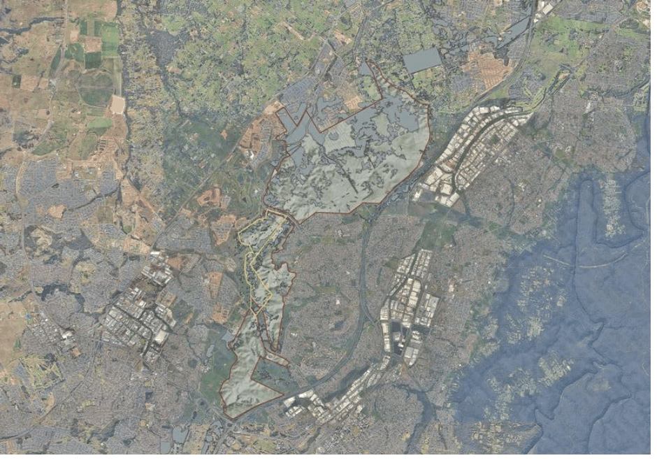

## Part 19 Macarthur Grange Site-Specific Development Control Plan

> [Picture on page 1: a picture, saved as a picture (images/vol-2-part-19-macarthur-grange-site-specific-development-con-page-1-3.gif, 150 dpi).]

### Macarthur Grange Golf Course Site

Address: Raby Road, Varroville (Lot 3900 DP1170905)

| Amendment No | Date Adopted by Council | Effective Date |
|---|---|---|
| Amendment No 24 | 11 March 2025 | 13 June 2025 |

### Contents

| Background ................................................................................................................................................. 3 |  |
|---|---|
| 19.1 Introduction ......................................................................................................................................... 4 |  |
| 19.1.1 | Application ................................................................................................................................. 4 |
| 19.1.2 | Purposes of this part................................................................................................................... 5 |
| 19.1.3 | Relationship to other parts of the Campbelltown DCP ................................................................ 5 |
| 19.2 Future character and development objectives .................................................................................... 6 |  |
| 19.2.1 | Future character statement ........................................................................................................ 6 |
| 19.2.2 | Development Objectives............................................................................................................. 6 |
| 19.3 Provisions ............................................................................................................................................ 8 |  |
| 19.3.1 | General provisions and Master Plan ........................................................................................... 8 |
| 19.3.2 | Subdivision ................................................................................................................................. 8 |
| 19.3.3 | Earthworks ................................................................................................................................10 |
| 19.3.4 | Built form and design ................................................................................................................10 |
| 19.3.5 | Landscaping and landscaped area ..............................................................................................11 |
| 19.3.6 | Fencing ......................................................................................................................................11 |
| 19.3.7 | Access and circulation ...............................................................................................................12 |
| 19.3.8 | Provision and Maintenance of Public Infrastructure...................................................................14 |
| 19.3.9 | Public Open Space and Hilltop Conservation Area ......................................................................16 |
| 19.3.10 | Vegetation Management ...........................................................................................................17 |
| 19.3.11 | Riparian corridors ......................................................................................................................18 |
| 19.3.12 | Aboriginal Heritage ....................................................................................................................18 |
| 19.3.13 | European Heritage.....................................................................................................................19 |
| 19.3.14 | Bushfire management ...............................................................................................................19 |

### Background

This Part sets out site-specific development controls for the Macarthur Grange Golf Course site (Lot 3900 DP1170905).

This DCP was prepared to support a Planning Proposal for the site which seeks to progress an environmental / rural residential development across the site consistent with the character and scenic values of the Scenic Hills Landscape Unit.

As part of this DCP, an indicative structure plan has been prepared to inform the preparation of a more detailed master plan at the subdivision stage. The master plan shall accompany any development application for subdivision and shall maintain the rural landscape character, retain natural vegetation and aim to ensure that future development is nestled in the landscape.

The master plan, once prepared shall allow for:

• A maximum of fifty-two (52) environmental living lots under community title, ranging from 0.5ha to in excess of 3ha, suitable for residential development.

• A lot of 3 to 4 ha associated with the existing Macarthur Grange Golf Course Club building to be developed for a commercial use such as a function centre and/or restaurant / café.

• Emergency access and egress

• Parks and walking tracks

This site specific DCP will form Part 19 Macarthur Grange DCP under Volume 2 Site Specific Development Control Plans of the Campbelltown (Sustainable City) DCP 2015.
